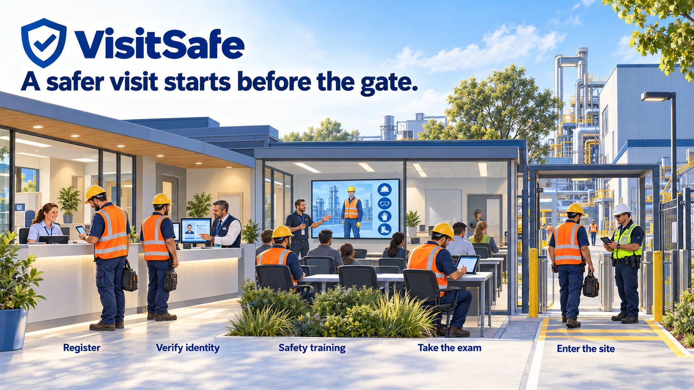

# VisitSafe

**A safer visit starts before the gate.**

[English](README.md) | [简体中文](README.zh-CN.md)



*A contractor's arrival: registration, identity confirmation, safety training, an exam, and supervised site entry.*

Turn visitor registration and safety onboarding into one clear mobile journey. VisitSafe helps visitors, contractors, and logistics drivers prepare for their visit, complete the required training, and keep their results within reach.

Built for factories, industrial sites, warehouses, and the teams that welcome people into them.

## Experience VisitSafe

| Live demo | What to explore |
| --- | --- |
| **[Visitor & learning portal](https://visit-safe.blazorserver.com/)** | Mobile registration, personal task lookup, assigned courses, video learning, exams, and training results |
| **[Management platform](https://visit-training.blazorserver.com/)** | The operational dashboard and workspaces for visits, approvals, people, vehicles, courses, and training records |

Start with the visitor portal on your phone. Choose a visit category to explore registration, or open the learning entry to find assigned training. The management dashboard displays sample operational data for demonstration.

## Less paperwork. A clearer path to readiness.

A visit should be easy to arrange, and safety requirements should be easy to understand. VisitSafe brings the next step into view for every participant.

| Your business need | The VisitSafe experience |
| --- | --- |
| Make arrival preparation easier | Collect visit details, appointments, destinations, people, and vehicle information in a guided registration flow |
| Give every person the right training | Match required courses to the visit type and selected areas, with progress tracked individually |
| Keep people moving | Save registration drafts and continue unfinished learning |
| Reduce repeated learning | Reuse valid passing results for the same person and course, preserving their original expiry dates |
| Make completion visible | Keep course progress, exam results, and training validity together |
| Welcome more of your team | Offer a visitor interface in Simplified Chinese and English |

## Built around the people visiting your site

**Visitors and suppliers** can arrange a visit, review the notice, add accompanying people, and work through their required training.

**Logistics drivers** can provide driver and vehicle details as part of the visit, keeping the transport context connected to the people arriving.

**Contractors and service teams** can register the work visit and complete the safety learning required for their destination areas.

**People assigned training in advance** can find and complete their learning without first creating a visit application.

## One clear journey, on your phone

1. **Register your visit.** Choose a visit category, review the notice, and add the appointment, destinations, participants, and applicable vehicle or business information.
2. **Confirm your identity.** When finding or resuming personal training, use the name and mobile number entered at registration to locate your assigned tasks.
3. **Learn what matters.** Follow each participant's assigned courses and complete the required safety videos.
4. **Take the exam.** Submit answers, review the result, and retake the exam when needed.
5. **Keep the result close.** View training completion and validity, return to unfinished tasks, and use eligible results on future visits.

Visit approval and training can progress in parallel. Business and area reviews, together with individual entry and exit operations, belong to the management platform. A completed training record is one part of site readiness; entry still depends on the applicable visit requirements.

## A visitor experience connected to your operation

The mobile portal and the management platform serve different people in the same visit journey.

| For visitors and learners | For operations and safety teams |
| --- | --- |
| Register and review visit information | Manage applications, participant profiles, and vehicle profiles |
| Find assigned courses and continue learning | Organize courses, assignments, and training records |
| Complete exams and view personal results | Review progress, scores, and training validity |
| Prepare for the next visit | Coordinate approvals and entry and exit responsibilities |

This repository contains the **React visitor and learning frontend**. The companion management application uses Blazor and ASP.NET Minimal APIs. The product continues to evolve; see the [frontend notes](web/README.md) and specifications below for the current integration scope.

## Bring VisitSafe to your site

Use your VisitSafe API address and shared access key in `web/.env.local`, following [the environment example](web/.env.example), then run:

```powershell
npm --prefix web ci
npm run dev
```

For Docker and Portainer, follow the **[development and deployment guide](doc/DEPLOYMENT.md)**.

The frontend is built with React, TypeScript, Vite, Ant Design Mobile, and Tailwind CSS, and is designed for modern phone browsers.

## Explore the project

- [Frontend setup and integration notes](web/README.md)
- [React mobile specification](doc/VisitSafe-React-Mobile-SPEC.md)
- [Backend business specification](doc/VisitSafe-Backend-SPEC.md)
- [API specification](doc/VisitSafe-API-SPEC.md)
- [Contributor guidelines](AGENTS.md)
- [Lucide icon license](web/public/assets/LUCIDE-LICENSE.txt)

**[Explore the visitor portal](https://visit-safe.blazorserver.com/) · [See the management platform](https://visit-training.blazorserver.com/)**
