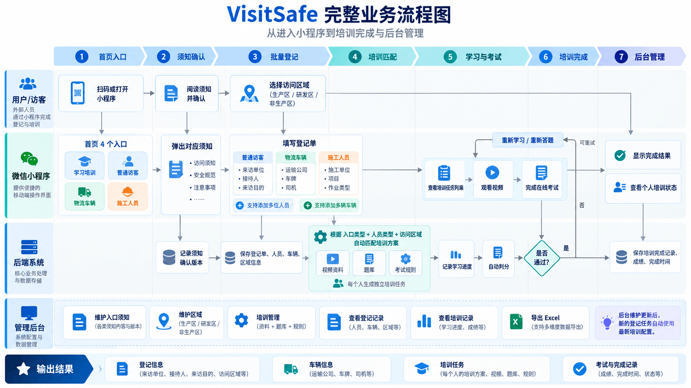
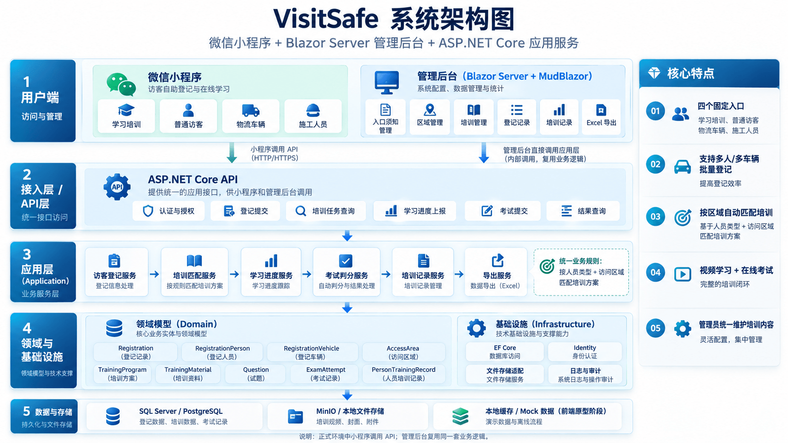

# VisitSafe 手机端应用

新版本使用 React 19、TypeScript 7、Vite 8、Ant Design Mobile 5、Tailwind CSS 4 和 React Router 8，面向现代手机浏览器。React 应用在 `web/`，独立重新开发登记、个人培训、视频学习、考试、结果、凭证和我的记录流程；现有小程序保留作产品参考。

## 启动 React 应用

```powershell
npm install
npm --prefix web install
npm run dev
```

打开终端显示的本地地址。在同一局域网中，手机可打开 Vite 显示的 Network 地址。页面针对手机宽度设计，预览时可使用浏览器设备模拟模式。

```powershell
npm test                  # 原小程序与 React 业务测试
npm run typecheck         # React TypeScript 检查
npm run build             # React 生产构建，输出 web/dist/
npx --prefix web playwright install chromium
npm run test:e2e          # 手机尺寸的完整浏览器流程
npm run typecheck:miniapp # 原小程序 TypeScript 检查
```

部署时将 `web/dist/` 作为静态网站目录，并将应用路径回退到 `index.html`，确保直接访问任务及考试链接可用。图标与视频随构建一起发布，不依赖外部图像服务。

React 应用使用独立的 `visitsafe.web.v1` 浏览器存储。三类登记、草稿、人员／车辆增改删、组合课程匹配、个人独立进度、姓名＋手机号继续学习、真实短视频、五题考试、错题重考和记录删除均可交互。考试截止时间按绝对时间保存，刷新及后台恢复不会重新计时。视频加载失败时可主动使用演示计时。

当前是本地演示版本，课程、视频及培训凭证属于演示材料。数据仅在当前浏览器共享；姓名＋手机号查询不构成身份认证。本轮未实现后台服务、真实审批或实际通行授权，后续按后端 SPEC 接入 ASP.NET Minimal API。React 需求见 [React 手机端 SPEC](doc/VisitSafe-React-Mobile-SPEC.md)，开发约定见 [AGENTS.md](AGENTS.md)。

## 原小程序参考说明

以下内容描述保留的微信小程序实现及其原有验收方式。

原生 TypeScript + WXML + WXSS 实现。使用本地数据和 Storage，不依赖后端、云服务或网络视频。

## 业务流程



## 系统架构



## 运行

1. 安装 Node.js（本次验证使用 24.18.1），在仓库根目录执行 `npm install`。
2. 在微信开发者工具中导入本仓库根目录。`project.config.json` 已设置 `miniprogramRoot: "miniprogram/"` 和 TypeScript 编译插件。
3. 使用自己的有效小程序 AppID，或开发者工具提供的测试号；点击“编译”。首页有学习培训、普通访客、物流车辆、施工人员四个入口。
4. 本项目没有运行时 npm 包，不需要点击“构建 npm”。通过“预览”可在手机上检查布局和视频兼容性。

## 界面与图标

首页沿用原有结构、工厂插画、四个纵向入口和原生 TabBar。视觉使用科技蓝 `#246BFD`、深海灰标题 `#192B43` 和页面背景 `#F5F7FB`，搭配浅蓝灰 Hero、白色卡片、14px 圆角、细边框及轻阴影。样式由原生 WXSS 实现，无额外 UI 框架；底部安全区沿用原生 TabBar，并为页面内容保留间距。

使用 [Lucide](https://lucide.dev/) 线性图标，按需下载到 `miniprogram/assets/`，页面直接通过 `image` 引用本地 SVG。底栏使用同一套图标导出的透明 PNG，不需要安装运行时图标库或“构建 npm”。

图标来源固定为 [Lucide 源码版本 70562c1](https://github.com/lucide-icons/lucide/tree/70562c1ee1c4fdcf736fe97bc893fb8511927934/icons)，保留原始 24×24 网格和 2px 线宽，仅调整颜色。`book`、`flask`、`helmet`、`shield`、`user`、`home` 分别对应官方 `book-open`、`flask-conical`、`hard-hat`、`shield-check`、`user-round`、`house`；`chevron`、`close`、`alert` 分别对应 `chevron-right`、`x`、`triangle-alert`。`-white`、`check-green`、首页 `-home` 和底栏 `-active` 文件为颜色变体。完整开源许可（含部分源自 Feather 的图标许可）见 [LUCIDE-LICENSE.txt](miniprogram/assets/LUCIDE-LICENSE.txt)。

## 演示流程

普通访客、物流车辆、施工人员：入口 → 勾选访客须知 → 登记信息（预约、业务信息、人员或车辆） → 多选访问区域 → 确认申请单 → 培训任务 → 视频学习 → 考试 → 结果/错题解析 → 我的记录。

学习培训：输入登记时的**姓名＋手机号** → 查找本人未完成培训的申请单 → 选择申请单 → 继续视频学习与考试。此入口不新建登记，不重复选择区域；匹配多个申请单时分别展示。

- 可点击“填入预约与两条演示数据”快速填写预约、对应业务信息及虚构人员或车辆。不会自动添加历史记录。
- 培训按**人员独立完成**。每位访客、施工人员和物流司机均需观看视频并答题，视频、考试答案、计时、成绩和重考进度互不共享。同一司机以姓名＋手机号识别，在一张申请单登记多辆车只生成一套个人课程。
- 登记后的任务页显示人员完成进度，可以选择某个人，也可以按“全部人员”依次完成。学习、考试、结果及记录均显示所属人员。生产区、研发区、非生产区的课程匹配规则不变；物流另需交通安全，施工另需施工安全。
- 每人都要通过该申请单匹配的全部课程，整张申请单才显示“已完成”。例如登记 3 人、选择 2 门课程，会显示 3 位学习人员和 6 项个人课程任务；一人通过两门后，人员完成进度为 `1/3`，课程进度为 `2/6`。
- 未完成的人员可以离开后从首页“学习培训”输入自己的姓名和手机号，继续原任务。两个字段必须同时匹配；姓名相同或手机号相同均不能单独匹配。已全部通过的人员不再出现在待完成查询中。
- 每段本地教学视频为 6 秒，完整播放后计入进度；全部视频完成才能考试。视频加载失败时启动 6 秒演示倒计时，结束后也计入本段学习进度；返回页面不会重新开始该倒计时。
- 每门课程 5 道单选题，每题 20 分，80 分通过，限时 15 分钟。演示题正确选项依次为 **A、B、C、A、B**。
- 选完答案自动进入下一题，答错立即提示并在答题卡标红；可用“上一题”或题号返回修改。最后一题保留在当前页，确认后交卷，按修改后的最终答案评分。
- 主动交卷前必须答完；到期按已有答案自动评分，未答题不得分。离开、重载不会重置截止时间。
- 未通过可查看错题并重考。重考清空答案、重新计时，保留已完成视频。
- 我的记录支持姓名、单位、车牌搜索，查看登记明细、继续培训以及确认删除。删除申请单会同步删除其培训任务。
- 添加/编辑弹窗右上角的 × 取消当前编辑，保留已保存的登记项。

## 登记信息

预约和业务信息按申请单填写一次；登记仍保持“登记信息 → 访问区域 → 确认提交”三个步骤。

| 入口 | 必填信息 | 车辆信息 |
| --- | --- | --- |
| 普通访客 | 预约日期、到访时段、被访人姓名、到访事由；每人的姓名、手机号、所属单位 | 随行车辆选填，仅填车牌号，可添加多辆 |
| 施工人员 | 预约日期、到访时段、项目名称、施工位置、施工单位、现场负责人；每人的姓名、手机号、工种 | 随行车辆选填，仅填车牌号，可添加多辆 |
| 物流车辆 | 预约日期、到访时段；每辆车的车牌号、司机姓名、手机号、运输单位 | 沿用车辆及司机登记，可添加多辆 |

- 预约日期使用原生日期选择器，只允许今天或未来日期；到访时段为 `08:30–12:00`、`13:00–17:00`。到访事由下拉选项为“会议、面试、洽谈”。
- 施工人员的所属单位自动使用整单施工单位，修改施工单位会同步更新该单人员。施工位置填写具体地点；下一步的访问区域用于匹配培训，两者分别填写。
- 随行车辆支持添加、直接编辑和确认删除；添加后必须填写有效车牌。车牌统一格式后校验重复，提交时保存规范化车牌。随行车辆不额外生成学习任务，实际入场人员仍须登记并独立培训。
- 新信息保存在草稿和申请单中，返回或重新进入可继续填写；确认页和记录详情按分组展示。我的记录也支持搜索随行车牌。
- 登记页沿用科技蓝和深海灰，使用白色分组卡片、14px 圆角、顶部字段标签、行内错误提示及带安全区留白的固定底部按钮，全部由原生 WXML/WXSS 实现。

## 验证命令

```powershell
npm test                    # 登记信息校验、草稿、课程匹配、个人进度、查询、评分及持久化测试
npm run typecheck           # 严格检查小程序 TypeScript 源码
npm run smoke               # 微信开发者工具模拟器完整培训流程验收
npm run smoke:registration  # 三类登记的新字段、随行车辆、草稿恢复及记录详情验收
```

两个模拟器验收命令仅适用于 Windows，需要 PowerShell 7，以及已打开、已登录并授权 Codex 自动化的微信开发者工具。默认 CLI 路径为腾讯安装目录，可通过环境变量 `WECHATIDE_CLI` 指定其他安装位置。运行时请勿操作模拟器。

`smoke` 覆盖三人访客登记、司机与施工人员独立学习、姓名＋手机号查询继续任务、全部人员完成后整单完成，以及原有视频和考试流程。`smoke:registration` 针对三类预约、访客和施工业务信息、随行车辆增改删与重复校验、草稿恢复、确认提交、任务数量及记录展示和车牌搜索。

模拟器验收使用虚构数据，先备份本应用的 `visitsafe.demo.v1` 存储，结束时恢复；仅在验收中模拟确认对话框并在结束时撤销。备份临时文件路径打印到终端，截图、日志位于忽略提交的 `doc/verification-artifacts/`。强行结束进程时，需使用打印的备份恢复记录。

## 目录

| 路径 | 内容 |
| --- | --- |
| `miniprogram/pages/` | 首页、登记、任务、视频、考试、结果、完成、记录及明细 |
| `miniprogram/models/visit.ts` | 业务类型、输入校验、评分 |
| `miniprogram/models/registration.ts` | 预约选项、业务信息和随行车牌校验、分组展示数据 |
| `miniprogram/data/catalog.ts` | 区域、培训方案、视频和题库 |
| `miniprogram/services/` | 本地存储事务、进度与页面展示数据 |
| `miniprogram/assets/` | 本地视频、插图及图标 |
| `tests/` | Node 测试，通过 tsx 执行 |
| `doc/` | 需求说明、参考图、实施计划及验收记录 |

## Demo 范围

短视频、题库和培训凭证均为流程演示材料。记录仅保存在当前设备；清除小程序存储会清除记录。姓名＋手机号查询仅用于匹配登记信息，不代表已完成身份认证。**目前可在同一设备演示继续学习；真正使用各自手机访问同一份申请单，需要后续接入共享数据服务。**

旧数据中有明确人员归属的任务保留进度，仅合并同一人员、同一课程的重复任务；单人旧共享任务可以归给唯一人员，多人旧共享任务无法确定实际学习人，会重建各人的课程进度。十题旧缓存保留前五题答案、重新计算成绩。新规则见 [前端 SPEC](doc/VisitSafe-MiniApp-Frontend-SPEC.md)。

新增登记字段兼容旧记录，缺失信息显示“未填写”；已提交申请单不会因预约日期已过而被删除或丢失培训进度。旧草稿提交时需要补齐当前必填信息。

尚未接入身份认证、访客审批、真实课程、证件核验或 ASP.NET Core Web API。后续可替换 `services/store.ts` 的存储适配层并扩展课程目录。
