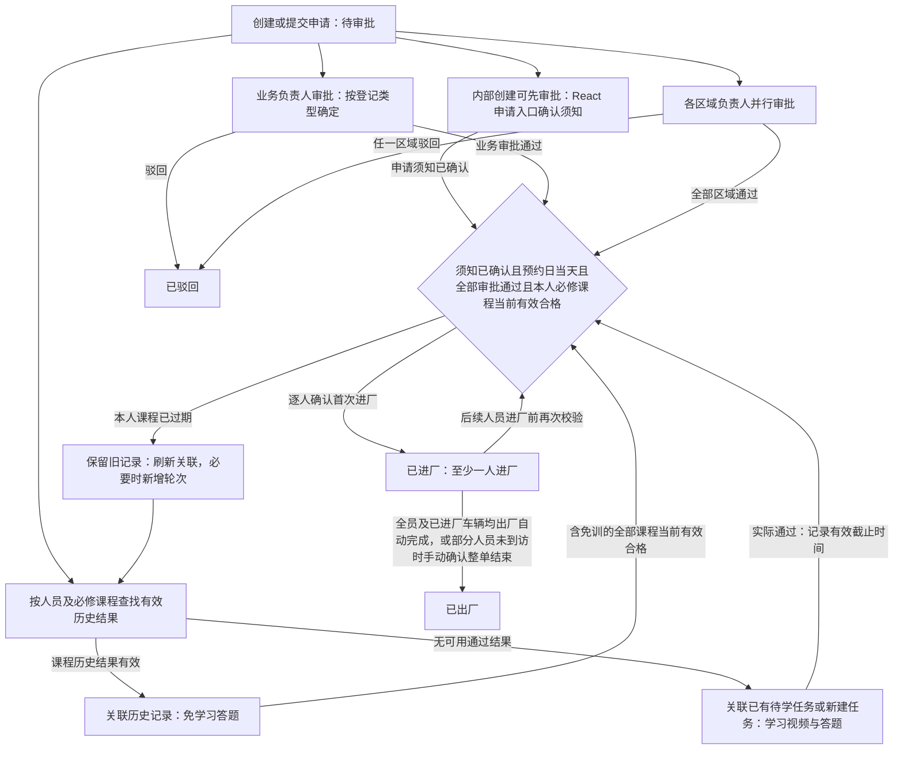
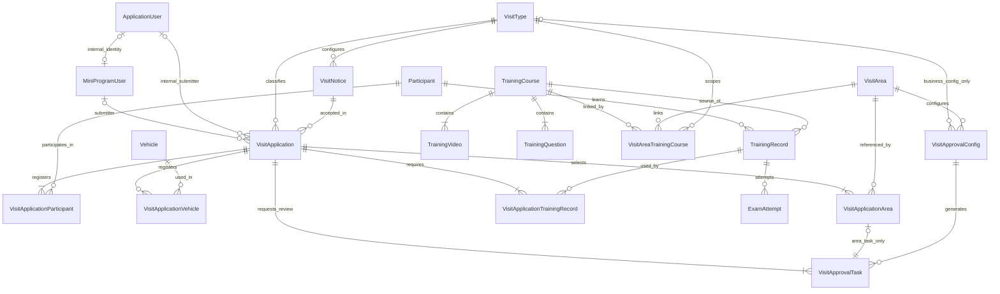

# VisitSafe 后端 SPEC：模块与实体定义

更新日期：2026-10-20。

## 1. 本版范围与已确认规则

本版定义主导航模块、业务实体、字段含义和关联关系。仓库已有申请内人员、培训记录及其 EF 配置、DbSet 和数据库迁移。本次确认人员与车辆档案可跨申请复用、后台选课后向人员分配独立培训任务、内部人员也能在后台创建申请，并保留考试合格有效期及 React 提交申请后学习的操作流程。内部创建不确认访客须知，React 申请入口确认后继续，进厂前必须已确认；审批照常进行。一人一审批任务、业务与区域审批并行、任一驳回即驳回整单并取消剩余待办，已确认为业务规则。本次同步车辆实体、申请车辆关联、EF 配置、DbSet 与演示种子，包括按申请保存车辆进出厂时间及操作人，并提供 MSSQL、PostgreSQL 的迁移与幂等 SQL 脚本；这不表示已执行数据库更新或完整业务接口及前后端页面已完成接入。

技术约束：业务前端采用 React，管理后台采用 CleanBlazorServerPro，通过 ASP.NET Minimal API 提供接口。实体主键采用 int，集合与字典采用 JSON 映射；MiniProgramUser 兼容外部匿名客户端及未来微信接入，也通过 ApplicationUserId 关联内部提交者，内部账号复用框架已有 ApplicationUser，不另建内部人员账号体系。React 本轮采用姓名＋手机号精确匹配的无登录访问，允许本人学习和查看关联申请完整信息，不以严格身份认证为前置条件，具体契约见 [API SPEC](VisitSafe-API-SPEC.md)。外部会话及文件存储的实际接入仍待实现，不自行引入微信登录。

本轮沿用既有实体和动态字段模块，不新增申请提交指纹、司机姓名快照或动态字段定义快照字段；PDF 资料保存在 TrainingVideo，无登录申请接续及审批人文本解析仍按相应章节执行。

已确认的业务规则：

- 主导航为首页 Dashboard、访客管理、培训管理、培训记录、基础配置、系统管理。
- 题库属于培训管理；培训记录作为独立主导航，供后台查看。
- 题库支持单选题和多选题，标准答案及实际作答均按选项集合保存；多选题按全部选对得分的规则评分。
- VisitType 与 VisitArea 一样作为可维护的基础配置实体；普通访客、物流车辆、施工人员只是初始数据，后续可动态新增登记类型。React 前端根据启用类型生成登记入口，学习培训入口独立保留。
- VisitApplication 只定义各登记类型通用的固定字段，通过 VisitTypeId 关联登记类型；类型专属业务字段通过该类型关联的已有动态字段模板扩展。
- 申请既可由 React 外部访客提交，也可由有创建权限的内部后台登录用户创建；普通访客、物流车辆、施工人员三种初始类型均支持两种入口，后续新增启用类型沿用统一流程。内部创建使用同样的校验、审批、课程匹配与人员进出厂规则，不因创建入口不同而免除审批或培训。
- TimeSlot 是申请单的固定字段，预约时段选项通过框架已有 PicklistSet 维护，仅用于登记和展示，不参与后续审批、进厂、过期或滞留判断；动态下拉字段的选项定义在对应字段的 metadata 中，不新增专用登记选项表。
- AppointmentDate 限制每位人员的实际进厂日期：按工厂业务时区计算的服务端确认进厂日期必须等于预约日期，不能提前或延后进厂；本版工厂业务时区为 Asia/Shanghai（UTC+08:00）。该限制不阻止已进厂人员跨日出厂，也不自动将申请转为 Expired。
- 申请单与访问区域为多对多关系；培训方案按“登记类型＋访问区域”组合配置。提交时按申请 VisitTypeId 和每个所选 VisitAreaId 同时匹配启用课程，将命中课程按 TrainingCourseId 去重，为每位人员关联培训记录，缺少可用记录时创建个人课程任务；同一区域的不同登记类型可分配不同课程。
- 访客须知按登记类型分别配置，登记弹窗展示当前申请类型对应的标题和正文；新增类型也需配置自己的须知。
- React 外部提交申请前确认须知；内部创建申请时只校验须知配置并保存快照，不要求内部创建人确认，NoticeAcceptedAt 为空。用户在 React 打开未确认的申请时弹出须知，确认后才能继续申请入口操作；审批不等待须知确认，进厂前服务端必须检查已确认。独立培训不要求确认申请须知。
- 每个课程视频可提供一份 PDF 文档，供查看和下载，作为补充资料，学习与考试完成规则保持不变。
- Participant 是独立人员档案，去除首尾空格后的姓名＋手机号组合唯一；相同组合复用同一档案，申请与人员通过 VisitApplicationParticipant 建立多对多关系。已有资料可带入登记，无需每次重新填写；每次提交保存本次人员资料快照，档案后续修改不改写历史申请。
- 人员档案支持身份证号码及一份可选附件；本次申请使用的身份证、附件引用及文件名一并保留在申请人员快照中。
- Vehicle 是独立车辆档案，规范化车牌全局唯一，相同车牌跨申请复用同一档案；申请通过 VisitApplicationVehicle 建立多对多关系，保存本次车牌、运输单位快照及车辆进出厂时间与操作人，档案修改不改写历史申请。不设置车辆类型字段，仅保存可选司机姓名 DriverName，不关联 Participant；车辆录入要求由所属申请的类型决定。
- 培训有效期保存在每门 TrainingCourse 的 TrainingValidityDays 字段中，通过后台培训管理的课程编辑维护，默认 60 天，必须为正整数；不同课程可设置不同天数。每门课程从本人实际考试通过时起算，截止时间保存在培训记录中；修改只影响该课程之后实际通过的记录，不重算已有截止时间。
- TrainingRecord 独立归属于人员和课程，不要求关联申请。后台用户可选择课程并发送给 Participant，按规则创建或复用个人培训任务；React 学习人员输入姓名＋手机号查找任务并完成培训，之后再申请时可引用有效结果，不为免训复制培训记录或考试。
- 新申请仍按当前登记类型及区域为每位人员匹配必修课程，再通过人员档案及同一 TrainingCourseId 查找本人有效的实际通过记录。可用结果免去视频学习和答题；未命中时优先关联本人已有未完成任务，没有可用任务时创建学习记录。已过期结果不能免训，需新增轮次；所有登记类型均使用此规则。
- React 访客及施工申请的操作流程保持不变：提交后进入本申请任务页，没有有效培训结果的正常开始或继续学习，不要求先从独立培训入口完成培训再申请。申请提交后即进入待审批，业务审批与学习培训并行；待审批期间可以学习、答题及重考。
- 审批同时覆盖登记类型对应的业务负责人和所选访问区域负责人：初始普通访客由被访人审批，施工人员由现场负责人审批，物流车辆由登记时填写并解析的对接人员审批；新增类型按自身业务配置指定的动态用户字段确定审批人。每个所选区域还分别生成区域负责人审批任务；业务审批和全部区域审批均通过后，整单才变为已批准。
- 每位申请人员在本次申请中仅记录一次进厂和一次出厂，各自的时间及实际操作人用户标识保存在 VisitApplicationParticipant；人员在本申请的在厂状态由两个时间推导，不新增独立通行记录实体，也不复用其他申请的进出厂记录。
- 学习方式沿用现有前端：同一手机可供多人轮流学习，申请单任务页可选择个人或按全部人员依次学习，各人进度独立。
- 学习培训入口按姓名＋手机号定位同一人员档案，查找本人当前需要学习的任务，包括独立分配和过期后生成的轮次；同一任务关联多张申请时只保留一份进度，可展示关联申请。查询不创建来访申请，有效免训课程不要求重复学习。
- 申请内培训人员来自本申请关联的人员名单；独立培训可先建人员档案再分配课程，两者均与车辆数量及运输单位无关。
- 进厂按个人控制：在 AppointmentDate 当天，本申请须知已确认、整单业务审批和全部区域审批通过，本人本申请全部必修课程的当前培训记录均已通过且仍在有效期内，包括有效的历史复用结果，才可确认本人进厂；其他人员未完成或考试未通过不阻止已满足条件的人员进厂。全部人员的必修课程均满足上述条件只表示整单当前培训合格，作为汇总展示，不作为个人进厂条件。已登记车辆可选择不进厂，但凡已确认进厂的车辆在整单结束前必须完成出厂确认；当全部登记人员及已进厂车辆均已完成出厂确认时，整单自动完成（CheckedOut），仅在存在未进厂人员且其余已进厂人员和已进厂车辆均已出厂时才需手动执行整单完成确认。
- 失败重考保留本人本轮视频完成进度，并产生新的考试记录；多个申请共享同一培训记录时共享该记录的进度和实际通过结果。
- 除本轮明确调整的内容外，登记字段、区域匹配、视频学习及答题行为以 [前端 SPEC](VisitSafe-React-Mobile-SPEC.md) 为依据。

## 2. 主导航与模块边界

| 主导航 | 模块职责 | 主要实体或数据来源 |
| --- | --- | --- |
| 首页 Dashboard | 展示登记数量、申请状态、人员数量和培训完成情况 | 汇总申请单、申请人员、培训记录和考试记录，不新增统计实体 |
| 访客管理 | 内部创建各启用类型申请，按登记类型管理申请、业务与区域审批待办和进出厂状态，复用人员与车辆档案并查看本次资料快照 | VisitApplication、Participant、VisitApplicationParticipant、Vehicle、VisitApplicationVehicle、VisitApplicationArea、VisitApprovalTask；MiniProgramUser 标记提交者，内部创建同时关联框架 ApplicationUser |
| 培训管理 | 维护培训方案及各课程培训有效期、视频、PDF 资料、课程题库及登记类型＋区域与方案的组合配置，支持提前为人员分配课程 | TrainingCourse、TrainingVideo、TrainingQuestion、VisitAreaTrainingCourse；通过 Participant、TrainingRecord 分配任务 |
| 培训记录 | 按人员、课程查看进度、历次考试、成绩、有效截止时间及关联申请，支持没有申请的培训 | TrainingRecord、ExamAttempt、VisitApplicationTrainingRecord，关联人员及可选的申请使用记录 |
| 基础配置 | 维护登记类型及其入口展示、申请模板、车辆录入要求、访问区域、类型业务审批人取值规则、区域审批负责人和各类型访客须知；预约时段通过 PicklistSet 维护，申请扩展字段及其下拉选项使用动态模块 | VisitType、VisitArea、VisitApprovalConfig、VisitNotice；复用框架已有 PicklistSet 及动态模块的字段定义、metadata 与模板 |
| 系统管理 | 使用框架现有用户、角色、权限和日志能力 | 沿用框架实体，本版不重复定义 |

访客管理采用统一申请单模型，按 VisitType 关联的申请模板使用动态字段，不通过固定三类枚举选择模板。培训记录模块读取实际的学习和考试记录，与课程配置分开。

## 3. 类型与公共字段

- 业务实体主键及其关联外键采用 `int`，可空关联采用 `int?`。关联实体 VisitApplicationArea、VisitAreaTrainingCourse、VisitApplicationParticipant、VisitApplicationTrainingRecord 使用复合主键；其他实体都有 `Id`。框架后台用户标识仍为 `string`，ClientId、ClientRequestId 和动态字段中的用户标识也保持字符串。
- 审计字段沿用框架基类：`CreatedAt: DateTimeOffset?`、`CreatedById: string?`、`LastModifiedAt: DateTimeOffset?`、`LastModifiedById: string?`；不另增 UpdatedAt。VisitApplication 继承已有 ExtensibleEntity，复用 DynamicFields 承载申请级动态字段。
- 业务操作人使用框架后台用户的稳定标识，字段以 `ById` 命名，例如 ReviewedById、CheckedInById、CheckedOutById；由服务端从当前登录用户取得，不接受客户端指定。用户改名或停用不改写历史操作人标识，历史用户引用需保留。
- 预约日期采用 `DateOnly`，与前端 `YYYY-MM-DD` 对应，表示工厂业务时区中的自然日；进出厂、考试及完成时间采用 `DateTimeOffset`，比较进厂日期前先转换到工厂业务时区。
- `?` 表示允许为空；实体内部集合与字典采用 JSON 列映射及深拷贝变更比较器。Options 保存为 string[]；正确选项下标、已完成视频 ID、错题 ID 保存为 int[]，考试答案保存为 Dictionary<int, int[]>；课程快照由 CourseSnapshotJson 保存。JSON 仅承载内部数据，不代替实体关联。
- 下文的集合、字典与快照属于实体内部数据，不额外设计独立的选项、答卷答案或课程版本实体。

| 类型 | 值 | 含义 |
| --- | --- | --- |
| VisitApplicationStatus | PendingApproval、Approved、CheckedIn、CheckedOut、Rejected、Cancelled、Expired | 待审批、已批准、已进厂、已出厂、已驳回、已取消、已过期 |
| VisitApprovalKind | Business、Area | 业务负责人审批、区域负责人审批；用于审批配置和任务 |
| VisitApprovalTaskStatus | Pending、Approved、Rejected、Cancelled | 待处理、已通过、已驳回、已取消；每条业务或区域任务独立保存 |
| TrainingQuestionType | SingleChoice、MultipleChoice | 单选题、多选题 |

VisitType 是第 7 节定义的实体，不属于上述枚举类型。前端的 `training` 是继续学习入口，不是新申请类型，不创建对应 VisitType 记录。

## 4. 访客管理实体

### 4.1 MiniProgramUser：申请提交者

保留此表名称，兼容 React 匿名客户端并预留未来微信接入字段，同时承载后台创建申请时的提交者关联。它与后台账号、实际学习人员分别建模，Id 使用 int。内部用户按当前登录用户的 ApplicationUserId 复用或新建 MiniProgramUser 记录，不填写 ClientId、AppId、OpenId；姓名、手机号从关联的 ApplicationUser 读取，不另存快照。

| 字段 | 类型 | 定义 |
| --- | --- | --- |
| ClientId | string? | 匿名客户端标识，非空时唯一；标识同一浏览器中的客户端，不代表真实人员身份 |
| AppId | string? | 预留微信小程序标识，React 匿名访问不填写 |
| OpenId | string? | 预留对应小程序下的用户标识，React 匿名访问不填写 |
| ApplicationUserId | string? | 内部提交者关联框架 ApplicationUser，由服务端取当前登录用户；非空时唯一，外部提交者为空 |

ClientId 和 ApplicationUserId 分别使用非空值唯一索引；AppId、OpenId 必须同时为空或同时有值，有值时组合唯一。同一后台账号并发创建申请时复用同一条内部提交者记录，与申请及关联在同一次保存中写入，失败不留下部分数据。一个提交者可提交多张申请，每张申请可登记多人；学习人员无需与提交者一一对应。ClientId 与每次申请草稿的 ClientRequestId 分开保存。

匿名客户端可首次生成 UUID 并保存在浏览器本地，清除数据、换浏览器或设备后可能生成新标识。ClientId 本身不作为访问个人资料的凭证；服务端匿名会话及受保护 Cookie 的接入尚未实现，提交者归属须由服务端确定，不能直接信任客户端提交的 SubmitterId。姓名＋手机号查找也不视为身份认证。

### 4.2 VisitApplication：来厂申请单

所有登记类型统一使用此实体。固定属性保存共有的提交者、登记类型关联、预约、须知确认、申请状态、审批和进出厂信息；类型专属业务信息由动态字段模块承载。一张申请保存自己的车辆、区域、人员及培训关联，人员档案、车辆档案和实际培训记录可供多张申请使用。

| 字段 | 类型 | 定义 |
| --- | --- | --- |
| SubmitterId | int? | 关联 MiniProgramUser；后台创建时关联按当前登录用户复用或新建的内部提交者记录 |
| SubmitterUserId | string? | 内部创建时关联框架 ApplicationUser，由服务端取当前登录用户；外部提交时为空 |
| ClientRequestId | string | 对应本次创建请求或草稿的稳定标识，两种入口均使用，避免重复创建申请 |
| VisitTypeId | int | 关联 VisitType，提交时必须是允许新申请选择的启用类型 |
| VisitTypeNameSnapshot | string | 提交时的登记类型名称，供历史申请展示 |
| Status | VisitApplicationStatus | 申请流程状态，提交时为 PendingApproval |
| AppointmentDate | DateOnly | 允许各人员首次进厂的自然日，按工厂业务时区解释；实际确认进厂日期必须与此值相同 |
| TimeSlot | string | 固定字段，保存提交时的预约时段值，例如 `08:30–10:00`；选项由 PicklistSet 维护，仅用于登记和展示 |
| VisitNoticeId | int | 提交时确认的须知，其 VisitTypeId 必须与本申请一致 |
| NoticeTitleSnapshot | string | 创建申请时对应类型的须知标题快照 |
| NoticeContentSnapshot | string | 创建申请时对应类型的须知正文快照，内部申请尚未确认时也保存 |
| NoticeAcceptedAt | DateTimeOffset? | 须知确认时间；外部提交时必须有值，内部创建时为空，之后由 React 确认或后台在空值时补录，已有值不可修改 |
| ReviewedAt | DateTimeOffset? | 整单审批结论形成的时间：业务及全部区域通过或任一审批任务驳回时记录；尚无整单结论时为空 |
| CheckedInAt | DateTimeOffset? | 本申请首位人员实际进厂的时间；无人进厂时为空 |
| CheckedOutAt | DateTimeOffset? | 整单完成（自动完成或手动确认完成）时保存的最后一位已进厂人员实际出厂时间；整单尚未结束时为空 |

关联集合：申请人员关联 VisitApplicationParticipant、申请车辆关联 VisitApplicationVehicle、申请区域、业务与区域审批任务、培训关联 VisitApplicationTrainingRecord。每条任务的审批人、审批时间与意见保存到 VisitApprovalTask，不在申请单上用单一审批人或意见代替。

创建来源与提交者约定：

- 外部提交保存 SubmitterId，SubmitterUserId 为空；后台新建同时保存 SubmitterId 和当前登录用户的 SubmitterUserId，对应 MiniProgramUser.ApplicationUserId 必须为同一用户。数据库不允许两个提交者 ID 都为空；通过 SubmitterUserId 是否有值区分内部与外部来源，不新增固定三类申请枚举或平行的内部账号体系。CreatedById 等框架审计字段继续记录实际写入操作人，不代替业务提交者字段。
- React 外部提交仍由服务端确定外部提交者，不接受客户端指定内部提交者。内部后台创建要求已登录且具备框架配置的申请创建权限，SubmitterUserId 只能取当前登录用户，不允许请求指定其他内部账号。
- 申请提交者、来访人员、业务审批人及区域负责人分别保存。内部员工代外部人员登记时，提交者为内部员工，Participant 仍为实际来访／学习人员；不能用内部登录账号替代人员姓名＋手机号或培训结果。
- 内部用户的停用、改名不改写历史提交者关联；后续是否允许代其他内部用户提交，留待单独明确，本版不提供客户端指定提交人的行为。
- 内部创建时不把创建人视为已确认访客须知。申请可以在须知尚未确认时正常审批；用户在 React 申请入口确认后继续，进厂前仍须检查 NoticeAcceptedAt 有值。须知确认不改变审批结论或培训有效期，重复确认保留首次服务端确认时间。

动态扩展约定：

- 接入已有动态字段模块，复用其字段定义、模板关联和字段值承载，不新增一套扩展字段实体或自定义存储结构。具体承载属性沿用该模块约定。
- 按 VisitType.ApplicationTemplateId 使用对应申请模板；每种类型的模板均须包含定位业务审批人员的动态字段。新增类型通过关联模板扩展，不新增类型枚举或固定分支。
- 扩展字段使用稳定的字段键，标签、控件类型、必填及下拉选项由动态字段定义及其 metadata 配置。已有业务字段保持归属，审批人员选择按本轮规则增加后台用户标识。
- 以下为三种初始登记类型的动态字段模板内容，不是 VisitApplication 的固定属性，也不限制后续新增类型及字段：

| 申请类型 | 动态字段键 | 含义 | 初始配置 |
| --- | --- | --- | --- |
| 普通访客 | hostUserId | 被访人审批账号 | 服务端从 hostName 解析并填充框架用户标识，React 不填写或提交 |
| 普通访客 | hostName | 被访人姓名 | React 必填，输入姓名或 UserName；解析成功后保存用户显示姓名 |
| 普通访客 | visitReason | 到访事由 | 单选下拉框，必填，选项为会议、面试、洽谈，定义在该字段的 metadata 中 |
| 施工人员 | projectName | 项目名称 | 文本，必填 |
| 施工人员 | workArea | 具体施工位置 | 文本，必填，与访问区域分别填写 |
| 施工人员 | contractorCompany | 整单施工单位 | 文本，必填，作为本单施工人员所属单位的来源 |
| 施工人员 | supervisorUserId | 现场负责人审批账号 | 服务端从 supervisor 解析并填充框架用户标识，React 不填写或提交 |
| 施工人员 | supervisor | 现场负责人姓名 | React 必填，输入姓名或 UserName；解析成功后保存用户显示姓名 |
| 物流车辆 | entryReason | 入厂事由 | 多选下拉框，必填，选项为送货、提货、退货、空车入场 |
| 物流车辆 | cargoType | 货物类型 | 单选下拉框，必填，选项为原材料、设备、成品、废料、危险品、其他 |
| 物流车辆 | businessOrderNumber | 业务单号 | 文本输入，必填 |
| 物流车辆 | logisticsContactUserId | 厂内对接人审批账号 | 服务端从 logisticsContactName 解析并填充框架用户标识，React 不填写或提交 |
| 物流车辆 | logisticsContactName | 厂内对接人姓名 | React 必填，输入姓名或 UserName；解析成功后保存用户显示姓名 |

React 在 dynamicValues 中分别使用 hostName、logisticsContactName、supervisor 输入并提交姓名或 UserName，不填写或提交 hostUserId、logisticsContactUserId、supervisorUserId。服务端解析后填充对应稳定用户 Id，并将姓名字段保存为用户显示姓名；已有字段初始化不表示解析已实现。外网表单仅投影可编辑的姓名文本字段，不下发内部用户字段或候选列表；用户字段与姓名伴随字段的关联沿用模板配置，新增类型不按 Code 硬编码。后台登录页面可继续使用框架已有人员选择能力。物流下拉选项沿用对应字段的 metadata，运输单位和车牌仍属于 Vehicle，不在申请动态模板重复保存。

动态数据属于整张申请，不按人员重复创建。申请保留字段关联和提交值，展示时使用关联字段定义的键、标签与类型，不单独保存字段定义快照；字段定义后续变更可能影响历史记录的展示解释。

业务审批人员解析约定：被访人、现场负责人及厂内对接人均须解析为启用且有相应审批权限的后台用户。React 外网不下发用户列表、候选账号、UserName 或后台用户 Id，只接受用户自行输入的姓名或 UserName；在提交服务内一次完成解析，不提供匿名用户搜索或实时自动补全接口。

输入去除首尾空格后，先按框架 UserName 规范化规则精确匹配；未命中再按显示姓名精确匹配。唯一且可用时保存稳定后台用户 Id 及显示姓名，之后再继续整次提交，不要求访客自行提供 Id。未命中、停用或无审批权限时提示“未找到可用人员，请重新填写姓名或 UserName”；姓名重名时提示“存在重名，请填写准确的 UserName”，不返回候选姓名、账号或 Id，不随机取第一条，不采用模糊匹配。全部解析及其他校验成功才保存申请，不留下部分数据。

这些标识仍由动态字段模块承载，不新增 VisitApplication 的类型专属固定属性。公开申请 DTO 只投影业务显示姓名，不序列化用户 Id、UserName、账号角色或原始动态字段记录；完整申请信息不等同于公开内部账号。第一版物流由填写并解析出的对接人员审批，仓储、出货等职责通过该人员体现，不另加收货／发货匹配规则。

约束：

- 外部提交按 `SubmitterId + ClientRequestId` 唯一，内部提交按 `SubmitterUserId + ClientRequestId` 唯一，仅对相应非空提交者生效。两种入口重试均返回同一申请，不重复生成人员、车辆、审批及培训关联。申请、人员与车辆档案的新建、本次人员及车辆快照、区域关联、审批任务、培训关联及必要的新建任务一致保存；失败不得留下部分数据。
- 所有新申请都要求启用且配置完整的 VisitType、有效预约日期、预约时段 PicklistSet 中允许选择的值，以及当前申请类型对应的启用须知配置；创建时保存须知标题和正文快照。外部提交还须校验须知已确认，内部创建允许尚未确认；服务端重新校验，不能仅依赖页面加载时的配置。
- 类型专属字段的校验基于该 VisitType 关联的动态模板，不再通过固定的可空业务属性区分登记类型。
- 提交时保存 VisitTypeNameSnapshot。登记类型更名、停用或调整模板、车辆录入要求只影响后续新申请，不改写历史类型名称、登记数据或已生成任务；已有未结束申请仍按提交时形成的记录继续审批和培训。
- TimeSlot 保存提交时的值，后续调整 PicklistSet 中的时段选项不改变历史申请的显示内容。
- 创建时间对应申请提交时间。前端草稿继续作为本地填写数据，本版不另建后端草稿实体。
- 申请流程状态保存到 Status；整单当前培训合格情况由每位人员、每门必修课程的当前培训记录汇总，已过期的旧轮次不参与当前合格判定，培训进度不自动改变申请流程状态。

预约日期与进厂约定：

- 提交时 AppointmentDate 不得早于服务端当前时间在工厂业务时区中的日期；旧草稿提交时重新校验。预约日期到来前可以审批和培训，但不能进厂。
- 每次确认个人首次进厂时，使用同一个服务端当前时刻校验日期并写入本人 CheckedInAt：该时刻转换到 Asia/Shanghai 后的日期必须等于 AppointmentDate，即允许区间为预约日当地 00:00（含）至次日 00:00（不含）。不采用客户端时钟、客户端提交的进厂时间或服务器操作系统的默认时区进行判断。
- 首位及后续进厂人员均须满足日期限制；即使申请仍为 CheckedIn，预约日结束后尚未进厂人员也不能再凭本申请进厂，需要重新申请。日期不匹配时拒绝进厂，不写入进厂时间及操作人，也不因拒绝而改变申请状态。
- AppointmentDate 仅限制进厂，不要求已进厂人员当天出厂；跨日出厂仍按实际时间记录，申请保持 CheckedIn，直到所有实际进厂人员出厂并确认整单结束。预约日结束不自动结束申请、停止学习或取消审批任务；独立过期规则仍待明确，明确前不启用自动过期。

申请状态定义：

| 状态 | 显示名称 | 含义 |
| --- | --- | --- |
| PendingApproval | 待审批 | 已提交，等待业务审批；可同步学习培训 |
| Approved | 已批准 | 审批通过，尚无人进厂；各人培训可能未完成 |
| CheckedIn | 已进厂 | 至少一人已确认进厂，本次访问进行中；不代表全员已进厂或培训完成 |
| CheckedOut | 已出厂 | 已确认出厂，本次申请正常结束 |
| Rejected | 已驳回 | 审批不通过，本次申请结束 |
| Cancelled | 已取消 | 进厂前取消，本次申请结束 |
| Expired | 已过期（预留） | 独立过期规则下结束的未进厂申请；判定依据待明确，暂不启用自动过期 |

审批与培训并行规则：

- 提交申请时，按登记类型创建一条业务审批任务，再为每个所选区域创建一条区域审批任务，同时匹配必修课程并保存人员及培训关联。已有培训按第 6.1 节使用，没有可用记录的课程创建待学习记录及快照。初始 Status 为 PendingApproval，React 仍进入本申请任务页，人员即可开始或继续所需学习；不要求先审批通过或先参加独立培训。申请、人员关联、区域、审批任务、培训关联及本次新建任务一致保存，失败或重复提交不得产生部分数据或重复任务。
- 业务负责人审批与各区域审批并行，无先后顺序。部分任务通过时申请仍为 PendingApproval；业务任务与全部区域任务均通过后转为 Approved，并记录整单 ReviewedAt。审批通过不要求培训已完成或内部创建申请已确认须知；任一任务驳回后整单转为 Rejected，并记录 ReviewedAt，取消其余待处理任务，驳回原因保存在对应任务中。
- 本人培训先完成但整单审批未完成时，申请仍为 PendingApproval，本人不能进厂；审批先通过但尚无人实际进厂时，申请仍为 Approved，无论培训是否完成。培训通过不自动改变申请状态。
- 只有 Status 为 Approved 或 CheckedIn、NoticeAcceptedAt 有值、服务端当前时刻在工厂业务时区中的日期等于 AppointmentDate、拟进厂人员本人全部必修课程的当前记录均有真实通过考试且满足 CompletedAt <= 当前时刻 < ValidUntil，才可确认该人员的首次进厂，一并记录其 CheckedInAt、CheckedInById。日期、培训有效期校验及进厂时间使用同一个服务端时刻；不检查其他人员的培训完成情况。首位人员进厂时，申请从 Approved 转为 CheckedIn，申请 CheckedInAt 取人员进厂时间的最小值；后续人员进厂不重置该时间。
- 部分人员进厂后，其余人员在申请未结束期间仍可继续学习、答题及重考；本人全部必修课程均有效合格且仍在 AppointmentDate 当天时，可独立确认首次进厂。提交时免训不保证进厂时仍有效；进厂前已过期的课程须按第 6.1 节生成新一轮培训记录并重新校验。已进厂人员不因培训随后过期而自动出厂或改变进出厂记录；人员出厂后不得再次进厂，申请已结束时尚未进厂人员也不得继续进厂。
- CheckedIn 状态下，申请登记的车辆可不进厂，但凡已确认进厂的车辆必须完成出厂确认。当本申请全部登记人员均已完成进厂和出厂确认、且所有已进厂车辆均已完成出厂确认时，在最后一位人员（或最后一辆已进厂车辆）完成出厂确认时整单自动转为 CheckedOut；若申请存在未到访（未进厂）人员，则在所有实际进厂人员及已进厂车辆均已出厂后，由后台用户手动执行整单完成确认将其转为 CheckedOut。整单转为 CheckedOut 时，申请 CheckedInAt 取已进厂人员进厂时间的最小值，CheckedOutAt 取已进厂人员出厂时间的最大值。仅部分已进厂人员或已进厂车辆出厂不结束申请；尚未到访人员及未进厂车辆的进出厂时间及操作人均保留为空，整单结束后不可再进厂。审批时间、培训完成时间与实际进出厂时间分别保存。
- PendingApproval、Approved 仅在所有申请人员和车辆均无进出厂记录时可转为 Cancelled，取消该单尚待处理的审批任务；车辆已进厂而人员尚未进厂时也禁止取消。取消与进厂并发时在同一事务中重查审计，不允许仅根据旧申请状态结束已发生进厂的申请。TimeSlot 不参与审批、进厂、过期或滞留判断；进厂日期由 AppointmentDate 限制。Expired 保留，但独立过期规则尚未确定，明确前不启用自动过期，不因预约日期已过而自动改变申请状态。
- CheckedIn 不自动转为 Expired；人员是否在本申请中在厂以 VisitApplicationParticipant 的进出厂时间为准，本版不根据预约时段生成超时未离厂结论。
- Rejected、Cancelled、Expired、CheckedOut 为结束状态，保留已有登记、培训关联及历史，不再通过该申请入口学习、答题、重考或进厂。独立培训记录不因某张申请结束而失效或被删除，仍可从本人学习入口或其他未结束申请继续；再次申请重新登记预约与业务信息并审批，人员资料和有效培训结果可复用。
- 学习培训入口查找本人当前需要学习的独立任务及申请关联任务，不要求存在未结束申请；同一记录不重复展示或复制进度。待审批申请不被过滤，有效通过结果不作为待学任务返回。后台分别展示申请状态、历史通过与当前培训合格情况，不增加待培训或培训通过的申请主状态。

本节定义申请单级状态及汇总进出厂时间。个人进出厂时间和操作人保存在第 4.7 节的 VisitApplicationParticipant 中，每人每张申请只进出一次，不另建通行记录表。申请级汇总时间对应的操作人通过相关申请人员关联查看；整单完成（自动完成或手动确认结束）时，使用框架现有操作日志记录申请标识、动作、当前操作人用户标识及服务端确认时间。整单结束确认与最后一位人员出厂可以由不同用户在不同时刻操作，不覆盖个人出厂审计信息，也不以整单确认时间替代申请汇总出厂时间。

### 4.3 Participant：独立人员档案

表示可重复登记和独立参加培训的一位人员，不保存 VisitApplicationId 或进出厂字段。关联集合为申请人员关联 VisitApplicationParticipant 和个人培训记录 TrainingRecord；没有来访申请时也可以存在。

| 字段 | 类型 | 定义 |
| --- | --- | --- |
| Name | string | 人员姓名，去除首尾空格后保存 |
| Phone | string | 手机号码，去除首尾空格后保存 |
| IdCardNumber | string? | 身份证号码，按文本保存，可选填 |
| AttachmentSource | string? | 本人员一份可选附件的地址或稳定文件引用 |
| AttachmentFileName | string? | 人员附件的展示与下载文件名 |
| Company | string? | 可带入后续登记的默认所属单位 |
| Trade | string? | 可带入后续登记的默认工种 |

人员识别与复用约定：

- 规范化后的 `Name + Phone` 唯一，相同组合定位同一个 ParticipantId；先学习后申请、先申请后学习及多次申请均沿用此标识。不能按手机号单独匹配、模糊匹配，或通过提交者、身份证、车辆资料自动合并。
- 建档和提交均在服务端去除姓名、手机号首尾空格；并发提交同一组合不得创建多份档案。不同姓名或不同手机号按不同组合处理，不将旧档案及培训记录自动迁移到新组合；已有档案的姓名、手机号更正和合并操作另行明确。
- 登记时可使用已保存资料预填，提交时将本次确认的值保存到 VisitApplicationParticipant。某张申请的单位、工种或附件修改不自动改写其他申请或人员档案；全局档案的维护权限及更新入口留待接口规格明确。
- 姓名＋手机号用于档案定位及本轮无登录访问，不构成已核验真实身份。匹配后可学习本人任务、查看本人实际培训结果和本人所在申请的完整信息，包括该申请快照中的身份证及附件；可确认该申请须知，但不授予无关申请、独立人员档案、取消、编辑、审批或进出厂权限。本人培训写入及考试卷面不向同单其他人员开放，访问契约见 API SPEC 第 3、6、7 节。

身份证与附件约定：

- 身份证与上传附件分别保存，本版不限定附件必须是身份证照片；均为可选资料。
- 配置附件时同时保存 AttachmentSource、AttachmentFileName，未上传时两者均为空，不新增附件实体。
- 每次申请保留当时使用的身份证、附件引用和文件名快照。档案附件更换不删除历史申请引用的旧文件；附件不属于车辆或培训方案。
- 首次新建档案时保存本次身份证及附件；复用已有档案时，本次输入只写申请快照，不自动更新档案。外部请求未填写时，本申请保持为空，不自动读取档案敏感资料；有后台权限的内部创建仍可按第 4.8 节主动选择已有资料。

同一申请内按去除首尾空格后的姓名＋手机号组合去重，不单独限制手机号唯一。人员所属单位、工种按本次提交值保存；施工登记表单可将当前施工单位填入本次人员资料，填写阶段修改施工单位只同步本次草稿中的人员单位。新增类型仍使用通用人员明细，不增加类型专属人员实体。

人员档案与车辆档案独立保存，不建立人员与车辆关联，也不从车辆资料创建或归并人员。默认运输单位保存在 Vehicle，本次使用值保存在 VisitApplicationVehicle.TransportCompanySnapshot。后台内部创建申请时，本次运输单位按第 4.8 节取第一位访客的本次单位，不建立车辆与该人员的关联。

### 4.4 Vehicle：独立车辆档案

表示可跨申请复用的一辆登记车辆，不保存 VisitApplicationId 或进出厂字段；通过 VisitApplicationVehicle 与申请建立多对多关系。车辆自身不区分随行车辆或物流车辆，仅保存司机姓名文本，不关联 Participant。

| 字段 | 类型 | 定义 |
| --- | --- | --- |
| Plate | string | 规范化车牌号，全局唯一，作为本版车辆识别与复用依据 |
| DriverName | string? | 可选默认司机姓名，最长 100 个字符，仅作车辆资料，不关联 Participant，不用于人员匹配或培训分配，不另存申请司机姓名快照 |
| TransportCompany | string? | 可带入后续登记的默认运输单位，不参与车辆匹配 |

车辆识别与复用约定：

- 车牌沿用前端既有规范化与格式校验，服务端建档和提交时重新执行；规范化后相同的车牌定位同一个 VehicleId。不同登记类型、提交者或运输单位不产生同车牌的新档案，并发提交不得创建重复档案。
- 首次建档保存规范化车牌及本次确认的运输单位、可选司机姓名，作为档案默认资料。再次登记可带入已有资料，提交时将本次确认的车牌和运输单位保存到 VisitApplicationVehicle；不另存申请司机姓名，调整本次单位或司机不自动改写车辆档案或其他申请，档案后续修改不改变既有车牌和运输单位快照。
- 不同规范化车牌按不同档案处理，不按运输单位合并车辆；已有档案的车牌更正、换牌及合并操作另行明确。档案资料维护入口及访问权限留待接口规格明确。
- 车辆本身不生成培训记录，培训归属于独立人员档案，由申请关联使用。

#### 4.4.1 VisitApplicationVehicle：申请与车辆关联

实现 VisitApplication 与 Vehicle 的多对多关系，`VisitApplicationId + VehicleId` 为复合主键。一张申请可登记多辆车，同一车辆可用于多张申请；每次申请新建本次关联，保存本次资料快照及车辆进出厂时间与操作人，不设置 SortOrder。

| 字段 | 类型 | 定义 |
| --- | --- | --- |
| VisitApplicationId | int | 所属申请单 |
| VehicleId | int | 关联独立车辆档案 |
| PlateSnapshot | string | 本次提交确认的规范化车牌，与提交时所关联车辆的车牌一致 |
| TransportCompanySnapshot | string? | 本次确认的运输单位；所属类型的 TransportCompanyRequired 为真时必填，否则可为空 |
| CheckedInAt | DateTimeOffset? | 本车辆在本申请的实际进厂时间；尚未进厂时为空 |
| CheckedInById | string? | 写入本次车辆进厂时间的后台登录用户标识，关联框架 ApplicationUser |
| CheckedOutAt | DateTimeOffset? | 本车辆在本申请的实际出厂时间；尚未出厂时为空 |
| CheckedOutById | string? | 写入本次车辆出厂时间的后台登录用户标识，关联框架 ApplicationUser |

VisitType.VehicleRequired 为真时，申请至少登记一辆车；TransportCompanyRequired 为真时，每条已登记车辆关联的 TransportCompanySnapshot 必填，不以档案默认值代替本次确认值。初始物流类型两项均为真，普通访客、施工类型两项均为假，保留现有物流必填、其他类型车辆选填的要求。新增类型直接配置这两项，不通过 Code 判断车辆要求。培训人员通过申请人员名单独立登记。

同一申请内规范化车牌及 VehicleId 均不得重复；跨申请复用档案不复用申请关联。新建关联时 CheckedInAt、CheckedInById、CheckedOutAt、CheckedOutById 均为空，不带入同一车辆其他申请的时间或操作人；演示种子保持未进出厂。车辆进出厂审计保存到本关联，不保存到全局 Vehicle，也不从人员进出厂审计复制。

每次写入车辆进厂或出厂时间时，一并保存当前有对应权限的后台登录用户标识，不接受客户端指定操作人。各操作的时间与用户标识必须成对为空或成对有值；车辆进厂要求申请满足基础进厂条件（已批准或进行中、须知已确认、工厂当前日期为预约日且全部审批通过），车辆可不进厂，但凡已进厂的车辆在整单完成前必须完成出厂确认，且出厂时间不得早于进厂时间。操作人改名或停用不改变历史用户引用。

申请结束或解除关联不级联删除车辆档案，不影响其他申请；被历史申请引用的档案、本次快照及车辆进出厂审计须保留。后台申请删除和编辑分别按第 4.9、4.10 节执行。本关联不保存司机或人员关联；通行页面支持登记车辆的进厂与出厂确认，未进厂车辆不阻止整单自动或手动完成，已进厂未出厂车辆阻止整单完成。

### 4.5 VisitApplicationArea：申请选择的访问区域

申请单与访问区域是多对多关系：一张申请可选择多个区域，一个区域可被多张申请选择。本实体为关联实体，使用 `VisitApplicationId + VisitAreaId` 作为唯一标识，不另设 Id。

| 字段 | 类型 | 定义 |
| --- | --- | --- |
| VisitApplicationId | int | 所属申请单 |
| VisitAreaId | int | 关联访问区域 |
| AreaNameSnapshot | string | 提交时的区域名称，供历史申请展示 |
| SortOrder | int | 本申请内的区域展示顺序 |

每张申请至少选择一个启用区域，同一区域不重复选择。动态字段 `workArea` 描述具体施工位置，与此区域关联分别保存。

### 4.6 VisitApprovalTask：申请审批任务

保存业务负责人或区域负责人的审批待办与结果。一张申请生成一条业务审批任务，以及每个所选区域的一条区域审批任务。各任务分别保存处理结果；审批配置与培训方案配置互相独立。

| 字段 | 类型 | 定义 |
| --- | --- | --- |
| VisitApplicationId | int | 所属申请单 |
| Kind | VisitApprovalKind | Business 为类型业务审批，Area 为区域审批 |
| VisitAreaId | int? | 区域任务必填，且属于该申请所选区域；业务任务为空 |
| VisitApprovalConfigId | int | 生成本任务时采用的审批配置 |
| ApproverUserId | string | 提交时按配置及申请动态字段确定的审批人，关联框架已有后台用户；生成后保留原值 |
| Status | VisitApprovalTaskStatus | 初始为 Pending，保存本任务的审批结果 |
| ReviewedById | string? | 实际审批操作人；尚未处理时为空 |
| ReviewedAt | DateTimeOffset? | 本任务通过或驳回的时间；尚未处理时为空 |
| ReviewComment | string? | 本任务的审批意见；驳回时必须填写原因 |
| CancelledAt | DateTimeOffset? | 未处理任务被取消的时间；未取消时为空 |

任务与整单的约定：

- 每张申请恰有一条 Business 任务，其审批人按申请 VisitTypeId 对应配置的 ApproverFieldKey 从动态字段取得；初始普通访客为 hostUserId，施工人员为 supervisorUserId，物流车辆为 logisticsContactUserId，新增类型按自身配置取得。
- Area 任务按 `VisitApplicationId + VisitAreaId` 唯一，每个所选区域恰有一条；不得遗漏所选区域，也不得生成未选择区域的任务。区域名称使用 VisitApplicationArea 中的提交时快照。
- 选择 N 个区域时，共生成 `1 + N` 条任务。业务负责人同时是区域负责人，或多个区域负责人相同，仍分别保留各职责的任务和审批结果，不因审批人相同而合并。
- 每条任务指定一位审批人。提交时必须取得本类型的启用业务审批配置、动态字段中的有效业务审批人，以及所有所选区域的启用配置和有效负责人，否则不能完成提交。申请、全部审批任务、培训关联及必要的新建任务一致生成；重复提交不能重复生成这些记录。
- 所有审批任务并行处理，无先后顺序；负责人可在培训未完成、内部创建申请尚未确认须知时审批。有审批权限的指定负责人仅查看和处理自己的 Pending 任务；管理员可查看和处理所有 Pending 任务，已通过、驳回或取消的任务不显示在待办列表。代审时保留原 ApproverUserId，ReviewedById 保存实际登录操作人。
- 部分任务 Approved、其余仍 Pending 时，整单保持 PendingApproval；只有业务任务及全部区域任务 Approved，整单才转为 Approved，申请 ReviewedAt 取最后一条通过任务的审批时间。
- 任一任务 Rejected 即结束整单审批：申请转为 Rejected，申请 ReviewedAt 取驳回时间，其余 Pending 任务转为 Cancelled。先前已通过的任务保留原结果，不改写历史。
- 申请进厂前取消时，剩余 Pending 任务转为 Cancelled；将来启用独立过期规则后，待审批申请过期时也取消剩余 Pending 任务。任务取消同时记录 CancelledAt，ReviewedById、ReviewedAt、ReviewComment 保持为空。
- Approved、Rejected、Cancelled 的任务不重复处理。整单审批结论与任务处理同时更新，不能绕过业务或区域任务直接把申请标记为审批通过；并发审批也必须遵守全部通过及整单结束的约束。
- 任务保存提交时解析出的审批人，之后不再从当前动态字段或配置实时计算待办归属。后续配置变更只影响新申请，不自动更换已有任务的审批人，也不改写历史审批结果。已通过任务在申请后续取消、进厂或出厂时仍保留 Approved。

### 4.7 VisitApplicationParticipant：申请与人员关联

实现 VisitApplication 与 Participant 的多对多关系，`VisitApplicationId + ParticipantId` 为复合主键。每次来访新建本次关联，复用同一人员档案，不复用其他申请的进出厂字段，不设置 SortOrder。

| 字段 | 类型 | 定义 |
| --- | --- | --- |
| VisitApplicationId | int | 所属申请单 |
| ParticipantId | int | 关联独立人员档案 |
| NameSnapshot | string | 本次提交确认的人员姓名 |
| PhoneSnapshot | string | 本次提交确认的手机号 |
| IdCardNumberSnapshot | string? | 本次使用的身份证号码 |
| AttachmentSourceSnapshot | string? | 本次使用的人员附件引用 |
| AttachmentFileNameSnapshot | string? | 本次使用的人员附件文件名 |
| CompanySnapshot | string? | 本次登记单位，初始施工登记继承整单施工单位 |
| TradeSnapshot | string? | 本次登记工种 |
| CheckedInAt | DateTimeOffset? | 本人在本申请的实际进厂时间；尚未进厂时为空 |
| CheckedInById | string? | 确认本次进厂的后台登录用户标识 |
| CheckedOutAt | DateTimeOffset? | 本人在本申请的实际出厂时间；尚未出厂时为空 |
| CheckedOutById | string? | 确认本次出厂的后台登录用户标识 |

人员进出厂约定：

- 新建关联时四个进出厂审计字段均为空。每位人员在本次申请中仅允许一次进厂和一次出厂，出厂后不再次进厂。
- 本申请人员状态由时间推导，不增加独立 Status，不把申请审批状态复制到人员档案或关联中。

| 人员在厂状态 | 判断条件 |
| --- | --- |
| 未进厂 | CheckedInAt、CheckedOutAt 均为空 |
| 在厂 | CheckedInAt 有值，CheckedOutAt 为空 |
| 已出厂 | CheckedInAt、CheckedOutAt 均有值 |

- 首次进厂遵循所属申请的业务审批、全部区域审批和本人全部必修课程当前有效合格要求，同时校验申请 Status 为 Approved 或 CheckedIn、NoticeAcceptedAt 有值，以及服务端当前时刻在工厂业务时区中的日期等于 AppointmentDate。有效培训也须重新检查 ValidUntil，其他人员的进度不参与本人放行判断；成功时一次性写入 CheckedInAt、CheckedInById。
- 出厂前必须已经进厂，CheckedOutAt 使用服务端当前时刻且不得早于 CheckedInAt；成功时一次性写入 CheckedOutAt、CheckedOutById，保留原进厂时间及操作人。已进厂人员允许跨日出厂。
- 进厂、出厂分别由有对应权限的已登录后台用户操作；操作人可以不同，无需与提交者或审批人相同。时间与操作人必须成对为空或成对有值，与申请状态及汇总时间一致保存，不接受客户端指定操作人。
- 拒绝、失败、重复或并发确认均不得覆盖首次成功审计；编辑人员档案或申请资料不得修改这些审计字段。
- 全部登记人员及已进厂车辆均出厂后整单自动结束；存在未到访人员时，须待全部实际进厂人员及已进厂车辆均出厂后才能手动确认整单结束，未到访人员和未进厂车辆不补写时间或操作人。本关联同时承载人员登记快照和本次审计，不再新增独立通行记录实体。

### 4.8 内部人员在后台创建申请

内部创建入口属于访客管理，复用 CleanBlazorServerPro 现有登录、用户、权限、动态表单、选项和日志能力。普通访客、物流车辆、施工人员三类初始申请均可创建；选择启用 VisitType 后加载对应模板、须知和车辆要求，不按三种 Code 另写业务分支。

处理流程：

1. 校验当前后台登录用户及创建权限，取得稳定的 SubmitterUserId，并使用本次 ClientRequestId 处理重复请求；按当前用户的 ApplicationUserId 复用或新建 MiniProgramUser，将其关联到申请的 SubmitterId，与申请一并保存。
2. 选择登记类型，填写对应动态信息、预约日期和时段、实际来访人员、所需车辆及访问区域。人员姓名支持自动补全，选中已有人员后带入电话、身份证和公司，同名人员通过手机号区分；未选已有人员时允许手工输入姓名和手机号，提交时仍按姓名＋手机号复用或新建档案，本次保存人员快照。车辆只输入或选择车牌，提交时按规范化车牌复用或新建档案；加载本类型启用须知并保存标题和正文快照，内部创建人无需确认，NoticeAcceptedAt 为空。
3. 服务端将本次提交人员列表中第一位访客的本次单位用于全部车辆的 TransportCompanySnapshot；第一位访客继承施工单位时使用继承后的值，不接受客户端单独指定车辆运输单位。类型要求运输单位且登记了车辆时，该访客的本次单位不能为空。新建车辆档案使用此单位作为默认资料，已有车辆档案及历史申请不随本次单位变化而更新。服务端继续执行启用类型、模板字段、日期、须知配置、区域课程配置和有效审批人校验，复用与外部提交相同的业务处理；后台表单校验不能替代提交校验，不能通过内部创建绕过配置缺失或预约日期限制。
4. 在同一业务提交过程中生成申请、人员与区域关联、业务与区域审批任务，以及实际培训任务或已有记录关联；初始状态同为 PendingApproval。内部创建不自动审批通过，提交人也不自动替代类型或区域配置的审批人。
5. 创建成功后后台可查看本次人员课程要求、实际进度和有效截止时间，审批照常进行。来访人员在 React 以姓名＋手机号精确匹配后，可找到该申请并查看同张完整申请信息；未结束申请的 NoticeAcceptedAt 为空时先展示本申请须知快照，沿用 3 秒倒计时及勾选确认交互，确认成功后继续。本人课程全部有效时只需查看申请及结果，无须重新提交、学习或答题；仍有未完成课程则继续本人原任务。独立学习不要求确认申请须知，但不能替代进厂前确认；已结束申请只读，不补写须知。具体查询和访问范围见 API SPEC 第 3、6、7 节。

内部创建和外部提交应复用同一套申请提交业务处理，避免两套校验、审批或课程分配规则。具体后台页面布局、命令与接口命名属于实施设计，本节不表示创建功能已实现。

### 4.9 未进厂申请删除

- 有既有申请删除权限的后台登录用户可删除尚无进厂记录的申请，不以审批状态或培训完成情况限制删除。
- 申请及其人员、车辆存在任一进出厂时间，或申请状态为 CheckedIn、CheckedOut 时拒绝删除，保留进出厂审计。批量删除中任一申请不满足条件，整批不删除。
- 删除申请时同时删除本申请的业务及区域审批任务、人员及车辆快照关联、区域关联、培训关联和所属动态字段实例及值；复用框架删除事件与审计，不删除独立人员、车辆档案或引用文件。
- 全部 TrainingRecord、视频进度及 ExamAttempt 均保留，包括未完成任务、已完成结果和其他申请共享的记录；仅移除本申请的 VisitApplicationTrainingRecord 关联，独立学习及其他申请继续使用原记录。
- 进厂检查与整批删除在同一事务中完成，失败不留下部分删除结果。

### 4.10 后台申请编辑

- 复用现有申请编辑权限，允许编辑 PendingApproval、Approved、CheckedIn 的申请；已结束申请只读。后台编辑不重启审批，不改变已有审批结论。
- 登记类型、访问区域、动态申请信息（包括审批人）、提交者及 ClientRequestId、申请状态、须知快照、审批记录和进出厂审计只读，更新命令不接收这些业务字段。
- 须知确认时间 NoticeAcceptedAt 已有值时只读，不得修改或清空；为空时可在后台编辑页选择日期时间并随申请保存，也可继续留空。补录按工厂时区 Asia/Shanghai（UTC+08:00）解释，服务端在同一事务中重查并仅填充空值，保留首次成功保存的时间。
- 可修改预约日期、时段及本次人员、车辆资料，可新增或移除尚无进出厂记录的人员和车辆。出现任何人员或车辆进出厂记录后，预约日期锁定；修改后的预约日期不能早于工厂当前日期。未修改的历史日期和时段可以保留，新选时段来自 PicklistSet。
- 有进出厂记录的人员、车辆整行锁定，禁止修改或移除；服务端在同一事务中重查记录，不接受客户端指定审计。姓名＋手机号变更按新组合复用或新建 Participant，车牌变更按规范化车牌复用或新建 Vehicle，不改名或改写原独立档案。其余资料只更新本申请快照，不更新其他申请或已有档案。
- 施工单位沿用只读动态字段 contractorCompany，其他类型的本次车辆运输单位继续取第一位人员的本次单位；已锁定车辆的运输单位快照不变。车辆及运输单位必填规则继续取申请所属 VisitType。
- 新增或更换人员，以及预约日期变更时，对尚未进厂人员按本申请已有课程并集匹配培训，不读取新的类型＋区域课程配置。保留已有实际任务及快照，优先使用最高轮次的未完成任务或满足当前时刻及预约日有效性要求的真实通过记录；需要新任务时使用本申请已有课程快照和全局下一轮次，不覆盖原进度、成绩或有效期。
- 移除人员时仅移除其本申请人员及培训关联，不删除独立人员、车辆、实际培训、考试或引用文件。编辑在同一事务中保存；对人员、车辆及培训轮次唯一键冲突沿用重查重试。保存校验最后修改时间，拒绝旧页面覆盖较新的编辑，复用框架更新事件及审计。

## 5. 培训管理实体

### 5.1 TrainingCourse：培训方案

对应前端的培训方案 Plan，本文中的课程和培训方案使用同一实体 TrainingCourse。每个方案包括视频、题目、考试规则和培训有效期；可选 PDF 资料属于各 TrainingVideo。

培训方案通过下述 VisitAreaTrainingCourse 关联登记类型和访问区域：同一个“登记类型＋区域”组合可配置多个方案，同一方案也可用于多个类型或区域组合。课程内容独立维护，不按组合重复创建课程。

| 字段 | 类型 | 定义 |
| --- | --- | --- |
| Code | string | 稳定课程编码，例如 production、research |
| Title | string | 课程名称 |
| Subtitle | string? | 简要说明 |
| Icon | string? | 前端可识别的图标标识 |
| PassingScore | int | 及格分，初始为 80 |
| ExamDurationMinutes | int | 考试时长，初始为 15 分钟 |
| TrainingValidityDays | int | 本课程实际通过后的有效天数，默认 60，必填且为正整数 |
| SortOrder | int | 展示顺序 |
| IsEnabled | bool | 是否允许分配新任务，包括独立分配和新申请课程匹配 |

Code 唯一。第一版每门可分配课程有至少一个视频、恰好五道选择题，可混合单选题和多选题，全部题目进入考试，不设置抽题或试卷实体。成绩按正确题数折算为百分制，五题时每题 20 分。

培训有效期维护：

- 在后台“培训管理”的课程新增、编辑页面维护 TrainingValidityDays，显示名称为“培训有效期（天）”，每门新课程默认 60 天。不同课程独立配置，不设置全局覆盖参数或专用配置实体。
- 有课程维护权限的后台用户可查看、修改并保存正整数；空值、0、负数及小数均不允许，前后端均校验。保存失败提示错误且不改变生效值，修改沿用框架权限和操作日志能力，记录修改人、时间及前后值。
- 每次实际考试通过时读取对应 TrainingCourse 当时生效的 TrainingValidityDays，计算并保存该 TrainingRecord 的 ValidUntil。尚未通过的已有任务也在实际通过时采用该课程当时的值；考试内容、评分及考试时长仍采用本轮课程快照。
- 将某课程的有效期从 60 天改为 30 天或 90 天，只影响该课程之后实际通过的记录；该课程已有实际通过记录保留原截止时间，所有关联申请读取同一原值，其他课程不受影响。申请提交、结果复用、进厂及过期检查均使用记录保存的 ValidUntil，不按课程当前值回算。
- 示例：某课程 TrainingValidityDays 为 60，实际通过时间为 2026-10-12 10:00（Asia/Shanghai），ValidUntil 为 2026-12-11 10:00。该时刻之前有效，恰好到达该时刻便已过期；再次申请不改变截止时间。另一课程可单独配置为 30 天，并按自身实际通过时间计算。

PDF 资料约定：

- 每个 TrainingVideo 可选配置一份 PDF，直接保存在视频的文件引用字段中，TrainingCourse 不重复保存，不新增文档实体。
- 配置 PDF 时同时保存 PdfSource 和 PdfFileName；没有 PDF 时两个字段均为空。
- PDF 用于在 React 前端或后台查看、下载，属于学习资料；查看或下载不计入视频完成进度，也不改变考试要求。
- 创建培训任务时，将各视频的 PDF 引用和文件名一并保存到课程快照的视频明细，独立分配与申请触发的新建任务使用相同规则。替换 PDF 使用新的文件引用，已有记录保留原引用及文件。

### 5.2 TrainingVideo：课程视频

对应前端 Lesson，一门课程可包含多个有序视频。

| 字段 | 类型 | 定义 |
| --- | --- | --- |
| TrainingCourseId | int | 所属课程 |
| Title | string | 视频标题 |
| Description | string? | 视频简介 |
| Source | string | 视频地址或文件引用 |
| PdfSource | string? | 本视频可选 PDF 文档的地址或稳定文件引用 |
| PdfFileName | string? | 本视频 PDF 文档的展示与下载文件名 |
| DurationSeconds | int | 视频时长，前端按需要格式化展示 |
| SortOrder | int | 播放顺序 |

视频与 PDF 文件存储方案不在本版确定。替换视频应生成新的文件引用，保留已有培训记录快照引用的文件。

### 5.3 TrainingQuestion：课程题库题目

题目直接属于课程，作为培训管理的一部分维护。第一版保留四个选项，支持单选题和多选题。

| 字段 | 类型 | 定义 |
| --- | --- | --- |
| TrainingCourseId | int | 所属课程 |
| Type | TrainingQuestionType | 单选或多选题型 |
| Title | string | 题干 |
| Options | string[] | 四个有序选项，对应 A、B、C、D |
| CorrectIndexes | int[] | 正确选项下标集合，元素取值 0–3，去重保存 |
| Explanation | string | 答案解析 |
| SortOrder | int | 在课程考试中的顺序 |

题型与答案约束：

- SingleChoice：CorrectIndexes 恰好包含一个下标，学生答案也只允许一个选项。
- MultipleChoice：CorrectIndexes 包含至少两个正确选项；学生可选择多个选项，保存为去重后的下标集合。
- 正确答案和学生答案按集合比较，顺序不影响判定。多选题只有所选集合与正确集合完全一致才得分；少选、多选、错选或未答均得零分。
- 第一版使用整题得分，不设置部分得分或题目独立权重，五题时单选与多选均每题 20 分。

第一版不增加题目分类、公共题库复用或随机组卷实体。

### 5.4 VisitAreaTrainingCourse：登记类型、访问区域与培训方案关联

沿用此关联实体，增加必填 VisitTypeId，保存“登记类型＋访问区域＋培训方案”的组合配置，使用 `VisitTypeId + VisitAreaId + TrainingCourseId` 作为唯一标识，不另设 Id。

| 字段 | 类型 | 定义 |
| --- | --- | --- |
| VisitTypeId | int | 关联适用的登记类型，必须与申请 VisitTypeId 一致 |
| VisitAreaId | int | 关联访问区域 |
| TrainingCourseId | int | 关联培训方案 |

同一个类型与区域组合可关联多个不同方案，同一方案可被多个组合复用。同一组三个标识只能关联一次；调整配置时直接增加或移除关联，不另设规则实体或规则启用字段。VisitTypeId 不允许为空，不将空值解释为适用全部类型；共同必修课程需显式配置到各适用组合。

初始配置沿用现有区域安全课程：对普通访客、物流车辆、施工人员分别配置“本类型＋生产区 → 生产区域安全培训”“本类型＋研发区 → 研发区域安全培训”“本类型＋非生产区 → 非生产区域安全培训”，共享同一课程实体。交通安全或施工安全等课程按需要配置到物流车辆或施工人员的对应区域组合，不通过类型 Code 硬编码追加。

提交时，以申请 VisitTypeId 为固定条件，逐个匹配所选 VisitAreaId，取对应组合中启用且内容有效的 TrainingCourse。仅类型匹配或仅区域匹配均不能命中；不读取其他类型的区域课程，也不将独立的类型课程与区域课程直接合并。

多个所选区域命中的课程取并集，按 TrainingCourseId 去重，随后为每位申请人员按第 6.1 节关联有效通过记录、已有未完成任务或新建任务，并保存 VisitApplicationTrainingRecord。同一课程被本类型的多个所选区域命中时，每人在本申请中只对应一门必修课程；关联记录确定本次必修课程集合，后续配置变更不回算此集合。后续重训可新增轮次及关联，不增加必修课程数；业务及区域审批任务数量不受课程去重或免训影响。

每个所选区域在本类型下必须匹配至少一门启用且内容有效的课程，否则拒绝提交并指出缺少配置的类型及区域，不生成申请、审批任务或培训记录。不能用其他区域命中的课程补足缺失组合，避免零任务或未覆盖区域被当作已完成。

所有登记类型，包括后续新增类型，均使用上述组合配置。新增类型需为其申请使用的区域配置相应课程，不能自动继承初始类型的配置；调整或移除组合、停用类型或课程只影响新申请匹配，已有个人任务及课程快照不重建。

现有通用安全课程可保留在课程目录中；当前“学习培训”入口只继续已有任务，不自动创建通用培训申请。

## 6. 培训记录实体

### 6.1 TrainingRecord：个人课程培训记录

同时承担课程任务、视频进度和真实完成结果。一条记录表示“某个人、某门课程的一轮实际培训”，不要求先有来访申请。用户可以先学习后申请，后台可以先为人员分配课程，提交申请时也可创建缺少的任务；上述入口使用同一套培训、视频和考试记录。申请通过第 6.3 节的关联引用任务或通过结果，不创建专用于免训的 TrainingRecord。

| 字段 | 类型 | 定义 |
| --- | --- | --- |
| ParticipantId | int | 所属独立人员档案，无申请时也必须明确学习人员 |
| TrainingCourseId | int | 来源课程 |
| RoundNumber | int | 本人员、本课程的实际培训轮次，从 1 开始，不按申请重新编号 |
| CourseSnapshotJson | string | 创建任务时的课程内容与考试规则快照 |
| StartedAt | DateTimeOffset? | 本人首次开始本轮课程学习的时间；尚未开始时为空 |
| CompletedVideoIds | int[] | 本记录快照中已完成的视频标识，去重保存 |
| CompletedAt | DateTimeOffset? | 本轮实际考试通过时间；未通过时为空，申请关联不改写 |
| ValidUntil | DateTimeOffset? | 本轮合格结果的有效截止时间，不含该时刻；实际通过时计算，未通过时为空，申请关联不延长 |

`ParticipantId + TrainingCourseId + RoundNumber` 唯一。TrainingRecord 不再保存 VisitApplicationId、ReusedFromTrainingRecordId 或复用自关联。考试通过 ExamAttempt 关联本轮实际培训；同一记录可通过 VisitApplicationTrainingRecord 被多张申请引用，也可以暂不关联任何申请。

课程快照在创建实际培训任务时确定，保存课程名称和展示信息、全部视频的标识与内容引用、可选 PDF 的文件引用和文件名、五道题的题型、选项、正确答案集合及解析、及格分和考试时长。无论后台提前分配还是提交申请时创建，均保存快照；使用已有任务不覆盖其快照。后续修改课程、PDF、题目或类型＋区域与方案的组合配置，不改变已有任务、资料引用、考试和成绩依据。第一版通过快照保存历史，不另建课程版本实体。

课程配置实体是管理用数据；快照也是后台保存的业务依据，具体向 React 前端返回哪些字段由后续接口契约定义。

培训完成凭证由 TrainingRecord、关联的实际 ExamAttempt 及所属人员、课程资料生成，不新增独立证书实体。凭证展示人员、课程、真实通过时间及 ValidUntil；申请免训时查看同一实际通过记录，不重新生成考试成绩或延长有效期。独立证书编号、发放、撤销及固定证书文件不属于本版范围。

已观看数量、最新考试结果、培训状态由本轮 StartedAt、视频完成标识、考试记录、CompletedAt 和 ValidUntil 推导，不额外保存计数或状态副本。有效通过结果直接满足相应申请的课程要求，申请关联不新增视频进度或考试；实际学习必须完成快照内全部视频才能开始考试。某张申请结束不终止共享培训记录，已结束申请入口关闭，独立学习入口及其他未结束申请仍可使用该任务。

任务分配与有效结果查询规则：

- 姓名＋手机号经去除首尾空格后定位唯一 ParticipantId，再以 `ParticipantId + TrainingCourseId` 查询。无申请的独立培训、其他申请关联的培训均可成为候选；不能用其他人员或其他课程的结果代替，也不能按提交者、账号、身份证或车辆匹配。
- 可免训结果必须有已交卷且 Passed = true 的 ExamAttempt，并由服务端判断 `CompletedAt <= 当前时刻 < ValidUntil`。提交申请时还要求 ValidUntil 晚于 AppointmentDate 在 Asia/Shanghai 的 00:00；独立分配任务时没有预约日期条件。多条符合条件的实际通过结果优先取 CompletedAt 最新的一条，同时间按 Id 升序确定，重复提交得到一致结果。
- 命中有效通过结果时，申请仅新增关联，直接指向真实 TrainingRecord，不复制记录、视频进度、考试、CompletedAt 或 ValidUntil，不形成复用链。无须新建申请也能查询本人课程是否合格及何时到期。
- 未命中可用通过结果时，优先关联本人同一课程已有未完成的当前任务，继续其视频进度、未结束考试和答案；同一任务被多个申请使用时不复制进度。没有可用未完成任务时新建记录，RoundNumber 为该人员该课程现有最大值加 1，无历史时为 1；StartedAt、CompletedAt、ValidUntil 为空，CompletedVideoIds 为空集合。
- 每门课程独立处理。没有培训记录时，React 提交申请后正常进入视频和考试；已有部分进度时继续学习；已过期时安排新的学习轮次，重新完成全部视频和考试，新通过时重新计算有效期；只有部分课程满足本次免训条件时，仅免训这些课程。不得因已存在一条未完成或过期记录就直接判定免训。
- 独立任务及新任务分配也须校验人员、启用课程及内容有效性，不能分配无视频或不符合考试规则的课程。任务创建、递增轮次和申请关联需处理重复及并发，同人同课程不因多次提交、后台重复分配或刷新创建多个相同待学任务。
- 第一版按 TrainingCourseId 认定同一课程，有效期内的实际通过结果继续认可；课程内容调整不提前作废历史合格结果。新增必修课程必须单独匹配和学习。需要内容变更后立即强制重训的规则另行定义，不在本版隐含执行。

后台可按人员姓名、手机号、课程和有效期筛选培训记录，展示轮次、历次考试、通过时间、有效截止时间及关联申请。查询“是否有效”与查询“当前待学任务”分开：尚未开始或未完成任务不视为合格结果；独立任务不因没有申请被遗漏。React 待学列表按本次申请或独立分配的当前任务是否需要学习筛选，不能因同课程其他轮次有通过结果而隐藏当前待学或重训任务；满足本次免训条件且没有待学轮次的课程不要求重复学习。

有效期与重训规则：

- 实际考试通过时，由服务端写入 CompletedAt，并按对应 TrainingCourse 当时的 TrainingValidityDays 计算 `ValidUntil = CompletedAt.AddDays(TrainingCourse.TrainingValidityDays)`。每门课程独立计算，有效区间为 CompletedAt（含）至 ValidUntil（不含），采用实际经过的天数，不按预约时段或自然日结束延长；未通过考试没有有效期。
- 本申请每位人员、每门必修课程，以本申请关联记录中 RoundNumber 最大的一条作为当前记录，不按人员全部培训记录的最大轮次替换申请使用依据。本人合格要求全部必修课程的当前记录均有真实通过考试及 CompletedAt、ValidUntil，且同一个服务端校验时刻处于有效区间内；必须存在至少一门必修课程。不能回退到本申请旧轮次的通过结果掩盖当前未完成或已过期；其他申请后来分配的新轮次也不自动覆盖本申请的关联。
- 独立学习入口按人员、课程查找当前未完成任务，不复制为多份申请任务。未结束申请中尚未进厂人员的任务查询、开始学习及进厂检查须识别当前记录过期：保留旧记录和关联，查找更高轮次的可用通过结果或已有未完成任务，再追加关联，不能关联较低轮次使申请回退；均不存在时，用原快照新增轮次并追加关联。新轮次按人员＋课程的全局最大轮次加 1，不沿用过期轮次的视频进度；并发刷新只能创建一个相应待学任务。
- 整单当前培训合格由本申请所有人员的当前课程结果汇总，仅用于展示；个人进厂校验不读取其他人员的结果。没有申请或申请已结束时，独立学习入口仍可使用已分配任务；没有继续培训需求的过期历史结果不因后台列表查询自动生成新任务。
- 进厂检查先按规则刷新过期的课程关联；已有符合要求的更高轮次有效通过记录时直接关联，无需重复学习或仅因旧关联过期就拒绝。刷新后仍有课程缺少有效通过结果才拒绝本次进厂，不写入 CheckedInAt、CheckedInById，也不因培训过期改变审批状态。当前轮次合格后，仍须同时满足须知确认、预约日期和整单审批条件；未到预约日、已过预约日及申请结束的原有规则继续适用。
- 失败重考继续使用本轮记录和同一课程快照，保留本轮视频完成进度。已通过且未过期的当前轮次不再重考；过期后的重新学习属于新的 RoundNumber，不能清空或覆盖旧轮次的通过时间、有效期、视频进度和考试结果。

首次开始播放本轮课程视频时写入 StartedAt，仅打开任务或课程页面不写入；继续学习、换手机、从另一申请打开同一任务或失败重考不重置该时间。StartedAt 与 CreatedAt、每次考试开始时间 ExamAttempt.StartedAt 分别记录。申请关联与过期重训均不修改旧记录。

调整后的申请与培训流程：

1. 提交新申请，校验登记信息、预约日期及各类型＋区域的课程配置，生成业务和区域审批任务。
2. 规范化姓名＋手机号及已登记车牌，分别复用或新建人员、车辆档案，保存本次人员及车辆快照；逐人逐课程关联有效结果、已有任务或本次新建任务。
3. React 保持提交后进入申请任务页，展示“有效期内免训”“待学习／学习中”“已通过”和有效截止时间；没有可用记录的正常学习，审批与培训继续并行。
4. 也可先独立分配并完成培训，再提交申请；符合有效期和预约日条件的同一课程直接关联免训，不要求重复学习。任务过期时按规则创建或关联新的当前轮次。
5. 预约日确认个人进厂时，服务端先按规则刷新课程关联，再校验申请须知已确认、整单审批及本人所有必修课程当前记录的有效期，全部满足后写入申请人员关联的进厂审计。培训合格不代替须知确认或业务与区域审批。

### 6.2 ExamAttempt：一次考试记录

一条记录表示某个人课程任务的一次考试。首次考试和每次重考分别保存，便于后台查看历次结果。

| 字段 | 类型 | 定义 |
| --- | --- | --- |
| TrainingRecordId | int | 所属个人课程培训记录 |
| AttemptNumber | int | 本记录内的考试次数，从 1 开始递增 |
| StartedAt | DateTimeOffset | 本次考试开始时间 |
| DeadlineAt | DateTimeOffset | 根据课程快照确定的截止时间 |
| Answers | Dictionary<int, int[]> | 快照题目标识 → 已选择选项下标集合；单选也使用单元素集合，未答题不写入 |
| SubmittedAt | DateTimeOffset? | 本次交卷时间；尚未交卷时为空 |
| Score | int? | 本次成绩；尚未交卷时为空 |
| Passed | bool? | 本次是否通过；尚未交卷时为空 |
| WrongQuestionIds | int[] | 交卷时的错题标识，包含未答题 |
| TimedOut | bool | 本次交卷是否因超过截止时间 |

`TrainingRecordId + AttemptNumber` 唯一，同一培训记录同时最多保留一次未交卷的考试。

答案允许在交卷前、截止时间前修改，评分采用最终答案集合。单选答案必须恰好选择一项；多选答案允许选择一项或多项，少选按评分规则判为错误。答案下标必须属于对应快照题目，重复选项去重；空集合视为未作答，不计入已答题数。

主动交卷必须全部题目都有作答；到期按已保存答案评分，未答题得零分。离开、重载或换手机不重置 StartedAt、DeadlineAt 或已保存答案。

Passed 为真时，以服务端交卷确认时刻写入所属 TrainingRecord 的 CompletedAt，并按对应 TrainingCourse 当前的 TrainingValidityDays 写入 ValidUntil；该结果及其有效期一经确定不由申请关联或课程配置调整改写。未通过重考新建 ExamAttempt，保留此前记录及本轮视频进度；已通过且仍有效的轮次不再重考，过期重训按第 6.1 节另建新轮次。新申请引用有效结果不创建考试，不能通过考试接口伪造一次新通过或延长原有效期。

错题解析使用本培训记录的课程快照，避免题库调整后历史成绩和解析不一致。

### 6.3 VisitApplicationTrainingRecord：申请与培训记录关联

实现 VisitApplication 与 TrainingRecord 的多对多关系。`VisitApplicationId + TrainingRecordId` 为复合主键；一条培训记录可以没有申请，也可以被多张申请使用。

| 字段 | 类型 | 定义 |
| --- | --- | --- |
| VisitApplicationId | int | 使用该培训任务或通过结果的申请 |
| TrainingRecordId | int | 直接引用真实培训记录，人员、课程、轮次及有效期从记录取得 |

- 被引用记录的 ParticipantId 必须属于本申请的 VisitApplicationParticipant，TrainingCourseId 必须是本次提交匹配的必修课程；不允许引用他人的记录。具体数据库映射和约束实现留待实体实现阶段审阅。
- 提交时按每位人员、每门去重后的必修课程保存一条初始关联，因此即使没有有效培训结果，申请任务页也有正常学习任务。提交后保留这些课程要求，不因培训组合配置更改而回算。
- 过期后追加新轮次的关联，保留旧关联；同一申请人员、课程在已关联轮次中取最大 RoundNumber 作为当前记录。多个申请可关联同一待学记录，一次真实学习通过后均读取同一结果及有效期。
- 关联已有通过记录即为本次课程免训依据，不再创建复制结果的 TrainingRecord 或保存 ReusedFromTrainingRecordId。任务页可从关联记录展示真实通过时间、成绩及截止时间。
- 申请结束或解除申请关联不级联删除人员档案、TrainingRecord、ExamAttempt 及引用文件；其他申请仍可使用，历史审计和通过依据必须保留。后台未进厂申请删除按第 4.9 节清理该申请关联，保留独立培训及考试。

### 6.4 后台向人员发送课程任务

后台用户选择启用且内容有效的课程及目标 Participant，发送后按第 6.1 节规则创建或复用培训任务；无须先创建来访申请，也不要求选择登记类型、访问区域或确认访客须知。“发送课程”在本版指分配任务，目标人员从现有 React 学习入口查询，不以短信、邮件或其他通知接入作为任务生成条件。

1. 使用框架已有登录用户、培训任务分配权限及审计能力，校验目标人员和课程；分配操作人来自当前后台登录用户，不接受客户端指定。
2. 目标人员不存在时先建立独立人员档案，姓名＋手机号按统一规范化和唯一规则处理；不创建后台登录账号或来访申请。
3. 无可用记录时创建 TrainingRecord 及课程快照；已有未完成任务时沿用任务和进度，已有有效通过结果时按规则认可，过期后需要重新学习时创建新轮次。重复发送或并发操作不生成相同待学任务。
4. React 用户输入人员姓名（Participant.Name）＋手机号，精确找到本人已分配的当前培训任务，完成视频和考试；这里的姓名不是后台账号 UserName，不新增账号登录字段。查询不会创建任务或来访申请。
5. 实际通过后保存本课程的 CompletedAt 和 ValidUntil，之后提交需要该课程的申请时，符合有效期与预约日条件即可关联免训。独立学习入口不需要确认某张申请的访客须知，申请入口及进厂仍执行各自须知确认要求。

本次明确后台选课并向人员分配任务、前端按姓名＋手机号查询完成的流程，不增加 React 自主选课目录。查询同时提供关联申请及实际通过结果，全部有效时仍可查看申请和有效截止时间；具体无登录访问契约见 API SPEC。任务分配页面及接口仍待实现；短信等额外通知渠道如有需要另行定义，不将本节写成已实现功能。

### 6.5 后台一键完成单条培训记录

后台培训记录详情提供“一键完成学习和考试”，仅持有独立权限 `Permissions.TrainingRecords.Complete` 的启用后台用户可操作，页面按钮与服务端同时校验权限。每次仅处理当前这一条未完成的 TrainingRecord，不批量处理人员或申请的其他课程。

此操作是本版新增的后台特批规则，适用于测试及获授权的访客、VIP 客户接待，是上述真实学习和考试要求的受控例外。服务端按本轮课程快照补全视频标识，以快照正确答案新增一次 100 分且通过的 ExamAttempt，保留已有答卷及考试历史；未开始的记录以当前服务端时刻写入 StartedAt，已有开始时间不重置。CompletedAt 使用同一服务端时刻，ValidUntil 按课程当前 TrainingValidityDays 计算。课程快照无效时拒绝操作。

已完成记录不重写，重复操作不重复生成考试或延长有效期；已过期记录保留历史，需要重训时按原规则创建新轮次后再处理。视频进度、考试结果及标识为 `BackOfficeCompletion` 的操作日志一致保存，日志保留当前登录操作人、操作时间及考试次数，以区别后台特批和本人学习。并发操作不能重复通过或覆盖首次成功结果。

后台特批的通过结果参与现有培训有效性、申请共享及新申请免训判断；不直接改变申请审批或进出厂状态，个人进厂仍校验审批、申请须知、预约日期及本人全部必修课程有效性。

## 7. 基础配置实体与配置约定

固定字段 TimeSlot 的预约时段选项通过框架已有 PicklistSet 维护，各登记类型共用同一套时段配置。TimeSlot 不属于动态字段，所选值只保存到 VisitApplication.TimeSlot。

动态下拉字段（如 visitReason）的选项维护在对应动态字段定义的 metadata 中。两类配置分别沿用已有 PicklistSet 与动态模块的约定，不新增专用登记选项实体或选项表，本版不重复定义框架实体与 metadata 结构。

初始配置：

| 字段 | 适用类型 | 选项配置来源 | 初始选项 | 所选值保存位置 |
| --- | --- | --- | --- | --- |
| TimeSlot（固定字段） | 各登记类型共用 | PicklistSet 的 TimeSlot 类别 | `08:30–10:00`、`10:00–12:00`、`13:00–15:00`、`15:00–17:00`，上午和下午各两组 | VisitApplication.TimeSlot |
| visitReason（动态字段） | 普通访客 | 该字段定义的 metadata | 会议、面试、洽谈 | 本申请的动态字段值 |
| entryReason（动态字段，多选） | 物流车辆 | 该字段定义的 metadata | 送货、提货、退货、空车入场 | 本申请的动态字段值 |
| cargoType（动态字段，单选） | 物流车辆 | 该字段定义的 metadata | 原材料、设备、成品、废料、危险品、其他 | 本申请的动态字段值 |

初始选项使用显示文本作为提交值。提交时，TimeSlot 按预约时段 PicklistSet 校验可选值；动态下拉字段按对应 metadata 校验可选值。

第一版时段只用于登记和展示，不参与后续审批、进厂、过期或滞留判断，不增加预约容量、排班或日历实体。修改或移除 PicklistSet 或动态字段 metadata 中的选项只影响后续填写，历史申请保留提交时的值和显示含义。

### 7.1 VisitArea：访问区域

| 字段 | 类型 | 定义 |
| --- | --- | --- |
| Code | string | 稳定区域编码，初始为 production、research、office |
| Name | string | 区域名称 |
| Description | string? | 区域说明，对应前端 subtitle |
| Caption | string? | 区域展示文字，如 PRODUCTION |
| Color | string? | 前端可识别的颜色标识 |
| Icon | string? | 前端可识别的图标标识 |
| SortOrder | int | 展示顺序 |
| IsEnabled | bool | 是否允许新申请选择 |

Code 唯一。区域用于展示、关联培训方案及区域审批配置，不承担门禁授权或具体施工位置管理。

### 7.2 VisitType：登记类型与动态入口

与 VisitArea 一样，作为后台基础配置维护，拥有公共 Id、创建时间及修改时间。用于定义登记入口展示、申请动态模板和车辆录入要求；普通访客、物流车辆、施工人员是初始配置，不是固定枚举值。

| 字段 | 类型 | 定义 |
| --- | --- | --- |
| Code | string | 稳定类型编码，初始为 visitor、logistics、contractor |
| Name | string | 登记类型名称，作为入口标题与当前类型展示名称 |
| Description | string? | 入口说明，对应前端 subtitle |
| Caption | string? | 入口辅助展示文字 |
| Color | string? | 前端可识别的颜色标识 |
| Icon | string? | 前端可识别的图标标识 |
| SortOrder | int | 首页登记入口展示顺序 |
| IsEnabled | bool | 是否展示登记入口并允许创建新申请 |
| ApplicationTemplateId | int? | 关联框架已有动态字段模块的申请模板；未配置时只能保持停用 |
| VehicleRequired | bool | 新申请是否至少需要登记一辆车 |
| TransportCompanyRequired | bool | 每辆已登记车辆是否必须填写运输单位，与是否必须登记车辆分别配置 |

初始类型配置：

| Code | Name | 申请模板 | VehicleRequired | TransportCompanyRequired |
| --- | --- | --- | --- | --- |
| visitor | 普通访客 | 普通访客动态模板 | false | false |
| logistics | 物流车辆 | 物流车辆动态模板 | true | true |
| contractor | 施工人员 | 施工人员动态模板 | false | false |

所有类型统一要求至少一位人员，姓名＋手机号组合不得重复；API 的 participantRules.minimumCount 恒为 1，不另增可配置最小人数。人员单位和工种按提交资料保存，不由登记类型控制必填或单位继承，也不单独限制手机号唯一。不按初始 Code 编写人员校验分支，不新增平行规则实体或人员字段存储，不影响已有人员档案或历史申请。

配置与使用约束：

- Code 唯一且创建后保持稳定；业务关联与提交使用 Id，Code 仅作为稳定标识及现有前端值的迁移对应，不用它编写入口、模板、须知、审批或车辆要求的固定分支。
- 新增类型先保持停用，配置名称、入口展示、有效申请模板、本类型启用须知及业务审批配置后才能启用。业务配置的 ApproverFieldKey 必须存在于所关联模板中并保存后台用户标识。
- 修改启用类型的模板、须知或审批配置时仍须满足以上完整性要求；如需移除必要配置，先停用类型，避免出现可见但无法登记的入口。
- 新类型复用统一的预约、人员、车辆、区域、审批和培训流程；类型专属申请信息由关联的动态模板提供，不新增申请实体、登记页面或枚举分支。
- 停用类型后，不再显示对应新登记入口，也不接受该类型的新申请；历史申请、已有审批任务和培训记录继续保留，未结束申请仍可按原记录继续处理。
- 被申请、须知、审批配置或培训组合配置引用的类型不得删除；历史申请用 VisitTypeNameSnapshot 展示提交时名称，类型更名不改变历史显示。
- 类型通过 VisitAreaTrainingCourse 与区域、课程共同关联；培训任务按申请类型与所选区域的组合配置生成，不增加仅按类型匹配的课程集合。

前端动态入口约定（具体接口契约留待后续定义）：

- 首页读取启用 VisitType 列表，按 SortOrder 升序、同序时按 Code 排序；登记入口数量由配置决定，不固定为三个。
- 入口展示使用 Name、Description、Caption、Color、Icon；缺少可选展示字段时使用前端默认样式，未知颜色或图标标识使用默认值，不影响新类型可用性。
- 点击入口后以 VisitTypeId 进入统一登记流程，按关联申请模板渲染业务字段，以同一 VisitTypeId 获取须知和业务审批规则，并应用车辆录入要求。不得按初始三种 Code 选择固定登记页面。
- 前端草稿和提交数据保存 VisitTypeId。原有 visitor、logistics、contractor 值通过初始 Code 对应实体 Id；旧枚举不作为新提交数据的类型标识。
- 继续学习入口独立保留，不由 VisitType 列表生成。没有启用登记类型时，首页仍可提供继续学习及历史记录入口。
- 恢复草稿或提交时重新检查类型和必要配置；类型已停用或配置已变更导致数据不再有效时，保留已填内容并提示重新选择或补充，不能静默切换为其他类型。

### 7.3 VisitNotice：访客须知

按 VisitType 分别维护须知内容，作为各自登记入口的弹窗内容来源，支持初始及后续新增的登记类型。

| 字段 | 类型 | 定义 |
| --- | --- | --- |
| VisitTypeId | int | 关联适用的 VisitType |
| Title | string | 本类型的须知标题 |
| Content | string | 本类型的须知正文，使用可供 React 前端展示的文本内容 |
| IsEnabled | bool | 是否为本类型当前使用的须知 |

内容对应关系：

| 初始登记入口 | 关联类型 Code | 内容来源 |
| --- | --- | --- |
| 普通访客 | visitor | 后台配置的普通访客须知 |
| 施工人员 | contractor | 后台配置的施工人员须知 |
| 物流车辆 | logistics | 后台配置的物流车辆须知 |

每个 VisitTypeId 同一时间最多有一份启用须知，不同类型的须知可同时启用。新登记严格按当前申请 VisitTypeId 匹配须知；该类型没有启用须知时，不能启用对应类型或完成新申请登记。

创建申请时关联对应须知并保存标题和正文快照，之后编辑须知不改变本申请待展示或已确认的内容。外部提交前必须确认；内部创建时 NoticeAcceptedAt 为空，允许正常审批，用户在 React 打开该申请时展示本申请快照，沿用 3 秒倒计时、勾选同意和确认交互，服务端保存首次确认时间后继续申请入口操作。重复确认或重新打开不覆盖首次确认时间，进厂前必须检查已确认；独立培训任务不依赖申请须知。已被申请引用的须知不得更改其 VisitTypeId。

本规则是对现有前端共用须知内容的需求调整，本轮只定义配置与实体关系，前端弹窗在后续接入时按类型读取相应内容。

### 7.4 VisitApprovalConfig：审批配置

配置分为类型业务审批与区域审批两类。业务审批配置按登记类型指定从哪个动态字段取得审批人；区域审批配置按访问区域指定负责人。两类配置都必须参与申请任务生成。

| 字段 | 类型 | 定义 |
| --- | --- | --- |
| Kind | VisitApprovalKind | Business 为类型业务审批配置，Area 为区域审批配置 |
| VisitTypeId | int? | 业务配置必填，关联 VisitType 并匹配申请类型；区域配置为空 |
| VisitAreaId | int? | 区域配置必填，关联 VisitArea；业务配置为空 |
| ApproverFieldKey | string? | 业务配置必填，指定保存审批人用户标识的动态字段键；区域配置为空 |
| ApproverUserId | string? | 区域配置必填，指定后台负责人；业务配置为空，由申请动态字段取得具体人员 |
| IsEnabled | bool | 是否为当前使用的审批配置 |

第一版配置来源：

| 审批职责 | 匹配依据 | 审批人来源 | 生成任务 |
| --- | --- | --- | --- |
| 普通访客业务审批 | Kind = Business、VisitTypeId 对应 Code = visitor 的类型 | 从 hostName 解析并存入 hostUserId 的被访人 | 一条 Business 任务 |
| 施工人员业务审批 | Kind = Business、VisitTypeId 对应 Code = contractor 的类型 | 从 supervisor 解析并存入 supervisorUserId 的现场负责人 | 一条 Business 任务 |
| 物流车辆业务审批 | Kind = Business、VisitTypeId 对应 Code = logistics 的类型 | 从 logisticsContactName 解析并存入 logisticsContactUserId 的对接人员 | 一条 Business 任务 |
| 后续新增类型业务审批 | Kind = Business、VisitTypeId = 新增类型 Id | 本类型 ApproverFieldKey 指定的动态用户字段 | 一条 Business 任务 |
| 区域审批 | Kind = Area、VisitAreaId = 每个所选区域 | 配置中的 ApproverUserId | 每个区域一条 Area 任务 |

配置约束：

- Kind = Business 时，VisitTypeId、ApproverFieldKey 必填，VisitAreaId、ApproverUserId 为空；Kind = Area 时，VisitAreaId、ApproverUserId 必填，VisitTypeId、ApproverFieldKey 为空。两类来源互斥，不能同时填写动态来源和固定负责人。
- 每个 VisitTypeId 同一时间最多有一份启用业务配置；每个区域同一时间最多有一份启用区域配置。所有登记类型的业务审批均不能省略，区域审批也不替代业务审批。
- 业务配置的 ApproverFieldKey 必须指向该类型模板中保存后台用户标识的字段；不能配置为 hostName、supervisor 等姓名文本。此约束用于服务端审批取值，不要求 React 提交 Id；React 提交对应姓名字段后，服务端先解析并填充用户字段，再生成审批任务。启用时检查字段及其姓名伴随字段配置，提交时检查解析出的用户是否可用且有审批权限，无法定位唯一可用账号时拒绝整次提交。
- 区域配置启用时负责人必须是可用且有审批权限的后台用户。申请选中两个或三个区域时，逐个匹配配置；不沿用培训方案去重结果决定审批任务数量。
- 提交时把配置标识和解析出的具体审批人保存到任务。之后调整动态字段来源、区域负责人或停用配置只影响新申请；被任务引用的配置保留，不更改其 Kind、VisitTypeId 或 VisitAreaId。
- 同一用户可同时承担业务和区域职责，各职责仍有独立任务和结果。每条任务一位审批人、任务并行，任一驳回即驳回整单并取消剩余待办；后续如需多个候选人、会签、转交或先后顺序，再明确对应规则。

## 8. 实体关系

| 关联关系 | 关联实体 | 含义 |
| --- | --- | --- |
| VisitApplication ↔ VisitArea | VisitApplicationArea | 一单多区域，一个区域关联多张申请 |
| VisitApplication ↔ Participant | VisitApplicationParticipant | 一单多人，同一人员可多次申请；本次登记快照和进出厂审计属于关联 |
| VisitApplication ↔ Vehicle | VisitApplicationVehicle | 一单多车，同一车辆可跨申请复用；本次车牌、运输单位快照及车辆进出厂审计属于关联 |
| VisitApplication ↔ TrainingRecord | VisitApplicationTrainingRecord | 一单关联多条培训记录，同一实际培训可供多张申请使用；培训也可无申请 |
| VisitType＋VisitArea ↔ TrainingCourse | VisitAreaTrainingCourse | 一个类型与区域组合对应多个方案，同一方案可用于多个组合 |

下图通过关联实体展开申请与人员、车辆、培训记录、区域的多对多关系，以及登记类型、区域与培训方案的组合配置关系。

登记类型与申请单是一对多关系，每张申请必须关联一个 VisitType。登记类型与须知、业务审批配置也是一对多关系，分别限制同一类型最多一份启用配置；申请模板通过 VisitType.ApplicationTemplateId 关联框架已有动态模块，不新增模板实体。

已提交申请必须有至少一条人员关联、区域关联、审批任务及培训关联；这些最少数量不限制独立人员或独立培训必须拥有申请。车辆关联通常可为空，VisitType.VehicleRequired 为真时至少一条；车辆档案可无申请。外部申请关联 MiniProgramUser；后台新建同时关联当前 ApplicationUser 及该账号对应的 MiniProgramUser，两条关联标记同一提交者，不能都为空。可分配课程仍须满足视频和题目要求。每张申请恰有一条业务任务，每个申请区域恰有一条区域任务；业务任务不关联申请区域。VisitType 仅关联 Kind = Business 的配置，VisitArea 仅关联 Kind = Area 的配置。业务配置必须关联登记类型，区域配置必须关联访问区域。配置草稿未满足要求时不能启用类型或生成任务。

固定字段 TimeSlot 的选项来自框架已有 PicklistSet，动态字段 `visitReason` 的选项来自字段定义的 metadata，申请分别保留各字段的提交值。本图不重复定义框架已有 PicklistSet 或动态模块的内部实体。

类型＋区域与方案的组合配置用于确定新申请必修课程，每条配置必须关联一个登记类型、一个区域和一门课程；独立培训不需要虚构类型或区域。VisitApplicationTrainingRecord 直接连接申请与实际培训记录，不再使用 TrainingRecord 的复用自关联。RoundNumber 按人员＋课程区分实际轮次，不覆盖历史。修改或停用基础配置、课程，或移除组合配置，不移除历史记录；被记录引用的主数据、视频、PDF 及人员附件需保留。

## 9. 前端数据对应关系

| 当前前端数据 | 后端实体或字段 |
| --- | --- |
| 首页固定的普通访客、物流车辆、施工人员登记入口 | 启用 VisitType 的有序列表，通过 Name、Description、Caption、Color、Icon 动态展示，三类仅为初始数据 |
| 当前登记类型值 visitor、logistics、contractor | 初始 VisitType.Code；后续草稿、申请、须知与审批匹配使用 VisitTypeId，历史类型名称使用 VisitTypeNameSnapshot |
| 新增类型的登记业务表单、人员及车辆录入要求 | VisitType.ApplicationTemplateId、统一人员明细校验、VehicleRequired、TransportCompanyRequired |
| training 与首页继续学习入口 | 按人员档案查询已有独立任务及申请关联任务，不要求存在申请，不对应 VisitType 记录 |
| Draft | 提交前仍作为前端草稿，草稿 id 对应 ClientRequestId |
| Visit | VisitApplication |
| 申请创建来源及提交者 | 外部 SubmitterId 关联 MiniProgramUser；后台创建同时保存当前用户的 SubmitterUserId 和对应 MiniProgramUser 的 SubmitterId；同一 VisitApplication 不因入口拆成两套模型 |
| 新增的申请流程状态、整单审批结论时间和进出厂信息 | VisitApplication.Status、ReviewedAt、CheckedInAt、CheckedOutAt |
| 新增的业务及区域审批待办和意见 | VisitApprovalTask，包含一条业务任务及各区域任务，各自保存审批人、状态、时间和意见 |
| 新增的业务审批人取值规则及区域负责人配置 | VisitApprovalConfig，业务配置按 VisitTypeId 指定动态字段来源，区域配置按 VisitAreaId 指定负责人 |
| appointmentDate、timeSlot | VisitApplication 的通用固定字段 |
| 预约时段的下拉选项 | 框架已有 PicklistSet，所选值保存到固定字段 TimeSlot |
| 到访事由的下拉选项 | 动态字段 visitReason 定义的 metadata |
| hostName、visitReason | 普通访客动态模板中的同名字段键 |
| projectName、workArea、contractorCompany、supervisor | 施工人员动态模板中的同名字段键 |
| 新增的被访人、现场负责人审批账号 | React 提交 hostName、supervisor，服务端解析并填充动态字段 hostUserId、supervisorUserId 及显示姓名 |
| 新增的厂内对接人员及姓名 | React 提交 logisticsContactName，服务端解析并填充 logisticsContactUserId 及显示姓名；业务任务分配给解析出的用户 Id |
| 新增的物流入厂事由、货物类型、业务单号 | 物流动态模板中的 entryReason、cargoType、businessOrderNumber；均为申请级必填字段 |
| Person | Participant 独立档案＋VisitApplicationParticipant 本次登记快照，按姓名＋手机号复用档案 |
| 新增的人员进出厂时间、操作人及在厂状态 | VisitApplicationParticipant.CheckedInAt、CheckedInById、CheckedOutAt、CheckedOutById；在厂状态按本申请的两个时间推导 |
| 新增的整单结束确认审计信息 | 框架现有操作日志，记录申请标识、动作、操作人用户标识及服务端确认时间 |
| 新增的人员身份证号码及上传附件 | Participant.IdCardNumber、AttachmentSource、AttachmentFileName；本次使用值保留在 VisitApplicationParticipant 对应快照字段 |
| Vehicle | Vehicle 独立档案＋VisitApplicationVehicle 本次车牌及运输单位快照，按规范化车牌复用，业务要求由申请类型决定 |
| AccompanyingVehicle | 同样复用 Vehicle 并建立 VisitApplicationVehicle，当前前端仅填写车牌；本次运输单位按所属类型配置校验 |
| 新增的车辆进出厂时间及操作人 | VisitApplicationVehicle.CheckedInAt、CheckedInById、CheckedOutAt、CheckedOutById，按本申请独立保存，不从档案或人员带入 |
| areaIds | VisitApplicationArea 关联的 VisitArea |
| 登记类型及所选区域共同匹配的培训方案 | 按 VisitTypeId＋VisitAreaId 匹配 VisitAreaTrainingCourse 关联的启用 TrainingCourse，多个区域命中的课程合并去重 |
| Plan | TrainingCourse＋TrainingVideo＋TrainingQuestion |
| 视频 PDF 资料 | TrainingVideo.PdfSource、PdfFileName，并保留到个人课程快照的视频明细 |
| Lesson | TrainingVideo |
| Question | TrainingQuestion |
| 当前单选题的 correct | TrainingQuestion.CorrectIndexes 的单元素集合；题型为 SingleChoice |
| 当前考试答案的单个选项下标 | ExamAttempt.Answers 中的单元素集合；新增多选题保存多个下标 |
| TrainingTask | 独立 TrainingRecord；申请页按 VisitApplicationTrainingRecord 汇总，并按本申请关联的人员＋课程取最大 RoundNumber 的记录 |
| completedLessonIds | TrainingRecord.CompletedVideoIds |
| attempt | 当前未交卷的 ExamAttempt |
| lastResult | 关联实际培训轮次最近一次已交卷 ExamAttempt 的结果；免训查看同一真实通过记录，不生成新成绩 |
| 新增的免训说明与有效截止时间 | VisitApplicationTrainingRecord 关联的真实 TrainingRecord.Id、CompletedAt、ValidUntil |
| 新增的后台培训有效期维护 | 培训管理中逐课程维护 TrainingCourse.TrainingValidityDays，每门默认 60 天 |
| noticeAccepted | VisitNoticeId、NoticeTitleSnapshot、NoticeContentSnapshot、NoticeAcceptedAt；内部创建时尚未确认，React 打开申请后补充确认 |
| 访客须知弹窗标题与正文 | 新登记按 VisitTypeId 获取启用须知；已有申请展示 NoticeTitleSnapshot、NoticeContentSnapshot，不能用后续修改的内容替换 |

后续接入时，首页由后台启用类型配置生成登记入口；新增类型后使用统一登记流程和关联动态模板，不再维护只允许 visitor、logistics、contractor 的入口数组或类型分支。前端 SPEC 中固定四个入口的描述记录当前演示实现。人员与培训解耦不改变 React 访客及施工申请“登记—选区域—确认提交—任务页—视频—考试—结果”的操作顺序，不增加独立培训必经步骤；本次先更新规范，前端数据层尚待适配。

后续接入时，车辆司机资料仅保留可选姓名文本，取消按车辆司机归并人员的逻辑。车辆按规范化车牌复用独立 Vehicle，申请通过 VisitApplicationVehicle 保存本次确认的车牌、运输单位，并记录本次车辆进出厂时间与操作人；申请人员通过 VisitApplicationParticipant 关联独立 Participant，再逐课程判断培训要求。两种申请关联均不保存 SortOrder；人员与车辆互不关联，本次同步模型及演示种子，不扩大前端页面实现范围。

现有前端按物流或施工类型追加课程的逻辑，后续接入时调整为由后台“登记类型＋访问区域”组合配置生成任务，不再通过固定类型分支追加课程。本轮只更新实体与业务规则定义。

前端继续使用 hostName、supervisor，并通过 logisticsContactName 填写厂内对接人；三个姓名字段均接受姓名或 UserName，前端不增加后台账号选择器或用户 Id 输入。服务端解析后填充对应审批用户字段并保存显示姓名；物流动态模板继续包含入厂事由、货物类型和业务单号。字段与模板的初始化配置已生成，外网姓名字段投影、服务端解析及提交逻辑仍待接入。

前端“一单三人、两门课程”的示例，对应三条 VisitApplicationParticipant 和六条初始 VisitApplicationTrainingRecord；三份人员档案以及六份实际培训记录可全部为已有、全部新建或混合使用。没有任何培训记录时正常新建六份任务，提交后即可学习；提前已通过的课程关联已有结果，不复制记录。若选择三个访问区域，还对应四条 VisitApprovalTask：一条业务任务、三条区域任务。在 AppointmentDate 当天，四条审批任务全部通过后，张三自己的两门课程均有效合格即可进厂，即使李四、王五尚未完成；其余人员分别满足本人要求后，在申请未结束且仍为预约日当天时可进厂。重训增加实际轮次及关联历史，不增加必修课程数。所有实际进厂人员出厂并确认整单结束后，申请正常结束；预约时段不参与进厂判断。

React 当前演示使用模拟课程有效期和浏览器本地记录展示历史免训、当前轮次及过期重训。独立人员、独立车辆与共享培训的数据层尚未适配；本次设计保留现有操作顺序，修改的是记录归属、匹配及关联方式。旧缓存处理方案需在数据层实现时明确，不能直接套用此前 v1 到 v2 的清除规则。真实认证、服务端有效性判断及实际进厂校验仍需接口接入，前端模拟结果不构成真实通行授权。

## 10. 模型检查要点

- VisitType 是与 VisitArea 同类的基础配置实体，支持动态新增、编辑、排序和停用；普通访客、物流车辆、施工人员为初始数据，学习培训不属于登记类型。
- React 外部访客和有创建权限的后台内部用户均可创建初始三类及后续启用类型的申请，使用同一申请模型和提交规则；提交者按对应关联与 ClientRequestId 分别幂等。
- 申请、须知与业务审批配置均通过 VisitTypeId 关联类型，不再使用 VisitType 枚举；申请保存提交时的类型名称快照。
- 首页入口数量及展示由启用 VisitType 决定，新类型通过关联申请模板、须知、业务审批配置和车辆要求复用统一登记流程。
- 类型启用前必须具备有效模板、启用须知和业务审批配置；停用后拒绝新申请，但保留历史及已有未结束申请的审批、培训能力。
- 三类初始登记的现有字段均有归属：通用字段固定保存，类型专属字段使用动态模板，申请级信息不按人员重复保存。
- VisitApplication 不包含被访人、到访事由、项目名称、施工位置、施工单位或现场负责人的固定业务属性。
- 动态模板保留既有字段键、初始必填规则及选项来源，历史申请保留字段关联和提交值；展示解释使用关联字段定义。
- TimeSlot 是固定字段，其选项通过框架已有 PicklistSet 维护，仅用于登记和展示，不参与后续判断；动态下拉字段的选项通过字段 metadata 维护，不新增专用登记选项表。
- AppointmentDate 按工厂业务时区限制每位人员首次进厂的日期；服务端在确认进厂时校验，预约日之前及之后均不能进厂。已进厂人员可以跨日出厂，日期不匹配不自动改变申请状态。
- 申请与区域为多对多关联；培训方案同时按申请 VisitTypeId 和每个所选 VisitAreaId 匹配，多个组合命中的课程取并集并去重，不因选择多个区域重复生成培训记录。
- VisitAreaTrainingCourse 使用 VisitTypeId＋VisitAreaId＋TrainingCourseId 唯一组合，三个关联均必填；每个所选区域在当前类型下至少有一门有效启用课程，缺少配置时不能提交。
- 姓名＋手机号规范化后唯一，Participant 可跨申请复用；每张申请建立独立 VisitApplicationParticipant，保留本次资料快照及进出厂审计。
- TrainingRecord 独立归属于人员＋课程，可无申请。申请通过 VisitApplicationTrainingRecord 使用有效结果或待学任务，免训不复制培训、考试或有效期。
- TrainingValidityDays 属于 TrainingCourse，在后台培训管理中逐课程维护，每门默认 60 天且为正整数；实际通过时按该课程当前值保存 ValidUntil，修改不追溯已有结果、不影响其他课程。
- React 提交访客或施工申请后仍进入申请任务页；没有可用培训记录时创建任务并正常学习，已有未完成任务继续学习，有效通过免训，过期重训。业务审批与学习并行，不要求先独立培训。
- 个人进厂必须在 AppointmentDate 当天、申请须知已确认、整单审批通过且本人全部必修课程当前轮次有效合格，其他人员培训未通过不阻止本人进厂。已有更高轮次有效结果时先刷新关联，仍无有效结果才要求重训。
- 审批配置支持类型业务规则和区域负责人规则：各类型业务审批人来自 ApproverFieldKey 指定的动态用户字段，初始为被访人、现场负责人和物流对接人员；各区域负责人来自区域配置。
- 每张申请恰有一条业务任务和每个所选区域的一条区域任务，共 `1 + N` 条；即使业务和区域负责人相同，也不合并任务。
- 部分审批任务通过不改变整单待审批状态；业务任务和全部区域任务都通过才形成已批准结论。每条任务一位审批人、所有任务并行，任一任务驳回即驳回整单并取消剩余待办。
- 每条任务保存各自审批人、状态、时间和意见，申请只保留整单结论时间；任务生成后保留解析出的用户标识，配置修改不自动改变已有任务。
- Status 管理七个申请流程状态，整单当前培训合格情况从个人各课程当前轮次及有效期汇总并仅用于展示；培训通过或有效免训不自动将申请标记为已批准、已进厂或已出厂，CheckedIn 也不表示全员培训合格。
- 审批与进出厂分别记录操作结果及时间；未进厂申请可取消，Expired 预留且独立判定规则待明确，暂不启用自动过期；已进厂未出厂的申请保留实际在厂状态。
- 每位人员在本申请中只进出一次；每次操作在 VisitApplicationParticipant 成对保存服务端时间及当前后台用户标识（CheckedInAt／CheckedInById、CheckedOutAt／CheckedOutById），重复操作不能覆盖原审计。人员在厂状态由本申请两个时间推导，不单独保存 Status 或通行记录实体。
- 人员进出厂操作人与申请提交者、审批人分别记录，使用框架权限校验和登录用户取值；整单结束确认另由框架操作日志记录，不替代个人出厂操作人或申请汇总出厂时间。
- 申请进厂时间取首位人员进厂时间；当全部登记人员及已进厂车辆均出厂自动完成，或存在未到访人员且已进厂人员与已进厂车辆均出厂后手动确认整单结束时，申请出厂时间取最后一位已进厂人员的出厂时间。未到访人员及未进厂车辆不补写时间。
- 身份证及一份可选附件保存到人员档案，本次申请保留对应快照；档案修改不删除历史引用，不改变姓名＋手机号的人员定位方式。
- 培训可独立分配，也可在申请时为关联人员生成；车辆不参与人员创建、归并或课程分配。
- Vehicle 按规范化车牌全局唯一并跨申请复用，通过 VisitApplicationVehicle 保存本次车牌及运输单位快照；本次运输单位修改不自动更新档案，历史快照不随档案修改。申请人员与车辆关联均不保存 SortOrder。
- 车辆不设置类型，仅保存可选司机姓名 DriverName，不关联 Participant；车辆及本次运输单位必填规则来自 VisitType 配置，车辆不增加人员数或课程数。车辆实际进出厂时间与操作人保存在 VisitApplicationVehicle，时间和用户标识成对保存，新关联四个字段初始为空，不沿用其他申请或人员审计。
- 个人课程记录按人员、课程及 RoundNumber 唯一，申请按已关联记录确定当前轮次；视频进度和考试按实际轮次保存，过期重训保留原记录及关联历史。多张申请使用同一实际轮次时共用真实进度和结果。
- 任务查询与个人进厂检查使用服务端时刻识别过期结果；过期课程生成新轮次，只有有效合格的当前轮次参与进厂校验。已进厂人员不因培训过期自动改变在厂状态。
- 课程、视频、题库和类型＋区域培训组合配置修改后，已有记录继续采用原快照。
- 单选与多选题的标准答案和作答均使用选项集合，题型与答案保留在课程快照中，多选按完全匹配评分。
- 培训方案可选 PDF 资料支持查看和下载；PDF 配置保留到课程快照，不改变视频与考试完成判定。
- 预约、事由、区域和须知调整后，历史申请仍能展示提交时内容。
- 所有登记类型的申请分别匹配同一 VisitTypeId 的启用须知，不能关联其他类型须知；每种类型最多一份启用。
- 培训记录为独立主导航，能通过人员、课程、有效期、历次考试及可选申请关联查看，无申请的培训也可查询。

个人进厂验收场景（后续实现时验证）：

以下进厂、进出厂审计和预约日期场景，除明确验证须知未确认的情况外，均以本申请须知已确认为前提；内部创建并审批通过不替代 React 须知确认。

1. 在 AppointmentDate 当天，一单三人、每人两门课程，业务及全部区域审批通过；张三两门均有效合格（可含历史免训）、李四仅一门有效合格、王五未开始。只允许张三进厂，申请转为 CheckedIn，整单当前培训仍未全部合格，李四、王五进厂时间为空。
2. 本人全部课程当前有效合格，但业务或任一区域审批尚未通过时，不能进厂；任一审批驳回后整单结束，所有人员都不能进厂。
3. 张三进厂后，李四在同一预约日继续学习并通过剩余课程，即可独立进厂；王五仍未通过不影响李四放行，申请首位人员进厂时间保持不变。
4. 在 AppointmentDate 当天，全部实际进厂人员已出厂，但尚未确认整单结束时，申请仍为 CheckedIn，尚未进厂且本人全部课程当前有效合格的人员仍可首次进厂；确认整单结束后转为 CheckedOut，未到访人员不补写时间，不得通过该申请继续学习或进厂；独立培训不随申请结束。
5. 已出厂人员不能在同一申请再次进厂；本人有必修课程未通过、已过期或没有培训记录时，不允许进厂，其他人员通过结果不能代替本人的结果。

进出厂审计验收场景（后续实现时验证）：

1. 新建 VisitApplicationParticipant 的四个进出厂审计字段均为空，即使同一人员已在另一张申请进出厂。用户 A 在预约日且满足审批、本人培训及操作权限要求时确认进厂，一并保存本次关联的服务端 CheckedInAt 和 A 的用户标识，出厂两个字段仍为空，其他申请不受影响。
2. 用户 B 随后确认该人员出厂，一并保存服务端 CheckedOutAt 和 B 的用户标识，原进厂时间及 A 的用户标识不变；跨日出厂采用相同审计规则。
3. 未登录或无对应权限的用户操作应被拒绝，人员审计信息和申请状态均不变；客户端伪造操作人标识不能改变服务端取得的实际登录用户标识。
4. 日期、审批或本人培训校验失败，以及未进厂便确认出厂时，均不写入审计字段；重复或并发确认成功后，仍只有首次成功操作的时间和用户标识，不能通过普通编辑覆盖。
5. 最后一位人员由 B 确认出厂后，用户 C 稍后确认整单结束；人员 CheckedOutById 仍为 B，申请 CheckedOutAt 仍为最后实际出厂时间，框架日志另记录 C 和整单确认时间，未到访人员的四个字段保持为空。
6. 操作人账号改名或停用后，历史记录仍保留原用户标识及关联，不能改为当前查看用户或其他人员。

预约日期验收场景（后续实现时验证）：

1. AppointmentDate 为 2026-10-12，整单审批和本人培训均通过；工厂时间 2026-10-11 23:59:59 不能进厂，2026-10-12 00:00:00 可以进厂，2026-10-13 00:00:00 不能进厂。每个边界使用尚未进厂人员分别验证，拒绝时不写入时间或改变申请状态。
2. 客户端日期错误或服务器运行于 UTC 时，仍按同一服务端时刻转换到 Asia/Shanghai 后判断：2026-10-11 16:00:00 UTC 对应预约日 00:00:00，应允许符合其他条件的人员进厂。
3. 预约时段为 08:30–10:00，同一预约日 15:00 仍可在审批和本人全部课程当前有效合格后进厂；TimeSlot 不增加小时级限制，但培训 ValidUntil 仍按实际时刻校验。
4. 张三预约日 23:50 进厂，次日 00:10 出厂应正常记录；申请未结束且仍为 CheckedIn 时，李四次日即使培训通过也不能首次进厂。张三出厂前的在厂状态不因跨日消失。
5. 预约日已过且无人进厂的申请仍保留原状态，本版不自动标为 Expired，但不能继续凭该单进厂；未完成的学习及审批不因日期已过自动停止或取消。再次进厂需新建申请并重新审批，培训按新申请匹配的课程和有效历史结果决定是否重学。
6. 工厂当前日期为 2026-10-12 时，提交 AppointmentDate 为 2026-10-11 的旧草稿应被拒绝；当天或未来日期可通过日期校验，并继续检查其他提交条件。

课程组合匹配验收场景（后续实现时验证）：

1. 为普通访客＋生产区配置生产区域安全培训，为施工人员＋生产区配置生产区域安全培训和施工安全培训。同样选择生产区，普通访客只得到前一门课程，施工人员得到两门课程，其他类型的配置不能混入。
2. 为物流车辆＋生产区配置生产区域安全培训和交通安全培训，为物流车辆＋非生产区配置非生产区域安全培训和同一交通安全课程。一单三人选择这两个区域时，合并去重后每人三门课程，初始共九条 VisitApplicationTrainingRecord；没有可用记录时新建九条实际任务，有已有任务或有效结果则直接关联。仍生成一条业务审批和两条区域审批任务。
3. 只有普通访客＋研发区的有效配置时，施工人员选择研发区应被拒绝。当前类型选择两个区域而其中一个缺少有效课程时，即使另一区域已有课程，也不生成申请或任务。
4. 重复保存同一 VisitTypeId＋VisitAreaId＋TrainingCourseId 组合应被拒绝；同一课程用于其他类型或区域组合可以保存，共享课程不重复创建。
5. 新增设备维护人员类型并配置本类型＋研发区的课程后，新申请按该组合生成任务；其他类型的组合不自动继承。修改、移除组合或停用课程后，新申请重新匹配，已有任务和课程快照保持原值。

动态类型验收场景（后续实现时验证）：

1. 初始三类配置启用后，首页展示三个登记入口及独立学习入口；现有字段、车辆要求、须知及审批人来源符合初始配置。
2. 新建例如“设备维护人员”的第四类，配置申请模板、对应须知和业务审批动态字段后启用，并为本类型使用的区域配置培训课程组合；首页无需修改类型枚举或入口代码即可出现新入口，并能走通登记、区域选择、提交、审批及培训流程。
3. 新类型没有有效模板、启用须知或业务审批配置时，不能启用；提交时缺少必要配置或有效审批人员时，不生成申请和任务。
4. 修改类型名称、展示顺序或车辆必填配置后，新登记按新配置展示与校验；历史申请仍展示提交时的类型名称和登记数据，审批及培训任务不重建。
5. 停用类型后，首页移除对应入口，已打开的登记页或旧草稿不能继续提交该类型；历史记录可查看，已提交且未结束的申请仍可继续审批和学习。没有启用登记类型时，继续学习入口仍可使用。
6. 任意新增类型的培训方案都按本类型与所选区域共同匹配；不同类型选择相同区域时可以采用不同课程，相同课程被多个所选区域命中时仍按人员去重。

培训有效期与历史免训验收场景（后续实现时验证）：

1. 新建课程时，培训管理的课程编辑页显示 TrainingValidityDays 默认 60；有课程维护权限的用户可保存正整数，空值、0、负数、小数及无权限操作被拒绝。保存失败不改变生效值，成功修改记录操作日志。
2. 张三＋相同手机号先独立实际通过课程 A，无须关联申请；之后提交申请且当前及预约日开始时仍有效，通过 VisitApplicationTrainingRecord 直接引用原记录，课程 A 无需视频或答题。不新增 TrainingRecord、考试或成绩，CompletedAt 和 ValidUntil 不变；后续申请继续引用同一记录。
3. 姓名相同但手机号不同，或手机号相同但姓名不同，均不能复用；姓名及手机号只存在首尾空格差异时，规范化后可以匹配。提交者相同不代替人员匹配，其他人员的结果不能复用。
4. 新申请需要 A、B、C，张三的 A 有效、B 已过期、C 从未通过，则只免训 A，B、C 需完整学习考试；李四独立判断。更换登记类型或区域后，仍只认可本次所需的同一 TrainingCourseId，不把整个人直接标为永久免训。
5. 课程 TrainingValidityDays 为 60，实际通过时间为 2026-10-12 10:00（Asia/Shanghai），ValidUntil 为 2026-12-11 10:00；该时刻前一瞬有效，恰好到达时刻已过期。复用多次、换手机、重载或失败重考均不能延长原截止时间。
6. 申请提交时历史结果有效，但预约日开始前便会过期，则关联已有未完成任务或新建待学轮次。预约日进厂检查发现旧关联已过期时，保留原记录与关联，先按第 6.1 节查找更高轮次可用结果；有有效结果则追加关联并继续校验，无有效结果则拒绝进厂，关联未完成任务或必要时按人员＋课程最大 RoundNumber 加 1 新建。重新合格后仍校验须知确认、预约日和审批；重复或并发查询不生成多个相同待学轮次，不能回退本申请旧轮次掩盖当前未完成。
7. 本申请关联的实际通过记录在尚未进厂时过期，同样按规则关联更高轮次的可用记录，或新增轮次完整重学，保留原轮次视频进度及考试历史；已进厂人员随后过期不自动出厂。培训过期不把申请 Status 自动改为 Expired，也不撤销已通过审批。
8. 课程 A 的 TrainingValidityDays 从 60 改为 30（或 90）后，A 的原实际通过记录保持原 ValidUntil，所有使用该记录的申请读取同一原截止时间。A 之后实际通过的轮次按新值计算，包括此前已分配但尚未通过的任务；课程 B 的配置与结果不变，修改不直接让未通过课程合格。
9. 原申请已出厂、取消或驳回，但本人此前确已实际通过且未过期，其结果仍可供新申请复用。未通过、只有视频进度或没有真实通过考试的记录不能作为免训来源；复用所引用的来源及考试历史需保留。
10. 当前任务页显示所使用真实培训记录的通过时间及有效截止时间，不把申请关联算作新观看或新考试。姓名＋手机号入口分别展示本人待学课程、关联申请及实际通过结果；课程全部有效也能找到申请和凭证，不要求记住培训记录 Id。后台查看各实际轮次、考试、有效期及使用该记录的申请。
11. 课程 A 配置为 60 天、B 配置为 30 天，同一人同一时刻通过两门课程，分别得到各自截止时间；第 31 天再次申请同时需要 A、B 时，只免训仍有效的 A，B 需重新学习考试，不能用 A 的期限代替 B。

人员复用与提交后学习验收场景（后续实现时验证）：

1. 首次提交访客或施工申请，所有人员均无培训记录：新建或复用人员档案，生成本次人员与课程关联及实际任务；React 仍从提交成功进入任务页，依次完成视频、考试和结果，不要求先独立培训。
2. 同一姓名＋手机号再次申请时复用 ParticipantId，带入已有资料，新建本次 VisitApplicationParticipant。前次进出厂时间不带入；修改档案单位、附件不改写前次申请快照。
3. 后台提前为人员分配课程 A，尚无申请即可开始学习。提交需要 A、B 的申请时，A 关联原未完成任务并保留进度，B 没有记录则正常新建；A、B 各自通过后均按本课程配置保存有效期。
4. 两张未结束申请需要同人同课程时关联同一未完成任务，轮流打开任一申请或独立学习入口均恢复同一视频进度、考试开始时间、截止时间和答案；真实通过一次，两张申请读取同一结果，各自审批及进厂日期仍独立。
5. 同时提交相同人员组合或重复分配同一待学课程，不生成重复档案或相同待学轮次；失败提交不改变已有学习进度或留下部分申请关联。
6. 某张申请结束后关闭该申请学习与进厂入口，独立任务及其他申请仍可使用同一培训；保留人员档案、真实考试、有效期和历史依据。

车辆复用验收场景（后续实现时验证）：

1. 同一规范化车牌用于不同类型或不同提交者的多张申请时，复用同一 VehicleId，每张申请分别建立 VisitApplicationVehicle 并保存本次快照；同一申请重复登记该车牌应被拒绝。
2. 同一车牌先后登记运输单位 A、B 时仍复用原档案，两张申请分别保存 A、B 快照；本次运输单位变化不自动改写档案或其他申请，后续维护档案默认运输单位也不改变历史快照。
3. 并发提交同一规范化车牌只生成一份车辆档案；重复 ClientRequestId 不生成重复车辆关联。提交失败不得留下部分新档案、申请快照或审批、培训任务。
4. 类型要求车辆或运输单位时，分别校验本次车辆关联数量及每条 TransportCompanySnapshot；已有档案不能绕过本次必填校验。普通访客及施工类型仍可不登记车辆，车辆不增加人员或培训任务。
5. 申请结束或解除车辆关联不删除独立车辆档案，其他申请仍可使用；历史申请继续按本次快照展示。规范化后不同车牌即使运输单位相同也不合并。
6. 同一车辆再次申请时，新 VisitApplicationVehicle 的 CheckedInAt、CheckedInById、CheckedOutAt、CheckedOutById 均为空；本次记录车辆实际进出厂时间及各自操作人，不覆盖前次申请或人员审计。车辆通行操作需待接口规格明确后实现，本次演示种子不生成进出厂审计；时间与操作人不成对或出厂时间早于进厂时间的记录应被拒绝。
7. 司机姓名仅保存为 Vehicle 的可选默认资料，不另存申请司机姓名快照；复用车辆时不自动更新已有 Vehicle.DriverName。任何人员或车辆已有进出厂记录时均禁止取消，包括车辆先入厂而人员未入厂的情形。

内部创建申请验收场景（后续实现时验证）：

1. 有创建权限的内部用户分别创建普通访客、物流车辆及施工人员申请，正确加载各自模板、须知和车辆要求；成功后均为 PendingApproval，生成一条业务任务及每个所选区域的一条区域任务，不自动通过审批。
2. 内部创建时由当前登录用户保存 SubmitterUserId，同时按 ApplicationUserId 复用或新建 MiniProgramUser 并保存 SubmitterId；同一后台账号多次或并发创建不重复生成提交者记录，姓名、手机号读取关联账号。外部提交仅保存 SubmitterId。伪造内部提交者、未登录或无创建权限的后台请求被拒绝，不留下部分业务记录。
3. 两种入口对于同样的类型、区域和人员采用相同的课程匹配、有效期及进厂条件；缺少配置、无效审批人或预约日在过去时均不能提交。
4. 内部创建的来访人员无培训记录时生成正常学习任务，已有有效结果时免训，已有未完成任务时继续；来访人员无需再次提交 React 申请，沿用学习入口完成任务。
5. 同一内部用户重复提交相同 ClientRequestId 返回同一申请和关联；客户端不能通过更换提交者参数重复创建。新增第四种启用类型仍可通过统一后台流程创建。
6. 内部创建时不要求操作人确认须知，保存须知快照且 NoticeAcceptedAt 为空，审批可正常完成。React 打开该申请时必须先弹出对应快照并完成确认才能继续申请入口操作；再次打开不重复确认，首次确认时间不变。即使审批和培训均通过，须知未确认也不能进厂；独立培训入口仍可正常学习，不能替代申请须知确认。
7. 姓名＋手机号查询可发现后台已建申请；同单任一人员均可查看完整业务信息并确认同一份申请须知，但仅能继续本人培训，不能取消或编辑申请。本人已有全部有效通过结果时直接查看申请，不生成新任务或考试，也不因同单他人未完成而要求本人重学。

本次模型调整按重新创建或刷新数据库处理，旧数据库记录无需迁移或兼容，不设计旧人员或车辆合并、旧复用记录转换或旧轮次重新编号方案；数据库刷新由项目方安排。历史保留规则适用于新模型使用后产生的申请、人员及车辆资料快照、培训、考试及进出厂记录。本次同步车辆实体、EF 配置、DbSet 与演示种子，并提供 MSSQL、PostgreSQL 的 DecoupleVehicles 迁移、模型快照与从初始版本到该迁移的幂等 SQL 脚本；脚本不包含旧车辆资料合并或申请车辆关联转换，本次不执行数据库更新或刷新。

本版已确认后台选课并向 Participant 分配任务、React 姓名＋手机号查询学习及查看关联申请完整信息、Vehicle 按规范化车牌跨申请复用并在申请关联保留车辆快照及进出厂时间、内部申请在 React 入口补充须知确认，以及每条任务一位审批人、业务与区域任务并行、任一驳回即驳回整单并取消剩余待办。后台未进厂申请删除已按第 4.9 节明确，保留独立人员、车辆、培训及考试。独立过期规则、人员姓名及手机号更正、车辆车牌更正与换牌、跨浏览器独立档案资料带入及附件复用权限、React 提交后申请修改范围及影响仍待明确；后台申请编辑按第 4.10 节执行，车辆放行及进出厂时间写入规则、具体通行页面操作和视频加载失败计时策略留待后续页面与接口规格。
