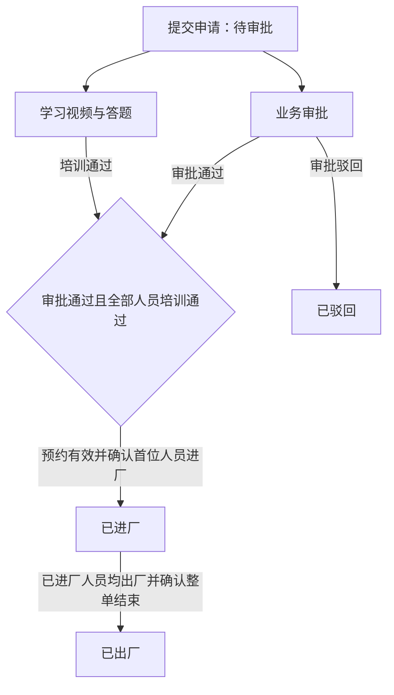
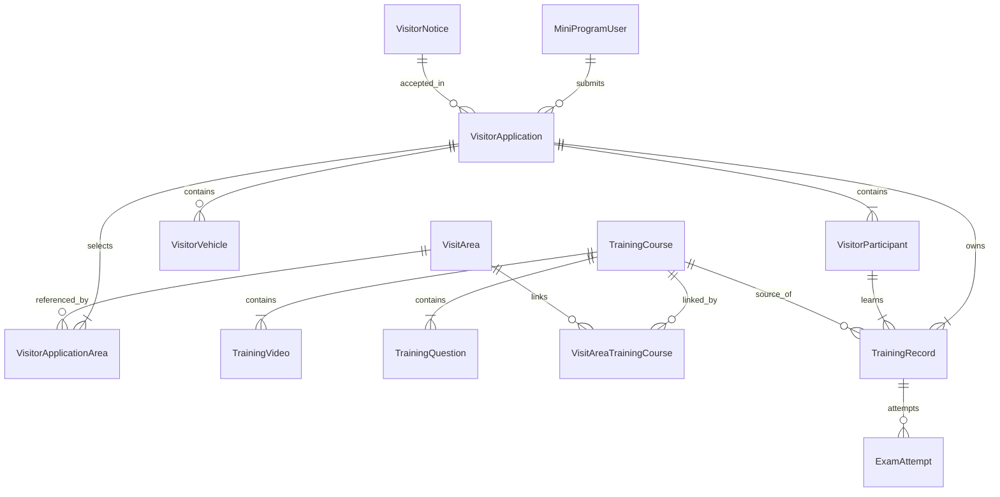

# VisitSafe 后端 SPEC：模块与实体定义

更新日期：2026-10-11。

## 1. 本版范围与已确认规则

本版只定义主导航模块、业务实体、字段含义和关联关系，供后续实现使用。实体命名与字段是本轮设计建议；不生成后端实现代码。

技术约束：采用 CleanBlazorServerPro 管理后台，通过 ASP.NET Minimal API 与微信小程序交互。此文档不展开框架接入、页面操作、接口契约、数据库映射或登录鉴权方案。

已确认的业务规则：

- 主导航为首页 Dashboard、访客管理、培训管理、培训记录、基础配置、系统管理。
- 题库属于培训管理；培训记录作为独立主导航，供后台查看。
- 题库支持单选题和多选题，标准答案及实际作答均按选项集合保存；多选题按全部选对得分的规则评分。
- VisitorApplication 只定义三类申请通用的固定字段，类型专属业务字段通过已有动态字段模块扩展。
- TimeSlot 是申请单的固定字段，预约时段选项通过框架已有 PicklistSet 维护；动态下拉字段的选项定义在对应字段的 metadata 中，不新增专用登记选项表。
- 申请单与访问区域为多对多关系；访问区域与培训方案也为多对多关系。个人课程任务仅按所选区域对应方案的并集生成，按方案去重，不按登记类型追加方案。
- 访客须知按普通访客、施工人员、物流车辆分别配置，登记弹窗展示当前申请类型对应的标题和正文。
- 培训方案可提供 PDF 文档，供查看和下载。第一版每个方案可选配置一份 PDF，作为补充资料，学习与考试完成规则保持不变。
- 申请人员支持填写身份证号码及上传人员附件。第一版按每位人员一份可选附件定义，资料保存在本申请的人员记录中。
- 申请车辆统一归属于申请单，不设置车辆类型字段，不维护司机信息或关联申请人员；保留车牌及运输单位，车辆录入要求由所属申请的类型决定。
- 第一版每次申请都重新生成个人培训任务，每个人都要重新学习和答题，历史通过结果不抵扣新申请。
- 提交申请后即进入待审批并生成个人培训任务，业务审批与学习培训并行；待审批期间可以学习、答题及重考。
- 每位申请人员在本次申请中仅记录一次进厂和一次出厂，时间保存在 VisitorParticipant，人员在厂状态由这两个时间推导，不新增通行记录实体。
- 学习方式沿用现有前端：同一手机可供多人轮流学习，申请单任务页可选择个人或按全部人员依次学习，各人进度独立。
- 学习培训入口按姓名＋手机号查找本人未完成任务，多个申请分别展示；查找后只显示匹配人员的课程。
- 培训人员来自本申请的人员名单，与车辆数量及运输单位无关。
- 全部人员通过本申请的全部必修课程，表示整单培训完成；进厂前还必须审批通过且预约有效。申请正常结束以确认出厂为准。
- 失败重考保留本申请、本人的视频完成进度，并产生新的考试记录。
- 除本轮明确调整的内容外，登记字段、区域匹配、视频学习及答题行为以 [前端 SPEC](VisitSafe-MiniApp-Frontend-SPEC.md) 为依据。

## 2. 主导航与模块边界

| 主导航 | 模块职责 | 主要实体或数据来源 |
| --- | --- | --- |
| 首页 Dashboard | 展示登记数量、申请状态、人员数量和培训完成情况 | 汇总申请单、申请人员、培训记录和考试记录，不新增统计实体 |
| 访客管理 | 管理三类申请及其登记信息、审批和进出厂状态，查看人员身份证号码及附件资料 | VisitorApplication、VisitorParticipant、VisitorVehicle、VisitorApplicationArea；MiniProgramUser 标记提交者 |
| 培训管理 | 维护培训方案、视频、PDF 资料、课程题库及区域与方案关联 | TrainingCourse、TrainingVideo、TrainingQuestion、VisitAreaTrainingCourse |
| 培训记录 | 查看个人课程进度、历次考试、成绩及关联申请 | TrainingRecord、ExamAttempt，关联申请单和人员 |
| 基础配置 | 维护访问区域、三类访客须知；预约时段通过 PicklistSet 维护，申请扩展字段及其下拉选项使用动态模块 | VisitArea、VisitorNotice；复用框架已有 PicklistSet 及动态模块的字段定义、metadata 与模板 |
| 系统管理 | 使用框架现有用户、角色、权限和日志能力 | 沿用框架实体，本版不重复定义 |

访客管理采用统一申请单模型，按登记类型使用对应动态字段模板。培训记录模块读取实际的学习和考试记录，与课程配置分开。

## 3. 类型与公共字段

- 实体标识采用 `string`。除关联实体 VisitorApplicationArea、VisitAreaTrainingCourse 外，各实体都有 `Id`。
- 创建时间采用 `CreatedAt: DateTimeOffset`；可编辑实体的修改时间采用 `UpdatedAt: DateTimeOffset?`。具体审计字段与基类在实现阶段沿用框架约定。
- 预约日期采用 `DateOnly`，与前端 `YYYY-MM-DD` 对应；考试及完成时间采用 `DateTimeOffset`。
- `?` 表示允许为空；集合采用有序列表或字典，下文说明其含义，不在本版选择具体存储映射。
- 下文的集合、字典与快照属于实体内部数据，不额外设计独立的选项、答卷答案或课程版本实体。

| 类型 | 值 | 含义 |
| --- | --- | --- |
| VisitorType | Visitor、Logistics、Contractor | 普通访客、物流车辆、施工人员 |
| VisitorApplicationStatus | PendingApproval、Approved、CheckedIn、CheckedOut、Rejected、Cancelled、Expired | 待审批、已批准、已进厂、已出厂、已驳回、已取消、已过期 |
| TrainingQuestionType | SingleChoice、MultipleChoice | 单选题、多选题 |

前端的 `training` 是继续学习入口，不是新申请类型，不加入 VisitorType。

## 4. 访客管理实体

### 4.1 MiniProgramUser：小程序提交者

用于区分申请单由哪个小程序用户提交，支持“我的记录”的数据归属。它与后台管理员账号、实际学习人员分别建模。

| 字段 | 类型 | 定义 |
| --- | --- | --- |
| AppId | string | 所属微信小程序标识 |
| OpenId | string | 该用户在所属小程序下的标识 |

`AppId + OpenId` 唯一。一个提交者可提交多张申请，每张申请可登记多人；学习人员无需与提交者一一对应。本实体不规定登录或鉴权协议，姓名＋手机号查找也不视为身份认证。

### 4.2 VisitorApplication：访客申请单

三类登记统一使用此实体。固定属性保存共有的提交者、类型、预约、须知确认、申请状态、审批和进出厂信息；类型专属业务信息由动态字段模块承载。一张申请拥有自己的人员、车辆、区域和培训记录。

| 字段 | 类型 | 定义 |
| --- | --- | --- |
| SubmitterId | string | 关联 MiniProgramUser，标记申请提交者 |
| ClientRequestId | string | 对应前端草稿标识，用于避免同一草稿重复创建申请 |
| Type | VisitorType | 登记类型 |
| Status | VisitorApplicationStatus | 申请流程状态，提交时为 PendingApproval |
| AppointmentDate | DateOnly | 预约日期 |
| TimeSlot | string | 固定字段，保存提交时的预约时段值，例如 `08:30–12:00`；选项由 PicklistSet 维护 |
| VisitorNoticeId | string | 提交时确认的须知，适用类型必须与本申请 Type 一致 |
| NoticeContentSnapshot | string | 本申请确认的须知内容快照 |
| NoticeAcceptedAt | DateTimeOffset | 须知确认时间 |
| ReviewedById | string? | 审批操作人，关联框架已有后台用户；尚未审批时为空 |
| ReviewedAt | DateTimeOffset? | 审批通过或驳回的时间；尚未审批时为空 |
| ReviewComment | string? | 审批意见，驳回时填写原因 |
| CheckedInAt | DateTimeOffset? | 本申请首位人员实际进厂的时间；无人进厂时为空 |
| CheckedOutAt | DateTimeOffset? | 确认整单出厂时保存的最后一位已进厂人员实际出厂时间；整单尚未结束时为空 |

关联集合：申请人员、申请车辆、申请区域、个人培训记录。

动态扩展约定：

- 接入已有动态字段模块，复用其字段定义、模板关联和字段值承载，不新增一套扩展字段实体或自定义存储结构。具体承载属性沿用该模块约定。
- 普通访客、物流车辆、施工人员按 Type 使用对应申请模板；物流模板当前没有类型专属业务字段，可为空。
- 扩展字段使用稳定的字段键，标签、控件类型、必填及下拉选项由动态字段定义及其 metadata 配置。前端已实现的业务字段和必填规则保持一致。
- 以下为第一版动态字段模板的初始内容，不是 VisitorApplication 的固定属性：

| 申请类型 | 动态字段键 | 含义 | 初始配置 |
| --- | --- | --- | --- |
| 普通访客 | hostName | 被访人姓名 | 文本，必填 |
| 普通访客 | visitReason | 到访事由 | 下拉框，必填，选项定义在该字段的 metadata 中 |
| 施工人员 | projectName | 项目名称 | 文本，必填 |
| 施工人员 | workArea | 具体施工位置 | 文本，必填，与访问区域分别填写 |
| 施工人员 | contractorCompany | 整单施工单位 | 文本，必填，作为本单施工人员所属单位的来源 |
| 施工人员 | supervisor | 现场负责人姓名 | 文本，必填 |

动态数据属于整张申请，不按人员重复创建。申请需要保留提交时的字段键、值和显示含义，模板或选项后续调整不能改变历史申请的业务信息；历史字段解释由动态模块的记录保留机制承载。

约束：

- `SubmitterId + ClientRequestId` 唯一。
- 所有新申请都要求有效预约日期、预约时段 PicklistSet 中允许选择的值，以及当前申请类型对应的启用须知确认。
- 类型专属字段的校验基于对应动态模板，不再通过固定的可空业务属性区分三类申请。
- TimeSlot 保存提交时的值，后续调整 PicklistSet 中的时段选项不改变历史申请的显示内容。
- 创建时间对应申请提交时间。前端草稿继续作为本地填写数据，本版不另建后端草稿实体。
- 申请流程状态保存到 Status；培训完成情况由该单所有个人培训记录汇总，培训进度不自动改变申请流程状态。

申请状态定义：

| 状态 | 显示名称 | 含义 |
| --- | --- | --- |
| PendingApproval | 待审批 | 已提交，等待业务审批；可同步学习培训 |
| Approved | 已批准 | 审批通过，尚未确认进厂；培训可能未完成 |
| CheckedIn | 已进厂 | 已确认进厂，本次访问进行中 |
| CheckedOut | 已出厂 | 已确认出厂，本次申请正常结束 |
| Rejected | 已驳回 | 审批不通过，本次申请结束 |
| Cancelled | 已取消 | 进厂前取消，本次申请结束 |
| Expired | 已过期 | 预约有效期结束且未进厂，本次申请结束 |

审批与培训并行规则：

- 提交申请时创建培训记录和课程快照，初始 Status 为 PendingApproval，人员即可开始学习；不要求先审批通过。
- PendingApproval 经审批转为 Approved 或 Rejected，并记录 ReviewedById、ReviewedAt 和 ReviewComment。审批通过不要求培训已完成；驳回必须填写原因。
- 培训先完成但审批未完成时，申请仍为 PendingApproval；审批先通过但培训未完成时，申请仍为 Approved。两项均通过后，申请仍为 Approved，直到实际确认进厂。
- 只有 Status 为 Approved 或 CheckedIn、所有申请人员均通过本申请的全部课程，并且处于预约有效期内，才可确认尚未进厂人员的首次进厂，记录该人员的 CheckedInAt。首位人员进厂时，申请从 Approved 转为 CheckedIn，申请 CheckedInAt 取人员进厂时间的最小值；后续人员进厂不重置该时间。
- CheckedIn 确认整单出厂时，必须确保所有实际进厂人员均已出厂，随后转为 CheckedOut，申请 CheckedOutAt 取已进厂人员出厂时间的最大值。仅部分人员出厂不结束申请；尚未到访人员的两个时间保留为空，整单结束后不可再进厂。审批时间、培训完成时间与实际进出厂时间分别保存。
- PendingApproval、Approved 可在进厂前转为 Cancelled；超过预约有效期仍未进厂时转为 Expired。有效期根据申请保存的 AppointmentDate、TimeSlot 确定，后续 PicklistSet 变更不改变历史申请的有效期。预约窗口开始前允许提前学习，进厂时才检查是否处于有效窗口内。
- CheckedIn 不自动转为 Expired；超过预约有效期仍有人员在厂时保留已进厂状态，供后台提示超时未离厂。人员是否在厂以 VisitorParticipant 的进出厂时间为准。
- Rejected、Cancelled、Expired、CheckedOut 为结束状态，保留已有登记、学习和考试历史，不再继续学习、答题或重考；再次申请按新申请处理，重新培训。
- 学习培训入口只查找未结束申请中的本人未完成任务，待审批申请不被过滤。后台分别展示申请状态与培训完成情况，不增加待培训或培训通过的申请主状态。

本节定义申请单级状态及汇总进出厂时间。个人进出厂时间直接保存在下述 VisitorParticipant 中，每人每张申请只进出一次，不另建通行记录表。

### 4.3 VisitorParticipant：申请人员

表示一位人员在一张申请中的登记身份，同时是本申请内的学习人员。它不是跨申请复用的人员档案。

| 字段 | 类型 | 定义 |
| --- | --- | --- |
| VisitorApplicationId | string | 所属申请单 |
| Name | string | 人员姓名，去除首尾空格后保存 |
| Phone | string | 手机号码，去除首尾空格后保存 |
| IdCardNumber | string? | 身份证号码，按文本保存，可选填 |
| AttachmentSource | string? | 本人员上传附件的地址或稳定文件引用 |
| AttachmentFileName | string? | 人员附件的展示与下载文件名 |
| Company | string? | 普通访客所属单位；施工人员继承整单施工单位 |
| Trade | string? | 施工人员工种 |
| CheckedInAt | DateTimeOffset? | 本人实际进厂时间；尚未进厂时为空 |
| CheckedOutAt | DateTimeOffset? | 本人实际出厂时间；尚未出厂时为空 |
| SortOrder | int | 在申请中的展示和依次学习顺序 |

人员进出厂约定：

- 新建人员记录时 CheckedInAt、CheckedOutAt 均为空。每位人员在本次申请中仅允许一次进厂和一次出厂，出厂后不再次进厂。
- 人员状态由时间推导，不增加独立的 Status 属性，也不把申请审批状态复制到人员记录中。

| 人员在厂状态 | 判断条件 |
| --- | --- |
| 未进厂 | CheckedInAt、CheckedOutAt 均为空 |
| 在厂 | CheckedInAt 有值，CheckedOutAt 为空 |
| 已出厂 | CheckedInAt、CheckedOutAt 均有值 |

- 首次进厂遵循所属申请的审批、全员培训及预约有效期要求；进厂时只写入一次 CheckedInAt。
- 出厂前必须已经进厂，CheckedOutAt 不得早于 CheckedInAt；不得出现没有进厂时间却有出厂时间的记录。出厂后两个时间保留原值。
- 个人出厂时间可独立记录，全部已进厂人员均出厂后才能确认整单结束。未到访人员不补写进出厂时间。

身份证与附件约定：

- 身份证按号码字段定义，与上传附件分别保存；本版不限定附件必须是身份证照片。
- 新增字段先采用可空类型，作为选填资料，兼容已有人员记录。
- 第一版每位人员可上传一份附件，配置附件时同时保存 AttachmentSource、AttachmentFileName；未上传时两者均为空，不新增附件实体。
- 三类申请的人员均在各自的 VisitorParticipant 中保存这些资料，附件归属于申请人员，不属于车辆或培训方案。
- 姓名＋手机号查找规则保持不变，身份证号码不改变现有学习任务归属。

普通访客和施工人员按前端规则，同一申请内不允许重复手机号。施工人员的 Company 继承本申请动态字段 `contractorCompany` 的值；填写阶段修改施工单位时同步该单施工人员的所属单位。

申请人员与申请车辆独立保存，不建立人员与车辆关联，也不从车辆资料创建或归并人员。运输单位保存在各自的申请车辆中，每辆车可填写自己的运输单位，不依赖人员 Company。

同一个人出现在另一张申请时，新建属于另一张申请的人员记录和培训记录，新的进出厂时间初始为空。其培训完成情况根据本人在本申请的全部个人课程推导。

### 4.4 VisitorVehicle：申请车辆

车辆直接作为申请单的明细保存，一张申请可包含多辆车。车辆自身不区分随行车辆或物流车辆，不保存司机资料，也不关联申请人员，所需登记信息根据所属申请的 Type 判断。

| 字段 | 类型 | 定义 |
| --- | --- | --- |
| VisitorApplicationId | string | 所属申请单 |
| Plate | string | 规范化车牌号 |
| TransportCompany | string? | 运输单位，物流申请必填，其他申请可为空 |
| SortOrder | int | 展示顺序 |

所属申请 Type 为 Logistics 时，保留车辆及运输单位录入要求，TransportCompany 必填。普通访客、施工申请可选填车辆，只填写车牌。培训人员通过申请人员名单独立登记。

车牌沿用前端规范化与格式校验，同一申请内规范化车牌唯一。车辆本身不生成培训记录，记录归属于申请人员。

### 4.5 VisitorApplicationArea：申请选择的访问区域

申请单与访问区域是多对多关系：一张申请可选择多个区域，一个区域可被多张申请选择。本实体为关联实体，使用 `VisitorApplicationId + VisitAreaId` 作为唯一标识，不另设 Id。

| 字段 | 类型 | 定义 |
| --- | --- | --- |
| VisitorApplicationId | string | 所属申请单 |
| VisitAreaId | string | 关联访问区域 |
| AreaNameSnapshot | string | 提交时的区域名称，供历史申请展示 |
| SortOrder | int | 本申请内的区域展示顺序 |

每张申请至少选择一个启用区域，同一区域不重复选择。动态字段 `workArea` 描述具体施工位置，与此区域关联分别保存。

## 5. 培训管理实体

### 5.1 TrainingCourse：培训方案

对应前端的培训方案 Plan，本文中的课程和培训方案使用同一实体 TrainingCourse。每个方案包括视频、题目、考试规则，以及可选 PDF 资料。

访问区域与培训方案是多对多关系：一个区域可配置多个方案，同一个方案也可配置到多个区域。区域与方案的关联使用下述 VisitAreaTrainingCourse 保存。

| 字段 | 类型 | 定义 |
| --- | --- | --- |
| Code | string | 稳定课程编码，例如 production、research |
| Title | string | 课程名称 |
| Subtitle | string? | 简要说明 |
| Icon | string? | 前端可识别的图标标识 |
| PdfSource | string? | 可选 PDF 文档的地址或稳定文件引用 |
| PdfFileName | string? | PDF 文档的展示与下载文件名 |
| PassingScore | int | 及格分，初始为 80 |
| ExamDurationMinutes | int | 考试时长，初始为 15 分钟 |
| SortOrder | int | 展示顺序 |
| IsEnabled | bool | 是否可分配给新申请 |

Code 唯一。第一版每门可分配课程有至少一个视频、恰好五道选择题，可混合单选题和多选题，全部题目进入考试，不设置抽题或试卷实体。成绩按正确题数折算为百分制，五题时每题 20 分。

PDF 资料约定：

- 每个方案可选配置一份 PDF，直接保存在培训方案的文件引用字段中，不新增文档实体。
- 配置 PDF 时同时保存 PdfSource 和 PdfFileName；没有 PDF 时两个字段均为空。
- PDF 用于在小程序或后台查看、下载，属于学习资料；查看或下载不计入视频完成进度，也不改变考试要求。
- 申请生成培训记录时，将 PDF 引用和文件名一并保存到课程快照。替换 PDF 使用新的文件引用，已有记录保留原引用及文件。

### 5.2 TrainingVideo：课程视频

对应前端 Lesson，一门课程可包含多个有序视频。

| 字段 | 类型 | 定义 |
| --- | --- | --- |
| TrainingCourseId | string | 所属课程 |
| Title | string | 视频标题 |
| Description | string? | 视频简介 |
| Source | string | 视频地址或文件引用 |
| DurationSeconds | int | 视频时长，前端按需要格式化展示 |
| SortOrder | int | 播放顺序 |

视频与 PDF 文件存储方案不在本版确定。替换视频应生成新的文件引用，保留已有培训记录快照引用的文件。

### 5.3 TrainingQuestion：课程题库题目

题目直接属于课程，作为培训管理的一部分维护。第一版保留四个选项，支持单选题和多选题。

| 字段 | 类型 | 定义 |
| --- | --- | --- |
| TrainingCourseId | string | 所属课程 |
| Type | TrainingQuestionType | 单选或多选题型 |
| Title | string | 题干 |
| Options | string[] | 四个有序选项，对应 A、B、C、D |
| CorrectIndexes | int[] | 正确选项下标集合，元素取值 0–3，去重保存 |
| Explanation | string | 答案解析 |
| SortOrder | int | 在课程考试中的顺序 |

题型与答案约束：

- SingleChoice：CorrectIndexes 恰好包含一个下标，学生答案也只允许一个选项。
- MultipleChoice：CorrectIndexes 包含至少两个正确选项；学生可选择多个选项，保存为去重后的下标集合。
- 正确答案和学生答案按集合比较，顺序不影响判定。多选题只有所选集合与正确集合完全一致才得分；少选、多选、错选或未答均得零分。
- 第一版使用整题得分，不设置部分得分或题目独立权重，五题时单选与多选均每题 20 分。

第一版不增加题目分类、公共题库复用或随机组卷实体。

### 5.4 VisitAreaTrainingCourse：访问区域与培训方案关联

用于保存访问区域与培训方案的多对多关联，使用 `VisitAreaId + TrainingCourseId` 作为唯一标识，不另设 Id。

| 字段 | 类型 | 定义 |
| --- | --- | --- |
| VisitAreaId | string | 关联访问区域 |
| TrainingCourseId | string | 关联培训方案 |

同一区域可关联多个不同方案，同一方案可被不同区域关联。同一对区域与方案只能关联一次；调整配置时直接增加或移除关联，不另设匹配类型或规则启用字段。

初始区域配置：生产区 → 生产区域安全培训；研发区 → 研发区域安全培训；非生产区 → 非生产区域安全培训。

申请选择多个区域时，收集这些区域关联的全部启用方案，按方案标识去重，随后为每位申请人员分别生成对应的 TrainingRecord。多个区域关联同一个方案时，该人员在本申请中只生成一条对应记录。

三种登记类型均使用上述区域配置。物流车辆与施工人员不再按类型自动追加交通安全或施工安全方案；如需学习某方案，将其关联到相应访问区域。

只向新申请分配启用课程。每张申请必须匹配至少一门有效课程，避免零任务被当作已完成。

现有通用安全课程可保留在课程目录中；当前“学习培训”入口只继续已有任务，不自动创建通用培训申请。

## 6. 培训记录实体

### 6.1 TrainingRecord：个人课程培训记录

同时承担课程任务、视频进度和完成结果，对应前端 TrainingTask。一条记录表示“某张申请中的某个人，学习某一门课程”。

| 字段 | 类型 | 定义 |
| --- | --- | --- |
| VisitorApplicationId | string | 所属申请单 |
| VisitorParticipantId | string | 所属学习人员，必须属于上述申请 |
| TrainingCourseId | string | 来源课程 |
| CourseSnapshotJson | string | 创建任务时的课程内容与考试规则快照 |
| StartedAt | DateTimeOffset? | 本人首次开始学习该门课程的时间；尚未开始时为空 |
| CompletedVideoIds | string[] | 本记录快照中已完成的视频标识，去重保存 |
| CompletedAt | DateTimeOffset? | 本人通过该门课程的时间；未通过时为空 |

`VisitorApplicationId + VisitorParticipantId + TrainingCourseId` 唯一。考试记录通过 ExamAttempt 关联本记录。

课程快照在提交申请、生成个人任务时确定，保存课程名称和展示信息、全部视频的标识与内容引用、可选 PDF 的文件引用和文件名、五道题的题型、选项、正确答案集合及解析、及格分和考试时长。后台后续修改课程、PDF、题目或区域与方案关联，不改变已有任务、资料引用、考试和成绩依据。第一版通过快照保存历史，不另建课程版本实体。

课程配置实体是管理用数据；快照也是后台保存的业务依据，具体向小程序返回哪些字段由后续接口契约定义。

已观看数量、最新考试结果、培训状态均由 StartedAt、视频完成标识及考试记录推导，不再额外保存可发生矛盾的计数或结果副本。必须完成快照内全部视频才能开始考试。

新申请生成新的 TrainingRecord，StartedAt、CompletedAt 初始为空，CompletedVideoIds 初始为空集合。首次开始播放本课程视频时写入 StartedAt，仅打开任务或课程页面不写入；继续学习、换手机或失败重考不重置该时间。

StartedAt 表示个人课程学习开始时间，与任务创建时间 CreatedAt、每次考试开始时间 ExamAttempt.StartedAt 分别记录。失败重考继续使用本记录和同一课程快照，保留视频完成进度。

### 6.2 ExamAttempt：一次考试记录

一条记录表示某个人课程任务的一次考试。首次考试和每次重考分别保存，便于后台查看历次结果。

| 字段 | 类型 | 定义 |
| --- | --- | --- |
| TrainingRecordId | string | 所属个人课程培训记录 |
| AttemptNumber | int | 本记录内的考试次数，从 1 开始递增 |
| StartedAt | DateTimeOffset | 本次考试开始时间 |
| DeadlineAt | DateTimeOffset | 根据课程快照确定的截止时间 |
| Answers | Dictionary<string, int[]> | 快照题目标识 → 已选择选项下标集合；单选也使用单元素集合，未答题不写入 |
| SubmittedAt | DateTimeOffset? | 本次交卷时间；尚未交卷时为空 |
| Score | int? | 本次成绩；尚未交卷时为空 |
| Passed | bool? | 本次是否通过；尚未交卷时为空 |
| WrongQuestionIds | string[] | 交卷时的错题标识，包含未答题 |
| TimedOut | bool | 本次交卷是否因超过截止时间 |

`TrainingRecordId + AttemptNumber` 唯一，同一培训记录同时最多保留一次未交卷的考试。

答案允许在交卷前、截止时间前修改，评分采用最终答案集合。单选答案必须恰好选择一项；多选答案允许选择一项或多项，少选按评分规则判为错误。答案下标必须属于对应快照题目，重复选项去重；空集合视为未作答，不计入已答题数。

主动交卷必须全部题目都有作答；到期按已保存答案评分，未答题得零分。离开、重载或换手机不重置 StartedAt、DeadlineAt 或已保存答案。

Passed 为真时写入所属 TrainingRecord 的 CompletedAt。未通过重考新建 ExamAttempt，保留此前记录；已通过课程不再重考。

错题解析使用本培训记录的课程快照，避免题库调整后历史成绩和解析不一致。

## 7. 基础配置实体与配置约定

### 7.1 VisitArea：访问区域

| 字段 | 类型 | 定义 |
| --- | --- | --- |
| Code | string | 稳定区域编码，初始为 production、research、office |
| Name | string | 区域名称 |
| Description | string? | 区域说明，对应前端 subtitle |
| Caption | string? | 区域展示文字，如 PRODUCTION |
| Color | string? | 前端可识别的颜色标识 |
| Icon | string? | 前端可识别的图标标识 |
| SortOrder | int | 展示顺序 |
| IsEnabled | bool | 是否允许新申请选择 |

Code 唯一。区域负责展示和关联培训方案，不承担门禁授权或具体施工位置管理。

### 7.2 VisitorNotice：访客须知

三种访客类型分别维护须知内容，作为各自登记入口的弹窗内容来源。

| 字段 | 类型 | 定义 |
| --- | --- | --- |
| Type | VisitorType | 适用的访客类型：Visitor、Contractor 或 Logistics |
| Title | string | 本类型的须知标题 |
| Content | string | 本类型的须知正文，使用可供小程序展示的文本内容 |
| IsEnabled | bool | 是否为本类型当前使用的须知 |

内容对应关系：

| 登记入口 | 须知类型 | 内容来源 |
| --- | --- | --- |
| 普通访客 | Visitor | 后台配置的普通访客须知 |
| 施工人员 | Contractor | 后台配置的施工人员须知 |
| 物流车辆 | Logistics | 后台配置的物流车辆须知 |

每个 Type 同一时间最多有一份启用须知，三类须知可同时启用。新登记严格按当前申请 Type 匹配须知；该类型没有启用须知时，不能完成新申请登记。

申请单关联对应须知，并保存接受时的正文快照和确认时间，之后编辑正文不改变历史确认内容或已有培训记录。已被申请引用的须知不得更改其 Type。

本规则是对现有前端共用须知内容的需求调整，本轮只定义配置与实体关系，前端弹窗在后续接入时按类型读取相应内容。

### 7.3 登记选项配置：PicklistSet 与动态字段 metadata

固定字段 TimeSlot 的预约时段选项通过框架已有 PicklistSet 维护，三类登记共用同一套时段配置。TimeSlot 不属于动态字段，所选值只保存到 VisitorApplication.TimeSlot。

动态下拉字段（如 visitReason）的选项维护在对应动态字段定义的 metadata 中。两类配置分别沿用已有 PicklistSet 与动态模块的约定，不新增专用登记选项实体或选项表，本版不重复定义框架实体与 metadata 结构。

初始配置：

| 字段 | 适用类型 | 选项配置来源 | 初始选项 | 所选值保存位置 |
| --- | --- | --- | --- | --- |
| TimeSlot（固定字段） | 三类登记共用 | PicklistSet | `08:30–12:00`、`13:00–17:00` | VisitorApplication.TimeSlot |
| visitReason（动态字段） | 普通访客 | 该字段定义的 metadata | 会议、面试、洽谈 | 本申请的动态字段值 |

初始选项使用显示文本作为提交值。提交时，TimeSlot 按预约时段 PicklistSet 校验可选值；动态下拉字段按对应 metadata 校验可选值。

第一版时段只用于登记选项，不增加预约容量、排班或日历实体。修改或移除 PicklistSet 或动态字段 metadata 中的选项只影响后续填写，历史申请保留提交时的值和显示含义。

## 8. 实体关系

| 多对多关系 | 关联实体 | 含义 |
| --- | --- | --- |
| VisitorApplication ↔ VisitArea | VisitorApplicationArea | 一单多区域，一个区域关联多张申请 |
| VisitArea ↔ TrainingCourse | VisitAreaTrainingCourse | 一个区域对应多个方案，一个方案对应多个区域 |

下图通过关联实体展开这两组多对多关系。

关系图中的至少一个人员、区域、培训记录，以及课程的视频和题目要求，适用于已提交申请和可分配课程。配置编辑过程可存在尚未满足这些要求的草稿内容，但不能据此生成申请培训记录。

固定字段 TimeSlot 的选项来自框架已有 PicklistSet，动态字段 `visitReason` 的选项来自字段定义的 metadata，申请分别保留各字段的提交值。本图不重复定义框架已有 PicklistSet 或动态模块的内部实体。

区域与方案关联只在新申请生成任务时使用，实际培训记录保持独立。修改或停用基础配置、课程，或移除区域与方案关联，不移除历史记录；被记录引用的主数据、视频和 PDF 文件，以及申请人员关联的附件需保留。

## 9. 前端数据对应关系

| 当前前端数据 | 后端实体或字段 |
| --- | --- |
| Draft | 提交前仍作为前端草稿，草稿 id 对应 ClientRequestId |
| Visit | VisitorApplication |
| 新增的申请流程状态、审批和进出厂信息 | VisitorApplication.Status、ReviewedById、ReviewedAt、ReviewComment、CheckedInAt、CheckedOutAt |
| appointmentDate、timeSlot | VisitorApplication 的通用固定字段 |
| 预约时段的下拉选项 | 框架已有 PicklistSet，所选值保存到固定字段 TimeSlot |
| 到访事由的下拉选项 | 动态字段 visitReason 定义的 metadata |
| hostName、visitReason | 普通访客动态模板中的同名字段键 |
| projectName、workArea、contractorCompany、supervisor | 施工人员动态模板中的同名字段键 |
| Person | VisitorParticipant |
| 新增的人员进出厂时间及在厂状态 | VisitorParticipant.CheckedInAt、CheckedOutAt；在厂状态由这两个时间推导 |
| 新增的人员身份证号码及上传附件 | VisitorParticipant.IdCardNumber、AttachmentSource、AttachmentFileName |
| Vehicle | VisitorVehicle，保存车牌、运输单位等车辆资料，业务要求由申请类型决定 |
| AccompanyingVehicle | VisitorVehicle，归属于申请单，当前前端仅填写车牌 |
| areaIds | VisitorApplicationArea 关联的 VisitArea |
| 所选区域对应的培训方案 | VisitAreaTrainingCourse 关联的启用 TrainingCourse，按方案去重 |
| Plan | TrainingCourse＋TrainingVideo＋TrainingQuestion |
| 新增的培训方案 PDF 资料 | TrainingCourse.PdfSource、PdfFileName，并保留到个人课程快照 |
| Lesson | TrainingVideo |
| Question | TrainingQuestion |
| 当前单选题的 correct | TrainingQuestion.CorrectIndexes 的单元素集合；题型为 SingleChoice |
| 当前考试答案的单个选项下标 | ExamAttempt.Answers 中的单元素集合；新增多选题保存多个下标 |
| TrainingTask | TrainingRecord |
| completedLessonIds | TrainingRecord.CompletedVideoIds |
| attempt | 当前未交卷的 ExamAttempt |
| lastResult | 最近一次已交卷 ExamAttempt 的结果 |
| noticeAccepted | VisitorNoticeId、NoticeContentSnapshot、NoticeAcceptedAt 对应的确认事实 |
| 访客须知弹窗标题与正文 | 按申请 Type 获取对应 VisitorNotice 的 Title、Content |

后续接入时，取消现有前端物流车辆中的司机资料录入及按车辆司机归并人员的逻辑。车辆资料保存到 VisitorVehicle，需要学习的人员通过申请人员名单保存到 VisitorParticipant，两者均归属于申请单，互不关联。

现有前端按物流或施工类型追加课程的逻辑，后续接入时调整为仅按所选区域关联方案生成任务。本轮只更新实体与业务规则定义。

前端“一单三人、两门课程”的示例，对应三条 VisitorParticipant、六条 TrainingRecord，各条记录拥有独立视频进度及 ExamAttempt。六条记录全部通过表示整单培训完成；申请审批通过且预约有效后才能确认进厂，确认出厂后正常结束。

## 10. 模型检查要点

- 三类登记的现有字段均有归属：通用字段固定保存，类型专属字段使用动态模板，申请级信息不按人员重复保存。
- VisitorApplication 不包含被访人、到访事由、项目名称、施工位置、施工单位或现场负责人的固定业务属性。
- 动态模板保留既有字段键、初始必填规则及选项来源，历史申请保留提交时的字段解释和值。
- TimeSlot 是固定字段，其选项通过框架已有 PicklistSet 维护；动态下拉字段的选项通过字段 metadata 维护，不新增专用登记选项表。
- 申请与区域、区域与方案均为多对多关联；培训方案只由所选区域决定，按方案去重，不因选择多个区域重复生成培训记录。
- 一张申请拥有独立人员记录，另一张申请重新创建培训记录。
- 申请提交后业务审批与学习培训并行；待审批期间可学习答题，进厂前必须审批通过且全部人员培训通过。
- Status 管理七个申请流程状态，培训完成情况从个人记录汇总；培训通过不自动将申请标记为已批准、已进厂或已出厂。
- 审批与进出厂分别记录操作结果及时间；未进厂申请可取消或过期，已进厂未出厂的申请保留实际在厂状态。
- 每位人员在本申请中只进出一次；人员在厂状态由 CheckedInAt、CheckedOutAt 推导，不单独保存 Status 或通行记录实体。
- 申请进厂时间取首位人员进厂时间；所有实际进厂人员均出厂且确认整单结束后，申请出厂时间取最后一位人员出厂时间。未到访人员不补写时间。
- 身份证号码和上传附件保存到对应申请人员；附件为可选单文件，不改变姓名＋手机号的任务匹配方式。
- 培训记录按申请人员生成，车辆不参与人员创建、归并或课程分配。
- 车辆统一归属于申请单，不设置车辆类型，不维护司机信息或人员关联；保留运输单位，车辆不增加人员数或课程数。
- 个人课程记录唯一，视频进度和考试记录互相隔离。
- 课程、视频、题库和区域与方案关联修改后，已有记录继续采用原快照。
- 单选与多选题的标准答案和作答均使用选项集合，题型与答案保留在课程快照中，多选按完全匹配评分。
- 培训方案可选 PDF 资料支持查看和下载；PDF 配置保留到课程快照，不改变视频与考试完成判定。
- 预约、事由、区域和须知调整后，历史申请仍能展示提交时内容。
- 三种申请分别匹配同类型的启用须知，不能关联其他类型须知；每种类型最多一份启用。
- 培训记录为独立主导航，能通过人员、申请、课程及历次考试关联查看数据。

本版不展开后台申请编辑与删除的权限、审批人员分配及具体通行页面操作，也不选择视频加载失败计时的正式使用策略。这些内容属于后续页面与接口规格，不由实体设计隐含决定。
