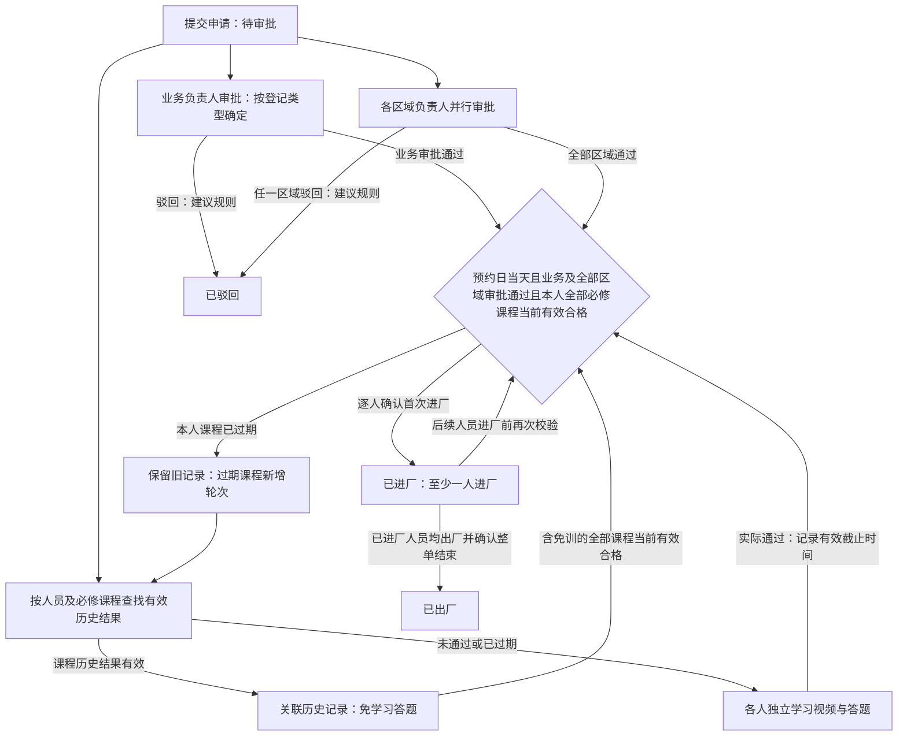
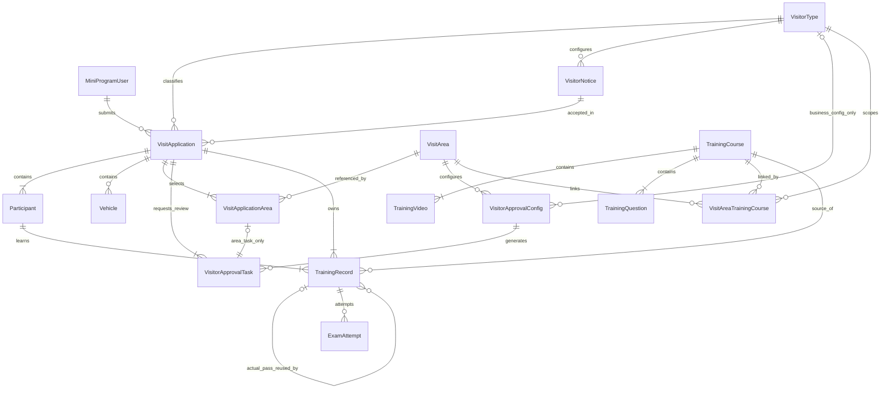

# VisitSafe 后端 SPEC：模块与实体定义

更新日期：2026-10-13。

## 1. 本版范围与已确认规则

本版只定义主导航模块、业务实体、字段含义和关联关系，供后续实现使用。实体命名与字段是本轮设计建议；不生成后端实现代码。

技术约束：采用 CleanBlazorServerPro 管理后台，通过 ASP.NET Minimal API 与微信小程序交互。此文档不展开框架接入、页面操作、接口契约、数据库映射或登录鉴权方案。

已确认的业务规则：

- 主导航为首页 Dashboard、访客管理、培训管理、培训记录、基础配置、系统管理。
- 题库属于培训管理；培训记录作为独立主导航，供后台查看。
- 题库支持单选题和多选题，标准答案及实际作答均按选项集合保存；多选题按全部选对得分的规则评分。
- VisitorType 与 VisitArea 一样作为可维护的基础配置实体；普通访客、物流车辆、施工人员只是初始数据，后续可动态新增登记类型。小程序根据启用类型生成登记入口，学习培训入口独立保留。
- VisitApplication 只定义各登记类型通用的固定字段，通过 VisitorTypeId 关联登记类型；类型专属业务字段通过该类型关联的已有动态字段模板扩展。
- TimeSlot 是申请单的固定字段，预约时段选项通过框架已有 PicklistSet 维护，仅用于登记和展示，不参与后续审批、进厂、过期或滞留判断；动态下拉字段的选项定义在对应字段的 metadata 中，不新增专用登记选项表。
- AppointmentDate 限制每位人员的实际进厂日期：按工厂业务时区计算的服务端确认进厂日期必须等于预约日期，不能提前或延后进厂；本版工厂业务时区为 Asia/Shanghai（UTC+08:00）。该限制不阻止已进厂人员跨日出厂，也不自动将申请转为 Expired。
- 申请单与访问区域为多对多关系；培训方案按“登记类型＋访问区域”组合配置。提交时按申请 VisitorTypeId 和每个所选 VisitAreaId 同时匹配启用课程，将命中课程合并并按方案去重，为每位人员生成个人课程任务；同一区域的不同登记类型可分配不同课程。
- 访客须知按登记类型分别配置，登记弹窗展示当前申请类型对应的标题和正文；新增类型也需配置自己的须知。
- 培训方案可提供 PDF 文档，供查看和下载。第一版每个方案可选配置一份 PDF，作为补充资料，学习与考试完成规则保持不变。
- 申请人员支持填写身份证号码及上传人员附件。第一版按每位人员一份可选附件定义，资料保存在本申请的人员记录中。
- 申请车辆统一归属于申请单，不设置车辆类型字段，不维护司机信息或关联申请人员；保留车牌及运输单位，车辆录入要求由所属申请的类型决定。
- 培训有效期保存在每门 TrainingCourse 的 TrainingValidityDays 字段中，通过后台培训管理的课程编辑维护，默认 60 天，必须为正整数；不同课程可设置不同天数。每门课程从本人实际考试通过时起算，截止时间保存在培训记录中；修改只影响该课程之后实际通过的记录，不重算已有截止时间。
- 新申请仍按当前登记类型及区域为每位人员匹配必修课程，再按姓名＋手机号完全一致、同一 TrainingCourseId 查找本人有效的历史实际通过记录。可复用的课程免去视频学习和答题，未通过、已过期或新增课程仍需学习答题；所有登记类型均使用此规则。
- 提交申请后即进入待审批并生成个人培训任务，业务审批与学习培训并行；待审批期间可以学习、答题及重考。
- 审批同时覆盖登记类型对应的业务负责人和所选访问区域负责人：初始普通访客由被访人审批，施工人员由现场负责人审批，物流车辆由登记时选择的对接人员审批；新增类型按自身业务配置指定的动态用户字段确定审批人。每个所选区域还分别生成区域负责人审批任务；业务审批和全部区域审批均通过后，整单才变为已批准。
- 每位申请人员在本次申请中仅记录一次进厂和一次出厂，各自的时间及实际操作人用户标识保存在 Participant；人员在厂状态由两个时间推导，不新增通行记录实体。
- 学习方式沿用现有前端：同一手机可供多人轮流学习，申请单任务页可选择个人或按全部人员依次学习，各人进度独立。
- 学习培训入口按姓名＋手机号查找本人当前需要学习的任务，包括过期后生成的新轮次，多个申请分别展示；查找后只显示匹配人员的课程，有效免训课程不要求重复学习。
- 培训人员来自本申请的人员名单，与车辆数量及运输单位无关。
- 进厂按个人控制：在 AppointmentDate 当天，整单业务审批和所有所选区域审批通过后，本人本申请全部必修课程的当前培训记录均已通过且仍在有效期内，包括有效的历史复用结果，即可确认本人进厂；其他人员未完成或考试未通过不阻止已满足条件的人员进厂。全部人员的必修课程均满足上述条件只表示整单当前培训合格，作为汇总展示，不作为个人进厂条件。申请正常结束以确认出厂为准。
- 失败重考保留本申请、本人的视频完成进度，并产生新的考试记录。
- 除本轮明确调整的内容外，登记字段、区域匹配、视频学习及答题行为以 [前端 SPEC](VisitSafe-MiniApp-Frontend-SPEC.md) 为依据。

## 2. 主导航与模块边界

| 主导航 | 模块职责 | 主要实体或数据来源 |
| --- | --- | --- |
| 首页 Dashboard | 展示登记数量、申请状态、人员数量和培训完成情况 | 汇总申请单、申请人员、培训记录和考试记录，不新增统计实体 |
| 访客管理 | 按登记类型管理申请及其登记信息、业务与区域审批待办和进出厂状态，查看人员身份证号码及附件资料 | VisitApplication、Participant、Vehicle、VisitApplicationArea、VisitorApprovalTask；MiniProgramUser 标记提交者 |
| 培训管理 | 维护培训方案及各课程培训有效期、视频、PDF 资料、课程题库及登记类型＋区域与方案的组合配置 | TrainingCourse、TrainingVideo、TrainingQuestion、VisitAreaTrainingCourse |
| 培训记录 | 查看个人课程进度、历次考试、成绩及关联申请 | TrainingRecord、ExamAttempt，关联申请单和人员 |
| 基础配置 | 维护登记类型及其入口展示、申请模板、车辆录入要求、访问区域、类型业务审批人取值规则、区域审批负责人和各类型访客须知；预约时段通过 PicklistSet 维护，申请扩展字段及其下拉选项使用动态模块 | VisitorType、VisitArea、VisitorApprovalConfig、VisitorNotice；复用框架已有 PicklistSet 及动态模块的字段定义、metadata 与模板 |
| 系统管理 | 使用框架现有用户、角色、权限和日志能力 | 沿用框架实体，本版不重复定义 |

访客管理采用统一申请单模型，按 VisitorType 关联的申请模板使用动态字段，不通过固定三类枚举选择模板。培训记录模块读取实际的学习和考试记录，与课程配置分开。

## 3. 类型与公共字段

- 实体标识采用 `string`。除关联实体 VisitApplicationArea、VisitAreaTrainingCourse 外，各实体都有 `Id`。
- 创建时间采用 `CreatedAt: DateTimeOffset`；可编辑实体的修改时间采用 `UpdatedAt: DateTimeOffset?`。具体审计字段与基类在实现阶段沿用框架约定。
- 业务操作人使用框架后台用户的稳定标识，字段以 `ById` 命名，例如 ReviewedById、CheckedInById、CheckedOutById；由服务端从当前登录用户取得，不接受客户端指定。用户改名或停用不改写历史操作人标识，历史用户引用需保留。
- 预约日期采用 `DateOnly`，与前端 `YYYY-MM-DD` 对应，表示工厂业务时区中的自然日；进出厂、考试及完成时间采用 `DateTimeOffset`，比较进厂日期前先转换到工厂业务时区。
- `?` 表示允许为空；集合采用有序列表或字典，下文说明其含义，不在本版选择具体存储映射。
- 下文的集合、字典与快照属于实体内部数据，不额外设计独立的选项、答卷答案或课程版本实体。

| 类型 | 值 | 含义 |
| --- | --- | --- |
| VisitApplicationStatus | PendingApproval、Approved、CheckedIn、CheckedOut、Rejected、Cancelled、Expired | 待审批、已批准、已进厂、已出厂、已驳回、已取消、已过期 |
| VisitorApprovalKind | Business、Area | 业务负责人审批、区域负责人审批；用于审批配置和任务 |
| VisitorApprovalTaskStatus | Pending、Approved、Rejected、Cancelled | 待处理、已通过、已驳回、已取消；每条业务或区域任务独立保存 |
| TrainingQuestionType | SingleChoice、MultipleChoice | 单选题、多选题 |

VisitorType 是第 7 节定义的实体，不属于上述枚举类型。前端的 `training` 是继续学习入口，不是新申请类型，不创建对应 VisitorType 记录。

## 4. 访客管理实体

### 4.1 MiniProgramUser：小程序提交者

用于区分申请单由哪个小程序用户提交，支持“我的记录”的数据归属。它与后台管理员账号、实际学习人员分别建模。

| 字段 | 类型 | 定义 |
| --- | --- | --- |
| AppId | string | 所属微信小程序标识 |
| OpenId | string | 该用户在所属小程序下的标识 |

`AppId + OpenId` 唯一。一个提交者可提交多张申请，每张申请可登记多人；学习人员无需与提交者一一对应。本实体不规定登录或鉴权协议，姓名＋手机号查找也不视为身份认证。

### 4.2 VisitApplication：来厂申请单

所有登记类型统一使用此实体。固定属性保存共有的提交者、登记类型关联、预约、须知确认、申请状态、审批和进出厂信息；类型专属业务信息由动态字段模块承载。一张申请拥有自己的人员、车辆、区域和培训记录。

| 字段 | 类型 | 定义 |
| --- | --- | --- |
| SubmitterId | string | 关联 MiniProgramUser，标记申请提交者 |
| ClientRequestId | string | 对应前端草稿标识，用于避免同一草稿重复创建申请 |
| VisitorTypeId | string | 关联 VisitorType，提交时必须是允许新申请选择的启用类型 |
| VisitorTypeNameSnapshot | string | 提交时的登记类型名称，供历史申请展示 |
| Status | VisitApplicationStatus | 申请流程状态，提交时为 PendingApproval |
| AppointmentDate | DateOnly | 允许各人员首次进厂的自然日，按工厂业务时区解释；实际确认进厂日期必须与此值相同 |
| TimeSlot | string | 固定字段，保存提交时的预约时段值，例如 `08:30–12:00`；选项由 PicklistSet 维护，仅用于登记和展示 |
| VisitorNoticeId | string | 提交时确认的须知，其 VisitorTypeId 必须与本申请一致 |
| NoticeContentSnapshot | string | 本申请确认的须知内容快照 |
| NoticeAcceptedAt | DateTimeOffset | 须知确认时间 |
| ReviewedAt | DateTimeOffset? | 整单审批结论形成的时间：业务及全部区域通过或任一审批任务驳回时记录；尚无整单结论时为空 |
| CheckedInAt | DateTimeOffset? | 本申请首位人员实际进厂的时间；无人进厂时为空 |
| CheckedOutAt | DateTimeOffset? | 确认整单出厂时保存的最后一位已进厂人员实际出厂时间；整单尚未结束时为空 |

关联集合：申请人员、申请车辆、申请区域、业务与区域审批任务、个人培训记录。每条任务的审批人、审批时间与意见保存到 VisitorApprovalTask，不在申请单上用单一审批人或意见代替。

动态扩展约定：

- 接入已有动态字段模块，复用其字段定义、模板关联和字段值承载，不新增一套扩展字段实体或自定义存储结构。具体承载属性沿用该模块约定。
- 按 VisitorType.ApplicationTemplateId 使用对应申请模板；每种类型的模板均须包含定位业务审批人员的动态字段。新增类型通过关联模板扩展，不新增类型枚举或固定分支。
- 扩展字段使用稳定的字段键，标签、控件类型、必填及下拉选项由动态字段定义及其 metadata 配置。已有业务字段保持归属，审批人员选择按本轮规则增加后台用户标识。
- 以下为三种初始登记类型的动态字段模板内容，不是 VisitApplication 的固定属性，也不限制后续新增类型及字段：

| 申请类型 | 动态字段键 | 含义 | 初始配置 |
| --- | --- | --- | --- |
| 普通访客 | hostUserId | 被访人审批账号 | 后台人员选择，必填，保存框架用户标识 |
| 普通访客 | hostName | 被访人姓名 | 由所选 hostUserId 同步保存显示姓名，沿用现有展示字段 |
| 普通访客 | visitReason | 到访事由 | 下拉框，必填，选项定义在该字段的 metadata 中 |
| 施工人员 | projectName | 项目名称 | 文本，必填 |
| 施工人员 | workArea | 具体施工位置 | 文本，必填，与访问区域分别填写 |
| 施工人员 | contractorCompany | 整单施工单位 | 文本，必填，作为本单施工人员所属单位的来源 |
| 施工人员 | supervisorUserId | 现场负责人审批账号 | 后台人员选择，必填，保存框架用户标识 |
| 施工人员 | supervisor | 现场负责人姓名 | 由所选 supervisorUserId 同步保存显示姓名，沿用现有展示字段 |
| 物流车辆 | logisticsContactUserId | 物流对接人员 | 后台人员选择，必填，保存框架用户标识及对应显示含义 |

动态数据属于整张申请，不按人员重复创建。申请需要保留提交时的字段键、值和显示含义，模板或选项后续调整不能改变历史申请的业务信息；历史字段解释由动态模块的记录保留机制承载。

业务审批人员选择约定：被访人、现场负责人及物流对接人员均须对应可用且有审批权限的后台用户。姓名用于展示，审批分配使用稳定用户标识，不通过姓名模糊匹配，也不允许只填写姓名便完成新申请提交。这些标识仍由动态字段模块承载，不新增 VisitApplication 的类型专属固定属性。第一版物流由登记时选中的对接人员审批，仓储、出货等职责通过所选人员体现，不另加收货／发货匹配规则。

约束：

- `SubmitterId + ClientRequestId` 唯一。
- 所有新申请都要求启用且配置完整的 VisitorType、有效预约日期、预约时段 PicklistSet 中允许选择的值，以及当前申请类型对应的启用须知确认；提交时重新校验，不能仅依赖首页加载时的配置。
- 类型专属字段的校验基于该 VisitorType 关联的动态模板，不再通过固定的可空业务属性区分登记类型。
- 提交时保存 VisitorTypeNameSnapshot。登记类型更名、停用或调整模板、车辆录入要求只影响后续新申请，不改写历史类型名称、登记数据或已生成任务；已有未结束申请仍按提交时形成的记录继续审批和培训。
- TimeSlot 保存提交时的值，后续调整 PicklistSet 中的时段选项不改变历史申请的显示内容。
- 创建时间对应申请提交时间。前端草稿继续作为本地填写数据，本版不另建后端草稿实体。
- 申请流程状态保存到 Status；整单当前培训合格情况由每位人员、每门必修课程的当前培训记录汇总，已过期的旧轮次不参与当前合格判定，培训进度不自动改变申请流程状态。

预约日期与进厂约定：

- 提交时 AppointmentDate 不得早于服务端当前时间在工厂业务时区中的日期；旧草稿提交时重新校验。预约日期到来前可以审批和培训，但不能进厂。
- 每次确认个人首次进厂时，使用同一个服务端当前时刻校验日期并写入本人 CheckedInAt：该时刻转换到 Asia/Shanghai 后的日期必须等于 AppointmentDate，即允许区间为预约日当地 00:00（含）至次日 00:00（不含）。不采用客户端时钟、客户端提交的进厂时间或服务器操作系统的默认时区进行判断。
- 首位及后续进厂人员均须满足日期限制；即使申请仍为 CheckedIn，预约日结束后尚未进厂人员也不能再凭本申请进厂，需要重新申请。日期不匹配时拒绝进厂，不写入进厂时间及操作人，也不因拒绝而改变申请状态。
- AppointmentDate 仅限制进厂，不要求已进厂人员当天出厂；跨日出厂仍按实际时间记录，申请保持 CheckedIn，直到所有实际进厂人员出厂并确认整单结束。预约日结束不自动结束申请、停止学习或取消审批任务；独立过期规则仍待明确，明确前不启用自动过期。

申请状态定义：

| 状态 | 显示名称 | 含义 |
| --- | --- | --- |
| PendingApproval | 待审批 | 已提交，等待业务审批；可同步学习培训 |
| Approved | 已批准 | 审批通过，尚无人进厂；各人培训可能未完成 |
| CheckedIn | 已进厂 | 至少一人已确认进厂，本次访问进行中；不代表全员已进厂或培训完成 |
| CheckedOut | 已出厂 | 已确认出厂，本次申请正常结束 |
| Rejected | 已驳回 | 审批不通过，本次申请结束 |
| Cancelled | 已取消 | 进厂前取消，本次申请结束 |
| Expired | 已过期（预留） | 独立过期规则下结束的未进厂申请；判定依据待明确，暂不启用自动过期 |

审批与培训并行规则：

- 提交申请时，按登记类型创建一条业务审批任务，再为每个所选区域创建一条区域审批任务，同时匹配必修课程并创建培训记录及课程快照。历史合格结果按第 6.1 节复用，其余课程生成待学习记录。初始 Status 为 PendingApproval，人员即可开始所需学习；不要求先审批通过。
- 第一版建议业务负责人审批与各区域审批并行，无先后顺序。部分任务通过时申请仍为 PendingApproval；业务任务与全部区域任务均通过后转为 Approved，并记录整单 ReviewedAt。审批通过不要求培训已完成；建议任一任务驳回后整单转为 Rejected，并记录 ReviewedAt，取消其余待处理任务，驳回原因保存在对应任务中。
- 本人培训先完成但整单审批未完成时，申请仍为 PendingApproval，本人不能进厂；审批先通过但尚无人实际进厂时，申请仍为 Approved，无论培训是否完成。培训通过不自动改变申请状态。
- 只有 Status 为 Approved 或 CheckedIn、服务端当前时刻在工厂业务时区中的日期等于 AppointmentDate、拟进厂人员本人全部必修课程的当前记录均有 CompletedAt 且该时刻早于 ValidUntil，才可确认该人员的首次进厂，一并记录其 CheckedInAt、CheckedInById。日期、培训有效期校验及进厂时间使用同一个服务端时刻；不检查其他人员的培训完成情况。首位人员进厂时，申请从 Approved 转为 CheckedIn，申请 CheckedInAt 取人员进厂时间的最小值；后续人员进厂不重置该时间。
- 部分人员进厂后，其余人员在申请未结束期间仍可继续学习、答题及重考；本人全部必修课程均有效合格且仍在 AppointmentDate 当天时，可独立确认首次进厂。提交时免训不保证进厂时仍有效；进厂前已过期的课程须按第 6.1 节生成新一轮培训记录并重新校验。已进厂人员不因培训随后过期而自动出厂或改变进出厂记录；人员出厂后不得再次进厂，申请已结束时尚未进厂人员也不得继续进厂。
- CheckedIn 确认整单出厂时，必须确保所有实际进厂人员均已出厂，随后转为 CheckedOut，申请 CheckedOutAt 取已进厂人员出厂时间的最大值。仅部分人员出厂不结束申请；尚未到访人员的进出厂时间及操作人均保留为空，整单结束后不可再进厂。审批时间、培训完成时间与实际进出厂时间分别保存。
- PendingApproval、Approved 可在进厂前转为 Cancelled，取消该单尚待处理的审批任务。TimeSlot 不参与审批、进厂、过期或滞留判断；进厂日期由 AppointmentDate 限制。Expired 保留，但独立过期规则尚未确定，明确前不启用自动过期，不因预约日期已过而自动改变申请状态。
- CheckedIn 不自动转为 Expired；人员是否在厂以 Participant 的进出厂时间为准，本版不根据预约时段生成超时未离厂结论。
- Rejected、Cancelled、Expired、CheckedOut 为结束状态，保留已有登记、学习和考试历史，不再继续学习、答题或重考；再次申请仍重新登记和审批，培训按课程复用有效的历史通过结果。来源申请结束不撤销本人已经实际取得且仍有效的培训结果；未通过结果不能复用。
- 学习培训入口只查找未结束申请中的本人当前需要学习的任务，待审批申请不被过滤；有效免训或实际通过结果不作为待学任务返回，未进厂人员的过期课程按第 6.1 节刷新当前轮次。后台分别展示申请状态、历史通过与当前培训合格情况，不增加待培训或培训通过的申请主状态。

本节定义申请单级状态及汇总进出厂时间。个人进出厂时间和操作人直接保存在下述 Participant 中，每人每张申请只进出一次，不另建通行记录表。申请级汇总时间对应的操作人通过相关人员记录查看；确认整单结束时，使用框架现有操作日志记录申请标识、动作、当前操作人用户标识及服务端确认时间。整单结束确认与最后一位人员出厂可以由不同用户在不同时刻操作，不覆盖个人出厂审计信息，也不以整单确认时间替代申请汇总出厂时间。

### 4.3 Participant：申请人员

表示一位人员在一张申请中的登记身份，同时是本申请内的学习人员。它不是跨申请复用的人员档案。

| 字段 | 类型 | 定义 |
| --- | --- | --- |
| VisitApplicationId | string | 所属申请单 |
| Name | string | 人员姓名，去除首尾空格后保存 |
| Phone | string | 手机号码，去除首尾空格后保存 |
| IdCardNumber | string? | 身份证号码，按文本保存，可选填 |
| AttachmentSource | string? | 本人员上传附件的地址或稳定文件引用 |
| AttachmentFileName | string? | 人员附件的展示与下载文件名 |
| Company | string? | 人员所属单位；初始施工登记继承整单施工单位 |
| Trade | string? | 人员工种，初始施工登记使用 |
| CheckedInAt | DateTimeOffset? | 本人实际进厂时间；尚未进厂时为空 |
| CheckedInById | string? | 确认本人进厂的实际操作人，关联框架后台用户；尚未进厂时为空 |
| CheckedOutAt | DateTimeOffset? | 本人实际出厂时间；尚未出厂时为空 |
| CheckedOutById | string? | 确认本人出厂的实际操作人，关联框架后台用户；尚未出厂时为空 |
| SortOrder | int | 在申请中的展示和依次学习顺序 |

人员进出厂约定：

- 新建人员记录时 CheckedInAt、CheckedInById、CheckedOutAt、CheckedOutById 均为空。每位人员在本次申请中仅允许一次进厂和一次出厂，出厂后不再次进厂。
- 人员状态由时间推导，不增加独立的 Status 属性，也不把申请审批状态复制到人员记录中。

| 人员在厂状态 | 判断条件 |
| --- | --- |
| 未进厂 | CheckedInAt、CheckedOutAt 均为空 |
| 在厂 | CheckedInAt 有值，CheckedOutAt 为空 |
| 已出厂 | CheckedInAt、CheckedOutAt 均有值 |

- 首次进厂遵循所属申请的业务审批、全部区域审批和本人全部必修课程当前有效合格要求，同时校验申请 Status 为 Approved 或 CheckedIn，以及服务端当前时刻在工厂业务时区中的日期等于 AppointmentDate；历史免训和实际通过都须检查 ValidUntil，其他人员的培训进度不参与本人放行判断。进厂成功时一次性写入 CheckedInAt、CheckedInById。
- 出厂前必须已经进厂，CheckedOutAt 使用服务端当前时刻且不得早于 CheckedInAt；不得出现没有进厂时间却有出厂时间的记录。出厂成功时一次性写入 CheckedOutAt、CheckedOutById，保留原进厂时间及操作人。
- 进厂、出厂分别由当前具有对应确认权限的已登录后台用户操作，权限沿用框架能力；操作人可以不同，也无需与申请提交者或审批人相同。时间与操作人必须成对为空或成对有值，成功操作时与相关申请状态及汇总时间一致保存，不得只写其中一个字段。
- 拒绝、失败、重复或并发确认均不得覆盖首次成功写入的进出厂时间及操作人；不能通过编辑人员资料更改这些审计字段。
- 个人出厂时间及操作人可独立记录，全部已进厂人员均出厂后才能确认整单结束。未到访人员不补写进出厂时间及操作人。

身份证与附件约定：

- 身份证按号码字段定义，与上传附件分别保存；本版不限定附件必须是身份证照片。
- 新增字段先采用可空类型，作为选填资料，兼容已有人员记录。
- 第一版每位人员可上传一份附件，配置附件时同时保存 AttachmentSource、AttachmentFileName；未上传时两者均为空，不新增附件实体。
- 各登记类型的人员均在各自的 Participant 中保存这些资料，附件归属于申请人员，不属于车辆或培训方案。
- 姓名＋手机号查找规则保持不变，身份证号码不改变现有学习任务归属。

初始普通访客和施工人员按前端规则，同一申请内不允许重复手机号。初始施工登记中，人员的 Company 继承本申请动态字段 `contractorCompany` 的值；填写阶段修改施工单位时同步该单施工人员的所属单位。新增类型仍使用通用人员明细；本轮不增加类型专属人员实体。

申请人员与申请车辆独立保存，不建立人员与车辆关联，也不从车辆资料创建或归并人员。运输单位保存在各自的申请车辆中，每辆车可填写自己的运输单位，不依赖人员 Company。

同一个人出现在另一张申请时，新建属于另一张申请的人员记录和培训记录，新的进出厂时间初始为空。历史培训按姓名＋手机号及课程复用，本人当前培训合格情况根据本申请每门必修课程的当前轮次与有效期推导，不复用进出厂时间。

### 4.4 Vehicle：申请车辆

车辆直接作为申请单的明细保存，一张申请可包含多辆车。车辆自身不区分随行车辆或物流车辆，不保存司机资料，也不关联申请人员，录入要求根据所属 VisitorType 的车辆配置判断。

| 字段 | 类型 | 定义 |
| --- | --- | --- |
| VisitApplicationId | string | 所属申请单 |
| Plate | string | 规范化车牌号 |
| TransportCompany | string? | 运输单位；所属类型的 TransportCompanyRequired 为真时，每辆已登记车辆必填，否则可为空 |
| SortOrder | int | 展示顺序 |

VisitorType.VehicleRequired 为真时，申请至少登记一辆车；TransportCompanyRequired 为真时，每辆已登记车辆必须填写运输单位。初始物流类型两项均为真，普通访客、施工类型两项均为假，保留现有物流必填、其他类型车辆选填的要求。新增类型直接配置这两项，不通过 Code 判断车辆要求。培训人员通过申请人员名单独立登记。

车牌沿用前端规范化与格式校验，同一申请内规范化车牌唯一。车辆本身不生成培训记录，记录归属于申请人员。

### 4.5 VisitApplicationArea：申请选择的访问区域

申请单与访问区域是多对多关系：一张申请可选择多个区域，一个区域可被多张申请选择。本实体为关联实体，使用 `VisitApplicationId + VisitAreaId` 作为唯一标识，不另设 Id。

| 字段 | 类型 | 定义 |
| --- | --- | --- |
| VisitApplicationId | string | 所属申请单 |
| VisitAreaId | string | 关联访问区域 |
| AreaNameSnapshot | string | 提交时的区域名称，供历史申请展示 |
| SortOrder | int | 本申请内的区域展示顺序 |

每张申请至少选择一个启用区域，同一区域不重复选择。动态字段 `workArea` 描述具体施工位置，与此区域关联分别保存。

### 4.6 VisitorApprovalTask：申请审批任务

保存业务负责人或区域负责人的审批待办与结果。一张申请生成一条业务审批任务，以及每个所选区域的一条区域审批任务。各任务分别保存处理结果；审批配置与培训方案配置互相独立。

| 字段 | 类型 | 定义 |
| --- | --- | --- |
| VisitApplicationId | string | 所属申请单 |
| Kind | VisitorApprovalKind | Business 为类型业务审批，Area 为区域审批 |
| VisitAreaId | string? | 区域任务必填，且属于该申请所选区域；业务任务为空 |
| VisitorApprovalConfigId | string | 生成本任务时采用的审批配置 |
| ApproverUserId | string | 提交时按配置及申请动态字段确定的审批人，关联框架已有后台用户；生成后保留原值 |
| Status | VisitorApprovalTaskStatus | 初始为 Pending，保存本任务的审批结果 |
| ReviewedById | string? | 实际审批操作人；尚未处理时为空 |
| ReviewedAt | DateTimeOffset? | 本任务通过或驳回的时间；尚未处理时为空 |
| ReviewComment | string? | 本任务的审批意见；驳回时必须填写原因 |
| CancelledAt | DateTimeOffset? | 未处理任务被取消的时间；未取消时为空 |

任务与整单的约定：

- 每张申请恰有一条 Business 任务，其审批人按申请 VisitorTypeId 对应配置的 ApproverFieldKey 从动态字段取得；初始普通访客为 hostUserId，施工人员为 supervisorUserId，物流车辆为 logisticsContactUserId，新增类型按自身配置取得。
- Area 任务按 `VisitApplicationId + VisitAreaId` 唯一，每个所选区域恰有一条；不得遗漏所选区域，也不得生成未选择区域的任务。区域名称使用 VisitApplicationArea 中的提交时快照。
- 选择 N 个区域时，共生成 `1 + N` 条任务。业务负责人同时是区域负责人，或多个区域负责人相同，仍分别保留各职责的任务和审批结果，不因审批人相同而合并。
- 第一版建议每条任务指定一位审批人。提交时必须取得本类型的启用业务审批配置、动态字段中的有效业务审批人，以及所有所选区域的启用配置和有效负责人，否则不能完成提交。申请、全部审批任务和个人培训任务一起生成；重复提交不能重复生成这些记录。
- 第一版建议所有审批任务并行处理，无先后顺序；负责人可在培训未完成时审批。有审批权限的指定负责人才能处理自己的 Pending 任务，实际 ReviewedById 与 ApproverUserId 一致。
- 部分任务 Approved、其余仍 Pending 时，整单保持 PendingApproval；只有业务任务及全部区域任务 Approved，整单才转为 Approved，申请 ReviewedAt 取最后一条通过任务的审批时间。
- 第一版建议任一任务 Rejected 即结束整单审批：申请转为 Rejected，申请 ReviewedAt 取驳回时间，其余 Pending 任务转为 Cancelled。先前已通过的任务保留原结果，不改写历史。
- 申请进厂前取消时，剩余 Pending 任务转为 Cancelled；将来启用独立过期规则后，待审批申请过期时也取消剩余 Pending 任务。任务取消同时记录 CancelledAt，ReviewedById、ReviewedAt、ReviewComment 保持为空。
- Approved、Rejected、Cancelled 的任务不重复处理。整单审批结论与任务处理同时更新，不能绕过业务或区域任务直接把申请标记为审批通过；并发审批也必须遵守全部通过及整单结束的约束。
- 任务保存提交时解析出的审批人，之后不再从当前动态字段或配置实时计算待办归属。后续配置变更只影响新申请，不自动更换已有任务的审批人，也不改写历史审批结果。已通过任务在申请后续取消、进厂或出厂时仍保留 Approved。

## 5. 培训管理实体

### 5.1 TrainingCourse：培训方案

对应前端的培训方案 Plan，本文中的课程和培训方案使用同一实体 TrainingCourse。每个方案包括视频、题目、考试规则、培训有效期，以及可选 PDF 资料。

培训方案通过下述 VisitAreaTrainingCourse 关联登记类型和访问区域：同一个“登记类型＋区域”组合可配置多个方案，同一方案也可用于多个类型或区域组合。课程内容独立维护，不按组合重复创建课程。

| 字段 | 类型 | 定义 |
| --- | --- | --- |
| Code | string | 稳定课程编码，例如 production、research |
| Title | string | 课程名称 |
| Subtitle | string? | 简要说明 |
| Icon | string? | 前端可识别的图标标识 |
| PdfSource | string? | 可选 PDF 文档的地址或稳定文件引用 |
| PdfFileName | string? | PDF 文档的展示与下载文件名 |
| PassingScore | int | 及格分，初始为 80 |
| ExamDurationMinutes | int | 考试时长，初始为 15 分钟 |
| TrainingValidityDays | int | 本课程实际通过后的有效天数，默认 60，必填且为正整数 |
| SortOrder | int | 展示顺序 |
| IsEnabled | bool | 是否可分配给新申请 |

Code 唯一。第一版每门可分配课程有至少一个视频、恰好五道选择题，可混合单选题和多选题，全部题目进入考试，不设置抽题或试卷实体。成绩按正确题数折算为百分制，五题时每题 20 分。

培训有效期维护：

- 在后台“培训管理”的课程新增、编辑页面维护 TrainingValidityDays，显示名称为“培训有效期（天）”，每门新课程默认 60 天。不同课程独立配置，不设置全局覆盖参数或专用配置实体。
- 有课程维护权限的后台用户可查看、修改并保存正整数；空值、0、负数及小数均不允许，前后端均校验。保存失败提示错误且不改变生效值，修改沿用框架权限和操作日志能力，记录修改人、时间及前后值。
- 每次实际考试通过时读取对应 TrainingCourse 当时生效的 TrainingValidityDays，计算并保存该 TrainingRecord 的 ValidUntil。尚未通过的已有任务也在实际通过时采用该课程当时的值；考试内容、评分及考试时长仍采用本轮课程快照。
- 将某课程的有效期从 60 天改为 30 天或 90 天，只影响该课程之后实际通过的记录；该课程已有实际通过及复用记录保留原截止时间，其他课程不受影响。申请提交、历史复用、进厂及过期检查均使用记录保存的 ValidUntil，不按课程当前值回算。
- 示例：某课程 TrainingValidityDays 为 60，实际通过时间为 2026-10-12 10:00（Asia/Shanghai），ValidUntil 为 2026-12-11 10:00。该时刻之前有效，恰好到达该时刻便已过期；再次申请不改变截止时间。另一课程可单独配置为 30 天，并按自身实际通过时间计算。

PDF 资料约定：

- 每个方案可选配置一份 PDF，直接保存在培训方案的文件引用字段中，不新增文档实体。
- 配置 PDF 时同时保存 PdfSource 和 PdfFileName；没有 PDF 时两个字段均为空。
- PDF 用于在小程序或后台查看、下载，属于学习资料；查看或下载不计入视频完成进度，也不改变考试要求。
- 申请生成培训记录时，将 PDF 引用和文件名一并保存到课程快照。替换 PDF 使用新的文件引用，已有记录保留原引用及文件。

### 5.2 TrainingVideo：课程视频

对应前端 Lesson，一门课程可包含多个有序视频。

| 字段 | 类型 | 定义 |
| --- | --- | --- |
| TrainingCourseId | string | 所属课程 |
| Title | string | 视频标题 |
| Description | string? | 视频简介 |
| Source | string | 视频地址或文件引用 |
| DurationSeconds | int | 视频时长，前端按需要格式化展示 |
| SortOrder | int | 播放顺序 |

视频与 PDF 文件存储方案不在本版确定。替换视频应生成新的文件引用，保留已有培训记录快照引用的文件。

### 5.3 TrainingQuestion：课程题库题目

题目直接属于课程，作为培训管理的一部分维护。第一版保留四个选项，支持单选题和多选题。

| 字段 | 类型 | 定义 |
| --- | --- | --- |
| TrainingCourseId | string | 所属课程 |
| Type | TrainingQuestionType | 单选或多选题型 |
| Title | string | 题干 |
| Options | string[] | 四个有序选项，对应 A、B、C、D |
| CorrectIndexes | int[] | 正确选项下标集合，元素取值 0–3，去重保存 |
| Explanation | string | 答案解析 |
| SortOrder | int | 在课程考试中的顺序 |

题型与答案约束：

- SingleChoice：CorrectIndexes 恰好包含一个下标，学生答案也只允许一个选项。
- MultipleChoice：CorrectIndexes 包含至少两个正确选项；学生可选择多个选项，保存为去重后的下标集合。
- 正确答案和学生答案按集合比较，顺序不影响判定。多选题只有所选集合与正确集合完全一致才得分；少选、多选、错选或未答均得零分。
- 第一版使用整题得分，不设置部分得分或题目独立权重，五题时单选与多选均每题 20 分。

第一版不增加题目分类、公共题库复用或随机组卷实体。

### 5.4 VisitAreaTrainingCourse：登记类型、访问区域与培训方案关联

沿用此关联实体，增加必填 VisitorTypeId，保存“登记类型＋访问区域＋培训方案”的组合配置，使用 `VisitorTypeId + VisitAreaId + TrainingCourseId` 作为唯一标识，不另设 Id。

| 字段 | 类型 | 定义 |
| --- | --- | --- |
| VisitorTypeId | string | 关联适用的登记类型，必须与申请 VisitorTypeId 一致 |
| VisitAreaId | string | 关联访问区域 |
| TrainingCourseId | string | 关联培训方案 |

同一个类型与区域组合可关联多个不同方案，同一方案可被多个组合复用。同一组三个标识只能关联一次；调整配置时直接增加或移除关联，不另设规则实体或规则启用字段。VisitorTypeId 不允许为空，不将空值解释为适用全部类型；共同必修课程需显式配置到各适用组合。

初始配置沿用现有区域安全课程：对普通访客、物流车辆、施工人员分别配置“本类型＋生产区 → 生产区域安全培训”“本类型＋研发区 → 研发区域安全培训”“本类型＋非生产区 → 非生产区域安全培训”，共享同一课程实体。交通安全或施工安全等课程按需要配置到物流车辆或施工人员的对应区域组合，不通过类型 Code 硬编码追加。

提交时，以申请 VisitorTypeId 为固定条件，逐个匹配所选 VisitAreaId，取对应组合中启用且内容有效的 TrainingCourse。仅类型匹配或仅区域匹配均不能命中；不读取其他类型的区域课程，也不将独立的类型课程与区域课程直接合并。

多个所选区域命中的课程取并集，按 TrainingCourseId 去重，随后为每位申请人员分别生成对应的首轮 TrainingRecord，并按第 6.1 节判断历史复用。同一课程被本类型的多个所选区域命中时，每人在本申请中只生成一个当前课程任务；后续因有效期届满新增的轮次不属于重复分配。业务及区域审批任务数量不受课程去重或免训影响。

每个所选区域在本类型下必须匹配至少一门启用且内容有效的课程，否则拒绝提交并指出缺少配置的类型及区域，不生成申请、审批任务或培训记录。不能用其他区域命中的课程补足缺失组合，避免零任务或未覆盖区域被当作已完成。

所有登记类型，包括后续新增类型，均使用上述组合配置。新增类型需为其申请使用的区域配置相应课程，不能自动继承初始类型的配置；调整或移除组合、停用类型或课程只影响新申请匹配，已有个人任务及课程快照不重建。

现有通用安全课程可保留在课程目录中；当前“学习培训”入口只继续已有任务，不自动创建通用培训申请。

## 6. 培训记录实体

### 6.1 TrainingRecord：个人课程培训记录

同时承担课程任务、视频进度和完成结果，对应前端 TrainingTask。一条记录表示“某张申请中的某个人，某门必修课程的一轮培训或历史结果复用”。每张申请仍拥有自己的记录，免训记录通过来源关联保留依据；同一课程因有效期届满需要重训时，新增轮次并保留旧记录。

| 字段 | 类型 | 定义 |
| --- | --- | --- |
| VisitApplicationId | string | 所属申请单 |
| ParticipantId | string | 所属学习人员，必须属于上述申请 |
| TrainingCourseId | string | 来源课程 |
| RoundNumber | int | 本申请、本人员、本课程的培训轮次，从 1 开始；过期后新增轮次 |
| ReusedFromTrainingRecordId | string? | 复用的历史实际通过记录；不复用时为空，不能指向另一条复用记录 |
| CourseSnapshotJson | string | 创建任务时的课程内容与考试规则快照 |
| StartedAt | DateTimeOffset? | 本人首次开始本轮课程学习的时间；尚未开始或本轮直接复用时为空 |
| CompletedVideoIds | string[] | 本记录快照中已完成的视频标识，去重保存 |
| CompletedAt | DateTimeOffset? | 本轮实际考试通过时间；复用时保留来源的真实通过时间，不能改为申请提交时间；未通过时为空 |
| ValidUntil | DateTimeOffset? | 本轮合格结果的有效截止时间，不含该时刻；实际通过时计算，复用时保留来源截止时间；未通过时为空 |

`VisitApplicationId + ParticipantId + TrainingCourseId + RoundNumber` 唯一。每个申请人员、每门课程以 RoundNumber 最大的记录作为当前任务，只有该轮可继续学习或考试，旧轮次仅供历史查询。考试记录通过 ExamAttempt 关联实际学习的记录；直接复用的记录不创建考试。

课程快照在提交申请、生成个人任务时确定，保存课程名称和展示信息、全部视频的标识与内容引用、可选 PDF 的文件引用和文件名、五道题的题型、选项、正确答案集合及解析、及格分和考试时长。后台后续修改课程、PDF、题目或类型＋区域与方案的组合配置，不改变已有任务、资料引用、考试和成绩依据。第一版通过快照保存历史，不另建课程版本实体。

课程配置实体是管理用数据；快照也是后台保存的业务依据，具体向小程序返回哪些字段由后续接口契约定义。

已观看数量、最新考试结果、培训状态由当前轮次的 StartedAt、视频完成标识、考试记录、CompletedAt、ValidUntil 及复用来源推导，不额外保存计数或状态副本。有效复用结果直接满足本课程培训要求，不伪造本轮观看进度或考试成绩；需要实际学习的轮次必须完成快照内全部视频才能开始考试。

历史复用规则：

- 同一人的识别沿用姓名＋手机号完全匹配：对当前及历史 Participant 的 Name、Phone 分别去除首尾空格后比较，不使用模糊匹配、不按手机号单独匹配，也不按 SubmitterId、微信账号、身份证号或车辆资料匹配。不同申请中的 Participant.Id 仍分别保存。
- 先按本申请的登记类型＋区域确定必修课程，再逐人逐课程查找历史实际通过结果。来源必须是同一 TrainingCourseId、ReusedFromTrainingRecordId 为空且有已交卷 Passed = true 的 ExamAttempt 的记录；姓名和手机号也须同时匹配。跨申请、跨登记类型或跨区域可复用同一课程，但不能用其他课程通过结果代替。
- 使用服务端时刻判断 `CompletedAt <= 当前时刻 < ValidUntil`。候选结果还须在预约日开始时有效，即 ValidUntil 晚于 AppointmentDate 在 Asia/Shanghai 的 00:00；已知预约日开始前便过期的结果不安排免训。多条符合条件的实际通过记录取 CompletedAt 最新的一条，同时间按 Id 排序选取，重复提交得到一致结果。
- 命中时创建本申请的复用记录，ReusedFromTrainingRecordId 指向实际通过来源，CompletedAt、ValidUntil 原样保存来源值；StartedAt 为空、CompletedVideoIds 为空集合，不新增 ExamAttempt。复用不重新计算有效期，不通过连续申请延长合格期限；来源实际通过结果、人员身份资料及考试历史须保留，不能因复用改写这些历史依据，来源人员进出厂仍按原规则记录。
- 未命中时创建待学习记录，ReusedFromTrainingRecordId、StartedAt、CompletedAt、ValidUntil 初始为空，CompletedVideoIds 初始为空集合。每门课程独立判断，因此一个人可能部分免训、部分需要学习，另一个人的结果不受影响。
- 第一版按 TrainingCourseId 认定同一课程，有效期内的实际通过结果继续认可；课程内容调整不提前作废历史合格结果。新增必修课程必须单独匹配和学习。需要内容变更后立即强制重训的规则另行定义，不在本版隐含执行。

有效期与重训规则：

- 实际考试通过时，由服务端写入 CompletedAt，并按对应 TrainingCourse 当时的 TrainingValidityDays 计算 `ValidUntil = CompletedAt.AddDays(TrainingCourse.TrainingValidityDays)`。每门课程独立计算，有效区间为 CompletedAt（含）至 ValidUntil（不含），采用实际经过的天数，不按预约时段或自然日结束延长；未通过考试没有有效期。
- 本人当前培训合格要求本申请每门必修课程的当前轮次均有 CompletedAt、ValidUntil，且同一个服务端校验时刻处于有效区间内；必须存在至少一门必修课程。历史已通过与当前有效合格分别展示，无记录或已过期不能判为合格。整单当前培训合格由全部人员的当前结果汇总，仅用于展示，个人进厂校验不读取其他人员的结果。
- 申请未结束且人员尚未进厂时，任务查询、开始学习及进厂检查须识别过期的当前轮次。当前轮次已过期则保留原记录，按相同课程快照创建 RoundNumber 加 1 的新轮次；可先重新查找有效的本人实际通过结果，有结果则复用，否则完整重学视频并考试，不沿用过期轮次的视频进度。已有待学习轮次不重复新增；并发刷新或操作只能生成一个新轮次。
- 进厂检查发现培训过期时拒绝本次进厂，不写入 CheckedInAt、CheckedInById，也不因培训过期改变申请审批状态。新轮次有效合格后，仍须同时满足预约日期和整单审批条件才能进厂。未到预约日、已过预约日及申请结束的原有规则继续适用。
- 失败重考继续使用本轮记录和同一课程快照，保留本轮视频完成进度。已通过且未过期的当前轮次不再重考；过期后的重新学习属于新的 RoundNumber，不能清空或覆盖旧轮次的通过时间、有效期、视频进度和考试结果。

首次开始播放本轮课程视频时写入 StartedAt，仅打开任务或课程页面不写入；继续学习、换手机或失败重考不重置该时间。StartedAt 与记录创建时间 CreatedAt、每次考试开始时间 ExamAttempt.StartedAt 分别记录。复用与过期重训均不修改来源记录。

调整后的申请与培训流程：

1. 提交新申请，校验登记信息、预约日期及各类型＋区域的课程配置，生成业务和区域审批任务。
2. 按人员、必修课程生成首轮记录：有效的历史实际通过结果关联免训，其余课程进入待学习。
3. 任务页分别展示“有效期内免训”“待学习／学习中”“已通过”和有效截止时间，仅引导需要学习的课程；审批与所需学习继续并行。
4. 未结束申请的任务查询发现过期课程时，生成新的当前轮次并提示重新学习；姓名＋手机号的学习入口只返回匹配人员当前尚未有效合格的课程。
5. 预约日确认个人进厂时，服务端再次校验整单审批和本人所有必修课程的实际有效期，全部满足后记录进厂。复用记录不代替本次申请的业务或区域审批。

### 6.2 ExamAttempt：一次考试记录

一条记录表示某个人课程任务的一次考试。首次考试和每次重考分别保存，便于后台查看历次结果。

| 字段 | 类型 | 定义 |
| --- | --- | --- |
| TrainingRecordId | string | 所属个人课程培训记录 |
| AttemptNumber | int | 本记录内的考试次数，从 1 开始递增 |
| StartedAt | DateTimeOffset | 本次考试开始时间 |
| DeadlineAt | DateTimeOffset | 根据课程快照确定的截止时间 |
| Answers | Dictionary<string, int[]> | 快照题目标识 → 已选择选项下标集合；单选也使用单元素集合，未答题不写入 |
| SubmittedAt | DateTimeOffset? | 本次交卷时间；尚未交卷时为空 |
| Score | int? | 本次成绩；尚未交卷时为空 |
| Passed | bool? | 本次是否通过；尚未交卷时为空 |
| WrongQuestionIds | string[] | 交卷时的错题标识，包含未答题 |
| TimedOut | bool | 本次交卷是否因超过截止时间 |

`TrainingRecordId + AttemptNumber` 唯一，同一培训记录同时最多保留一次未交卷的考试。

答案允许在交卷前、截止时间前修改，评分采用最终答案集合。单选答案必须恰好选择一项；多选答案允许选择一项或多项，少选按评分规则判为错误。答案下标必须属于对应快照题目，重复选项去重；空集合视为未作答，不计入已答题数。

主动交卷必须全部题目都有作答；到期按已保存答案评分，未答题得零分。离开、重载或换手机不重置 StartedAt、DeadlineAt 或已保存答案。

Passed 为真时，以服务端交卷确认时刻写入所属 TrainingRecord 的 CompletedAt，并按对应 TrainingCourse 当前的 TrainingValidityDays 写入 ValidUntil；该结果及其有效期一经确定不由复用或课程配置调整改写。未通过重考新建 ExamAttempt，保留此前记录及本轮视频进度；已通过且仍有效的当前轮次不再重考，过期重训按第 6.1 节另建新轮次。有效复用记录不创建考试，不能通过考试接口伪造一次新通过或延长来源有效期。

错题解析使用本培训记录的课程快照，避免题库调整后历史成绩和解析不一致。

## 7. 基础配置实体与配置约定

固定字段 TimeSlot 的预约时段选项通过框架已有 PicklistSet 维护，各登记类型共用同一套时段配置。TimeSlot 不属于动态字段，所选值只保存到 VisitApplication.TimeSlot。

动态下拉字段（如 visitReason）的选项维护在对应动态字段定义的 metadata 中。两类配置分别沿用已有 PicklistSet 与动态模块的约定，不新增专用登记选项实体或选项表，本版不重复定义框架实体与 metadata 结构。

初始配置：

| 字段 | 适用类型 | 选项配置来源 | 初始选项 | 所选值保存位置 |
| --- | --- | --- | --- | --- |
| TimeSlot（固定字段） | 各登记类型共用 | PicklistSet | `08:30–12:00`、`13:00–17:00` | VisitApplication.TimeSlot |
| visitReason（动态字段） | 普通访客 | 该字段定义的 metadata | 会议、面试、洽谈 | 本申请的动态字段值 |

初始选项使用显示文本作为提交值。提交时，TimeSlot 按预约时段 PicklistSet 校验可选值；动态下拉字段按对应 metadata 校验可选值。

第一版时段只用于登记和展示，不参与后续审批、进厂、过期或滞留判断，不增加预约容量、排班或日历实体。修改或移除 PicklistSet 或动态字段 metadata 中的选项只影响后续填写，历史申请保留提交时的值和显示含义。

### 7.1 VisitArea：访问区域

| 字段 | 类型 | 定义 |
| --- | --- | --- |
| Code | string | 稳定区域编码，初始为 production、research、office |
| Name | string | 区域名称 |
| Description | string? | 区域说明，对应前端 subtitle |
| Caption | string? | 区域展示文字，如 PRODUCTION |
| Color | string? | 前端可识别的颜色标识 |
| Icon | string? | 前端可识别的图标标识 |
| SortOrder | int | 展示顺序 |
| IsEnabled | bool | 是否允许新申请选择 |

Code 唯一。区域用于展示、关联培训方案及区域审批配置，不承担门禁授权或具体施工位置管理。

### 7.2 VisitorType：登记类型与动态入口

与 VisitArea 一样，作为后台基础配置维护，拥有公共 Id、创建时间及修改时间。用于定义登记入口展示、申请动态模板和车辆录入要求；普通访客、物流车辆、施工人员是初始配置，不是固定枚举值。

| 字段 | 类型 | 定义 |
| --- | --- | --- |
| Code | string | 稳定类型编码，初始为 visitor、logistics、contractor |
| Name | string | 登记类型名称，作为入口标题与当前类型展示名称 |
| Description | string? | 入口说明，对应前端 subtitle |
| Caption | string? | 入口辅助展示文字 |
| Color | string? | 前端可识别的颜色标识 |
| Icon | string? | 前端可识别的图标标识 |
| SortOrder | int | 首页登记入口展示顺序 |
| IsEnabled | bool | 是否展示登记入口并允许创建新申请 |
| ApplicationTemplateId | string? | 关联框架已有动态字段模块的申请模板；未配置时只能保持停用 |
| VehicleRequired | bool | 新申请是否至少需要登记一辆车 |
| TransportCompanyRequired | bool | 每辆已登记车辆是否必须填写运输单位，与是否必须登记车辆分别配置 |

初始类型配置：

| Code | Name | 申请模板 | VehicleRequired | TransportCompanyRequired |
| --- | --- | --- | --- | --- |
| visitor | 普通访客 | 普通访客动态模板 | false | false |
| logistics | 物流车辆 | 物流车辆动态模板 | true | true |
| contractor | 施工人员 | 施工人员动态模板 | false | false |

配置与使用约束：

- Code 唯一且创建后保持稳定；业务关联与提交使用 Id，Code 仅作为稳定标识及现有前端值的迁移对应，不用它编写入口、模板、须知、审批或车辆要求的固定分支。
- 新增类型先保持停用，配置名称、入口展示、有效申请模板、本类型启用须知及业务审批配置后才能启用。业务配置的 ApproverFieldKey 必须存在于所关联模板中并保存后台用户标识。
- 修改启用类型的模板、须知或审批配置时仍须满足以上完整性要求；如需移除必要配置，先停用类型，避免出现可见但无法登记的入口。
- 新类型复用统一的预约、人员、车辆、区域、审批和培训流程；类型专属申请信息由关联的动态模板提供，不新增申请实体、登记页面或枚举分支。
- 停用类型后，不再显示对应新登记入口，也不接受该类型的新申请；历史申请、已有审批任务和培训记录继续保留，未结束申请仍可按原记录继续处理。
- 被申请、须知、审批配置或培训组合配置引用的类型不得删除；历史申请用 VisitorTypeNameSnapshot 展示提交时名称，类型更名不改变历史显示。
- 类型通过 VisitAreaTrainingCourse 与区域、课程共同关联；培训任务按申请类型与所选区域的组合配置生成，不增加仅按类型匹配的课程集合。

前端动态入口约定（具体接口契约留待后续定义）：

- 首页读取启用 VisitorType 列表，按 SortOrder 升序、同序时按 Code 排序；登记入口数量由配置决定，不固定为三个。
- 入口展示使用 Name、Description、Caption、Color、Icon；缺少可选展示字段时使用前端默认样式，未知颜色或图标标识使用默认值，不影响新类型可用性。
- 点击入口后以 VisitorTypeId 进入统一登记流程，按关联申请模板渲染业务字段，以同一 VisitorTypeId 获取须知和业务审批规则，并应用车辆录入要求。不得按初始三种 Code 选择固定登记页面。
- 前端草稿和提交数据保存 VisitorTypeId。原有 visitor、logistics、contractor 值通过初始 Code 对应实体 Id；旧枚举不作为新提交数据的类型标识。
- 继续学习入口独立保留，不由 VisitorType 列表生成。没有启用登记类型时，首页仍可提供继续学习及历史记录入口。
- 恢复草稿或提交时重新检查类型和必要配置；类型已停用或配置已变更导致数据不再有效时，保留已填内容并提示重新选择或补充，不能静默切换为其他类型。

### 7.3 VisitorNotice：访客须知

按 VisitorType 分别维护须知内容，作为各自登记入口的弹窗内容来源，支持初始及后续新增的登记类型。

| 字段 | 类型 | 定义 |
| --- | --- | --- |
| VisitorTypeId | string | 关联适用的 VisitorType |
| Title | string | 本类型的须知标题 |
| Content | string | 本类型的须知正文，使用可供小程序展示的文本内容 |
| IsEnabled | bool | 是否为本类型当前使用的须知 |

内容对应关系：

| 初始登记入口 | 关联类型 Code | 内容来源 |
| --- | --- | --- |
| 普通访客 | visitor | 后台配置的普通访客须知 |
| 施工人员 | contractor | 后台配置的施工人员须知 |
| 物流车辆 | logistics | 后台配置的物流车辆须知 |

每个 VisitorTypeId 同一时间最多有一份启用须知，不同类型的须知可同时启用。新登记严格按当前申请 VisitorTypeId 匹配须知；该类型没有启用须知时，不能启用对应类型或完成新申请登记。

申请单关联对应须知，并保存接受时的正文快照和确认时间，之后编辑正文不改变历史确认内容或已有培训记录。已被申请引用的须知不得更改其 VisitorTypeId。

本规则是对现有前端共用须知内容的需求调整，本轮只定义配置与实体关系，前端弹窗在后续接入时按类型读取相应内容。

### 7.4 VisitorApprovalConfig：审批配置

配置分为类型业务审批与区域审批两类。业务审批配置按登记类型指定从哪个动态字段取得审批人；区域审批配置按访问区域指定负责人。两类配置都必须参与申请任务生成。

| 字段 | 类型 | 定义 |
| --- | --- | --- |
| Kind | VisitorApprovalKind | Business 为类型业务审批配置，Area 为区域审批配置 |
| VisitorTypeId | string? | 业务配置必填，关联 VisitorType 并匹配申请类型；区域配置为空 |
| VisitAreaId | string? | 区域配置必填，关联 VisitArea；业务配置为空 |
| ApproverFieldKey | string? | 业务配置必填，指定保存审批人用户标识的动态字段键；区域配置为空 |
| ApproverUserId | string? | 区域配置必填，指定后台负责人；业务配置为空，由申请动态字段取得具体人员 |
| IsEnabled | bool | 是否为当前使用的审批配置 |

第一版配置来源：

| 审批职责 | 匹配依据 | 审批人来源 | 生成任务 |
| --- | --- | --- | --- |
| 普通访客业务审批 | Kind = Business、VisitorTypeId 对应 Code = visitor 的类型 | 动态字段 hostUserId 中选定的被访人 | 一条 Business 任务 |
| 施工人员业务审批 | Kind = Business、VisitorTypeId 对应 Code = contractor 的类型 | 动态字段 supervisorUserId 中选定的现场负责人 | 一条 Business 任务 |
| 物流车辆业务审批 | Kind = Business、VisitorTypeId 对应 Code = logistics 的类型 | 动态字段 logisticsContactUserId 中选定的对接人员 | 一条 Business 任务 |
| 后续新增类型业务审批 | Kind = Business、VisitorTypeId = 新增类型 Id | 本类型 ApproverFieldKey 指定的动态用户字段 | 一条 Business 任务 |
| 区域审批 | Kind = Area、VisitAreaId = 每个所选区域 | 配置中的 ApproverUserId | 每个区域一条 Area 任务 |

配置约束：

- Kind = Business 时，VisitorTypeId、ApproverFieldKey 必填，VisitAreaId、ApproverUserId 为空；Kind = Area 时，VisitAreaId、ApproverUserId 必填，VisitorTypeId、ApproverFieldKey 为空。两类来源互斥，不能同时填写动态来源和固定负责人。
- 每个 VisitorTypeId 同一时间最多有一份启用业务配置；每个区域同一时间最多有一份启用区域配置。所有登记类型的业务审批均不能省略，区域审批也不替代业务审批。
- 业务配置的 ApproverFieldKey 必须指向该类型模板中保存后台用户标识的字段；不能配置为 hostName、supervisor 等姓名文本，也不接受无法定位账号的自由文本。启用时检查字段定义，提交时检查实际选择的用户是否可用且有审批权限。
- 区域配置启用时负责人必须是可用且有审批权限的后台用户。申请选中两个或三个区域时，逐个匹配配置；不沿用培训方案去重结果决定审批任务数量。
- 提交时把配置标识和解析出的具体审批人保存到任务。之后调整动态字段来源、区域负责人或停用配置只影响新申请；被任务引用的配置保留，不更改其 Kind、VisitorTypeId 或 VisitAreaId。
- 同一用户可同时承担业务和区域职责，各职责仍有独立任务和结果。第一版建议每条任务一位审批人、任务并行；后续如需多个候选人、会签、转交或先后顺序，再明确对应规则。

## 8. 实体关系

| 关联关系 | 关联实体 | 含义 |
| --- | --- | --- |
| VisitApplication ↔ VisitArea | VisitApplicationArea | 一单多区域，一个区域关联多张申请 |
| VisitorType＋VisitArea ↔ TrainingCourse | VisitAreaTrainingCourse | 一个类型与区域组合对应多个方案，同一方案可用于多个组合 |

下图通过关联实体展开申请与区域的多对多关系，以及登记类型、区域与培训方案的组合配置关系。

登记类型与申请单是一对多关系，每张申请必须关联一个 VisitorType。登记类型与须知、业务审批配置也是一对多关系，分别限制同一类型最多一份启用配置；申请模板通过 VisitorType.ApplicationTemplateId 关联框架已有动态模块，不新增模板实体。

关系图中的至少一个人员、区域、审批任务、培训记录，以及课程的视频和题目要求，适用于已提交申请和可分配课程。每张申请恰有一条业务任务，每个申请区域恰有一条区域任务；业务任务不关联申请区域。VisitorType 仅关联 Kind = Business 的配置，按 VisitorTypeId 匹配；VisitArea 仅关联 Kind = Area 的配置。业务配置必须关联登记类型，区域配置必须关联访问区域。配置编辑过程可存在尚未满足这些要求的草稿内容，但不能据此启用登记类型或生成申请任务。

固定字段 TimeSlot 的选项来自框架已有 PicklistSet，动态字段 `visitReason` 的选项来自字段定义的 metadata，申请分别保留各字段的提交值。本图不重复定义框架已有 PicklistSet 或动态模块的内部实体。

类型＋区域与方案的组合配置只在新申请生成任务时使用，每条配置必须关联一个登记类型、一个区域和一门课程，实际培训记录保持独立。TrainingRecord 的可选自关联表示历史实际通过来源与新申请复用记录的关系，不允许复用链或环；复用记录最多关联一条来源，一条实际通过来源可被多张申请复用。RoundNumber 区分过期重训的轮次，不覆盖历史。修改或停用基础配置、课程，或移除组合配置，不移除历史记录；被记录引用的主数据、视频和 PDF 文件，以及申请人员关联的附件需保留。

## 9. 前端数据对应关系

| 当前前端数据 | 后端实体或字段 |
| --- | --- |
| 首页固定的普通访客、物流车辆、施工人员登记入口 | 启用 VisitorType 的有序列表，通过 Name、Description、Caption、Color、Icon 动态展示，三类仅为初始数据 |
| 当前登记类型值 visitor、logistics、contractor | 初始 VisitorType.Code；后续草稿、申请、须知与审批匹配使用 VisitorTypeId，历史类型名称使用 VisitorTypeNameSnapshot |
| 新增类型的登记业务表单与车辆录入要求 | VisitorType.ApplicationTemplateId、VehicleRequired、TransportCompanyRequired |
| training 与首页继续学习入口 | 独立的已有任务查询流程，不对应 VisitorType 记录 |
| Draft | 提交前仍作为前端草稿，草稿 id 对应 ClientRequestId |
| Visit | VisitApplication |
| 新增的申请流程状态、整单审批结论时间和进出厂信息 | VisitApplication.Status、ReviewedAt、CheckedInAt、CheckedOutAt |
| 新增的业务及区域审批待办和意见 | VisitorApprovalTask，包含一条业务任务及各区域任务，各自保存审批人、状态、时间和意见 |
| 新增的业务审批人取值规则及区域负责人配置 | VisitorApprovalConfig，业务配置按 VisitorTypeId 指定动态字段来源，区域配置按 VisitAreaId 指定负责人 |
| appointmentDate、timeSlot | VisitApplication 的通用固定字段 |
| 预约时段的下拉选项 | 框架已有 PicklistSet，所选值保存到固定字段 TimeSlot |
| 到访事由的下拉选项 | 动态字段 visitReason 定义的 metadata |
| hostName、visitReason | 普通访客动态模板中的同名字段键 |
| projectName、workArea、contractorCompany、supervisor | 施工人员动态模板中的同名字段键 |
| 新增的被访人、现场负责人审批账号 | 动态字段 hostUserId、supervisorUserId；选择后台用户，并同步现有姓名展示字段 |
| 新增的物流对接人员 | 动态字段 logisticsContactUserId，选择后台用户；业务任务分配给该人员 |
| Person | Participant |
| 新增的人员进出厂时间、操作人及在厂状态 | Participant.CheckedInAt、CheckedInById、CheckedOutAt、CheckedOutById；在厂状态由两个时间推导，操作人关联框架后台用户 |
| 新增的整单结束确认审计信息 | 框架现有操作日志，记录申请标识、动作、操作人用户标识及服务端确认时间 |
| 新增的人员身份证号码及上传附件 | Participant.IdCardNumber、AttachmentSource、AttachmentFileName |
| Vehicle | Vehicle，保存车牌、运输单位等车辆资料，业务要求由申请类型决定 |
| AccompanyingVehicle | Vehicle，归属于申请单，当前前端仅填写车牌 |
| areaIds | VisitApplicationArea 关联的 VisitArea |
| 登记类型及所选区域共同匹配的培训方案 | 按 VisitorTypeId＋VisitAreaId 匹配 VisitAreaTrainingCourse 关联的启用 TrainingCourse，多个区域命中的课程合并去重 |
| Plan | TrainingCourse＋TrainingVideo＋TrainingQuestion |
| 新增的培训方案 PDF 资料 | TrainingCourse.PdfSource、PdfFileName，并保留到个人课程快照 |
| Lesson | TrainingVideo |
| Question | TrainingQuestion |
| 当前单选题的 correct | TrainingQuestion.CorrectIndexes 的单元素集合；题型为 SingleChoice |
| 当前考试答案的单个选项下标 | ExamAttempt.Answers 中的单元素集合；新增多选题保存多个下标 |
| TrainingTask | 本申请、本人员、每门必修课程 RoundNumber 最大的 TrainingRecord，包含有效历史结果复用及所需学习 |
| completedLessonIds | TrainingRecord.CompletedVideoIds |
| attempt | 当前未交卷的 ExamAttempt |
| lastResult | 当前实际学习轮次最近一次已交卷 ExamAttempt 的结果；复用记录展示免训来源，不伪造本轮考试成绩 |
| 新增的免训说明与有效截止时间 | TrainingRecord.ReusedFromTrainingRecordId、CompletedAt、ValidUntil |
| 新增的后台培训有效期维护 | 培训管理中逐课程维护 TrainingCourse.TrainingValidityDays，每门默认 60 天 |
| noticeAccepted | VisitorNoticeId、NoticeContentSnapshot、NoticeAcceptedAt 对应的确认事实 |
| 访客须知弹窗标题与正文 | 按申请 VisitorTypeId 获取对应 VisitorNotice 的 Title、Content |

后续接入时，首页由后台启用类型配置生成登记入口；新增类型后使用统一登记流程和关联动态模板，不再维护只允许 visitor、logistics、contractor 的入口数组或类型分支。前端 SPEC 中固定四个入口的描述记录当前实现，本轮的动态入口约定作为后续接入要求；本轮只调整后端 SPEC，不修改前端实现。

后续接入时，取消现有前端物流车辆中的司机资料录入及按车辆司机归并人员的逻辑。车辆资料保存到 Vehicle，培训人员通过申请人员名单保存到 Participant，再按每门课程的有效历史结果判断是否需要学习；两者均归属于申请单，互不关联。

现有前端按物流或施工类型追加课程的逻辑，后续接入时调整为由后台“登记类型＋访问区域”组合配置生成任务，不再通过固定类型分支追加课程。本轮只更新实体与业务规则定义。

现有前端 hostName、supervisor 为姓名文本，后续接入审批时增加对应后台人员选择与用户标识，姓名保留用于展示；物流动态模板增加对接人员选择。本轮只调整 SPEC，不修改前端实现。

前端“一单三人、两门课程”的示例，对应三条 Participant、六条首轮 TrainingRecord。其中可包含有效历史结果复用记录；需要实际学习的记录才拥有本轮视频进度及 ExamAttempt。若选择三个访问区域，还对应四条 VisitorApprovalTask：一条业务任务、三条区域任务。在 AppointmentDate 当天，四条审批任务全部通过后，张三自己的两门课程均有效合格即可确认张三进厂，即使李四、王五尚未完成培训；李四、王五分别满足本人两门课程的有效合格要求后，才可在申请未结束且仍为预约日当天时确认本人进厂。每人每门课程的当前轮次均有效合格只表示整单当前培训合格；过期重训可以增加历史轮次，但不增加必修课程数。所有实际进厂人员出厂并确认整单结束后，申请正常结束。预约时段不参与进厂判断。

当前前端仍按每次申请重新学习的方式实现。有效期参数维护、历史免训展示、当前轮次及进厂时有效性检查为后续后台与接口接入要求，本轮仅更新后端 SPEC，不修改 React 实现。

## 10. 模型检查要点

- VisitorType 是与 VisitArea 同类的基础配置实体，支持动态新增、编辑、排序和停用；普通访客、物流车辆、施工人员为初始数据，学习培训不属于登记类型。
- 申请、须知与业务审批配置均通过 VisitorTypeId 关联类型，不再使用 VisitorType 枚举；申请保存提交时的类型名称快照。
- 首页入口数量及展示由启用 VisitorType 决定，新类型通过关联申请模板、须知、业务审批配置和车辆要求复用统一登记流程。
- 类型启用前必须具备有效模板、启用须知和业务审批配置；停用后拒绝新申请，但保留历史及已有未结束申请的审批、培训能力。
- 三类初始登记的现有字段均有归属：通用字段固定保存，类型专属字段使用动态模板，申请级信息不按人员重复保存。
- VisitApplication 不包含被访人、到访事由、项目名称、施工位置、施工单位或现场负责人的固定业务属性。
- 动态模板保留既有字段键、初始必填规则及选项来源，历史申请保留提交时的字段解释和值。
- TimeSlot 是固定字段，其选项通过框架已有 PicklistSet 维护，仅用于登记和展示，不参与后续判断；动态下拉字段的选项通过字段 metadata 维护，不新增专用登记选项表。
- AppointmentDate 按工厂业务时区限制每位人员首次进厂的日期；服务端在确认进厂时校验，预约日之前及之后均不能进厂。已进厂人员可以跨日出厂，日期不匹配不自动改变申请状态。
- 申请与区域为多对多关联；培训方案同时按申请 VisitorTypeId 和每个所选 VisitAreaId 匹配，多个组合命中的课程取并集并去重，不因选择多个区域重复生成培训记录。
- VisitAreaTrainingCourse 使用 VisitorTypeId＋VisitAreaId＋TrainingCourseId 唯一组合，三个关联均必填；每个所选区域在当前类型下至少有一门有效启用课程，缺少配置时不能提交。
- 一张申请拥有独立人员记录，另一张申请仍创建自己的培训记录，按姓名＋手机号及同一课程关联有效的历史实际通过结果；免训不新建考试，也不刷新来源有效期。
- TrainingValidityDays 属于 TrainingCourse，在后台培训管理中逐课程维护，每门默认 60 天且为正整数；实际通过时按该课程当前值保存 ValidUntil，修改不追溯已有结果、不影响其他课程。
- 申请提交后业务审批与所需学习并行；待审批期间可学习答题。个人进厂必须在 AppointmentDate 当天、整单审批通过且本人全部必修课程的当前轮次有效合格，其他人员培训未通过不阻止本人进厂。
- 审批配置支持类型业务规则和区域负责人规则：各类型业务审批人来自 ApproverFieldKey 指定的动态用户字段，初始为被访人、现场负责人和物流对接人员；各区域负责人来自区域配置。
- 每张申请恰有一条业务任务和每个所选区域的一条区域任务，共 `1 + N` 条；即使业务和区域负责人相同，也不合并任务。
- 部分审批任务通过不改变整单待审批状态；业务任务和全部区域任务都通过才形成已批准结论。所有任务并行、任一任务驳回即驳回整单并取消剩余待办，是本版建议规则。
- 每条任务保存各自审批人、状态、时间和意见，申请只保留整单结论时间；任务生成后保留解析出的用户标识，配置修改不自动改变已有任务。
- Status 管理七个申请流程状态，整单当前培训合格情况从个人各课程当前轮次及有效期汇总并仅用于展示；培训通过或有效免训不自动将申请标记为已批准、已进厂或已出厂，CheckedIn 也不表示全员培训合格。
- 审批与进出厂分别记录操作结果及时间；未进厂申请可取消，Expired 预留且独立判定规则待明确，暂不启用自动过期；已进厂未出厂的申请保留实际在厂状态。
- 每位人员在本申请中只进出一次；每次操作成对保存服务端时间及当前后台用户标识（CheckedInAt／CheckedInById、CheckedOutAt／CheckedOutById），重复操作不能覆盖原审计信息。人员在厂状态由两个时间推导，不单独保存 Status 或通行记录实体。
- 人员进出厂操作人与申请提交者、审批人分别记录，使用框架权限校验和登录用户取值；整单结束确认另由框架操作日志记录，不替代个人出厂操作人或申请汇总出厂时间。
- 申请进厂时间取首位人员进厂时间；所有实际进厂人员均出厂且确认整单结束后，申请出厂时间取最后一位人员出厂时间。未到访人员不补写时间。
- 身份证号码和上传附件保存到对应申请人员；附件为可选单文件，不改变姓名＋手机号的任务匹配方式。
- 培训记录按申请人员生成，车辆不参与人员创建、归并或课程分配。
- 车辆统一归属于申请单，不设置车辆类型，不维护司机信息或人员关联；车辆及运输单位必填规则来自 VisitorType 配置，车辆不增加人员数或课程数。
- 个人课程记录按申请、人员、课程及 RoundNumber 唯一，当前轮次取最大值；视频进度和考试记录按轮次隔离，过期重训保留原记录。
- 任务查询与个人进厂检查使用服务端时刻识别过期结果；过期课程生成新轮次，只有有效合格的当前轮次参与进厂校验。已进厂人员不因培训过期自动改变在厂状态。
- 课程、视频、题库和类型＋区域培训组合配置修改后，已有记录继续采用原快照。
- 单选与多选题的标准答案和作答均使用选项集合，题型与答案保留在课程快照中，多选按完全匹配评分。
- 培训方案可选 PDF 资料支持查看和下载；PDF 配置保留到课程快照，不改变视频与考试完成判定。
- 预约、事由、区域和须知调整后，历史申请仍能展示提交时内容。
- 所有登记类型的申请分别匹配同一 VisitorTypeId 的启用须知，不能关联其他类型须知；每种类型最多一份启用。
- 培训记录为独立主导航，能通过人员、申请、课程及历次考试关联查看数据。

个人进厂验收场景（后续实现时验证）：

1. 在 AppointmentDate 当天，一单三人、每人两门课程，业务及全部区域审批通过；张三两门均有效合格（可含历史免训）、李四仅一门有效合格、王五未开始。只允许张三进厂，申请转为 CheckedIn，整单当前培训仍未全部合格，李四、王五进厂时间为空。
2. 本人全部课程当前有效合格，但业务或任一区域审批尚未通过时，不能进厂；任一审批驳回后整单结束，所有人员都不能进厂。
3. 张三进厂后，李四在同一预约日继续学习并通过剩余课程，即可独立进厂；王五仍未通过不影响李四放行，申请首位人员进厂时间保持不变。
4. 在 AppointmentDate 当天，全部实际进厂人员已出厂，但尚未确认整单结束时，申请仍为 CheckedIn，尚未进厂且本人全部课程当前有效合格的人员仍可首次进厂；确认整单结束后转为 CheckedOut，未到访人员不补写时间，也不得继续学习或进厂。
5. 已出厂人员不能在同一申请再次进厂；本人有必修课程未通过、已过期或没有培训记录时，不允许进厂，其他人员通过结果不能代替本人的结果。

进出厂审计验收场景（后续实现时验证）：

1. 新建人员记录的四个进出厂审计字段均为空。用户 A 在预约日且满足审批、本人培训及操作权限要求时确认进厂，一并保存服务端 CheckedInAt 和 A 的用户标识，出厂两个字段仍为空。
2. 用户 B 随后确认该人员出厂，一并保存服务端 CheckedOutAt 和 B 的用户标识，原进厂时间及 A 的用户标识不变；跨日出厂采用相同审计规则。
3. 未登录或无对应权限的用户操作应被拒绝，人员审计信息和申请状态均不变；客户端伪造操作人标识不能改变服务端取得的实际登录用户标识。
4. 日期、审批或本人培训校验失败，以及未进厂便确认出厂时，均不写入审计字段；重复或并发确认成功后，仍只有首次成功操作的时间和用户标识，不能通过普通编辑覆盖。
5. 最后一位人员由 B 确认出厂后，用户 C 稍后确认整单结束；人员 CheckedOutById 仍为 B，申请 CheckedOutAt 仍为最后实际出厂时间，框架日志另记录 C 和整单确认时间，未到访人员的四个字段保持为空。
6. 操作人账号改名或停用后，历史记录仍保留原用户标识及关联，不能改为当前查看用户或其他人员。

预约日期验收场景（后续实现时验证）：

1. AppointmentDate 为 2026-10-12，整单审批和本人培训均通过；工厂时间 2026-10-11 23:59:59 不能进厂，2026-10-12 00:00:00 可以进厂，2026-10-13 00:00:00 不能进厂。每个边界使用尚未进厂人员分别验证，拒绝时不写入时间或改变申请状态。
2. 客户端日期错误或服务器运行于 UTC 时，仍按同一服务端时刻转换到 Asia/Shanghai 后判断：2026-10-11 16:00:00 UTC 对应预约日 00:00:00，应允许符合其他条件的人员进厂。
3. 预约时段为 08:30–12:00，同一预约日 15:00 仍可在审批和本人全部课程当前有效合格后进厂；TimeSlot 不增加小时级限制，但培训 ValidUntil 仍按实际时刻校验。
4. 张三预约日 23:50 进厂，次日 00:10 出厂应正常记录；申请未结束且仍为 CheckedIn 时，李四次日即使培训通过也不能首次进厂。张三出厂前的在厂状态不因跨日消失。
5. 预约日已过且无人进厂的申请仍保留原状态，本版不自动标为 Expired，但不能继续凭该单进厂；未完成的学习及审批不因日期已过自动停止或取消。再次进厂需新建申请并重新审批，培训按新申请匹配的课程和有效历史结果决定是否重学。
6. 工厂当前日期为 2026-10-12 时，提交 AppointmentDate 为 2026-10-11 的旧草稿应被拒绝；当天或未来日期可通过日期校验，并继续检查其他提交条件。

课程组合匹配验收场景（后续实现时验证）：

1. 为普通访客＋生产区配置生产区域安全培训，为施工人员＋生产区配置生产区域安全培训和施工安全培训。同样选择生产区，普通访客只得到前一门课程，施工人员得到两门课程，其他类型的配置不能混入。
2. 为物流车辆＋生产区配置生产区域安全培训和交通安全培训，为物流车辆＋非生产区配置非生产区域安全培训和同一交通安全课程。一单三人选择这两个区域时，合并去重后每人三门课程，共九条 TrainingRecord；仍生成一条业务审批和两条区域审批任务。
3. 只有普通访客＋研发区的有效配置时，施工人员选择研发区应被拒绝。当前类型选择两个区域而其中一个缺少有效课程时，即使另一区域已有课程，也不生成申请或任务。
4. 重复保存同一 VisitorTypeId＋VisitAreaId＋TrainingCourseId 组合应被拒绝；同一课程用于其他类型或区域组合可以保存，共享课程不重复创建。
5. 新增设备维护人员类型并配置本类型＋研发区的课程后，新申请按该组合生成任务；其他类型的组合不自动继承。修改、移除组合或停用课程后，新申请重新匹配，已有任务和课程快照保持原值。

动态类型验收场景（后续实现时验证）：

1. 初始三类配置启用后，首页展示三个登记入口及独立学习入口；现有字段、车辆要求、须知及审批人来源符合初始配置。
2. 新建例如“设备维护人员”的第四类，配置申请模板、对应须知和业务审批动态字段后启用，并为本类型使用的区域配置培训课程组合；首页无需修改类型枚举或入口代码即可出现新入口，并能走通登记、区域选择、提交、审批及培训流程。
3. 新类型没有有效模板、启用须知或业务审批配置时，不能启用；提交时缺少必要配置或有效审批人员时，不生成申请和任务。
4. 修改类型名称、展示顺序或车辆必填配置后，新登记按新配置展示与校验；历史申请仍展示提交时的类型名称和登记数据，审批及培训任务不重建。
5. 停用类型后，首页移除对应入口，已打开的登记页或旧草稿不能继续提交该类型；历史记录可查看，已提交且未结束的申请仍可继续审批和学习。没有启用登记类型时，继续学习入口仍可使用。
6. 任意新增类型的培训方案都按本类型与所选区域共同匹配；不同类型选择相同区域时可以采用不同课程，相同课程被多个所选区域命中时仍按人员去重。

培训有效期与历史免训验收场景（后续实现时验证）：

1. 新建课程时，培训管理的课程编辑页显示 TrainingValidityDays 默认 60；有课程维护权限的用户可保存正整数，空值、0、负数、小数及无权限操作被拒绝。保存失败不改变生效值，成功修改记录操作日志。
2. 张三＋相同手机号实际通过课程 A 后，在有效期内提交另一申请且预约日开始时仍有效，新申请课程 A 的首轮记录关联原实际通过记录，无需视频或答题；不新增考试、成绩，CompletedAt 和 ValidUntil 保留来源值。再次复用仍指向实际通过记录，不形成复用链。
3. 姓名相同但手机号不同，或手机号相同但姓名不同，均不能复用；姓名及手机号只存在首尾空格差异时，规范化后可以匹配。小程序提交者相同不代替人员匹配，其他人员的结果不能复用。
4. 新申请需要 A、B、C，张三的 A 有效、B 已过期、C 从未通过，则只免训 A，B、C 需完整学习考试；李四独立判断。更换登记类型或区域后，仍只认可本次所需的同一 TrainingCourseId，不把整个人直接标为永久免训。
5. 课程 TrainingValidityDays 为 60，实际通过时间为 2026-10-12 10:00（Asia/Shanghai），ValidUntil 为 2026-12-11 10:00；该时刻前一瞬有效，恰好到达时刻已过期。复用多次、换手机、重载或失败重考均不能延长原截止时间。
6. 申请提交时历史结果有效，但预约日开始前便会过期，则该课程直接生成待学习记录。提交时允许免训而预约日进厂时已过期的，拒绝进厂并保留原记录；新增一个 RoundNumber 加 1 的当前轮次，重新实际通过后再校验预约日和审批。重复或并发查询不生成多个待学习轮次，旧轮次已通过不掩盖新轮次未完成。
7. 本申请内实际学习通过的记录在尚未进厂时过期，同样新增轮次并完整重学，保留原轮次视频进度及考试历史；已进厂人员随后过期不自动出厂。培训过期不把申请 Status 自动改为 Expired，也不撤销已通过审批。
8. 课程 A 的 TrainingValidityDays 从 60 改为 30（或 90）后，A 的原实际通过记录及已关联的复用记录保持原 ValidUntil，A 之后实际通过的轮次按新值计算，包括此前已分配但尚未通过的任务；课程 B 的配置与结果不变，修改不直接让未通过课程合格。
9. 原申请已出厂、取消或驳回，但本人此前确已实际通过且未过期，其结果仍可供新申请复用。未通过、只有视频进度或没有真实通过考试的记录不能作为免训来源；复用所引用的来源及考试历史需保留。
10. 当前任务页显示免训来源及有效截止时间，不把复用算作本轮视频已看或新考试已考。姓名＋手机号入口只展示该人当前需学习的课程；后台培训记录可区分实际通过与历史复用，查看各轮次和关联来源。
11. 课程 A 配置为 60 天、B 配置为 30 天，同一人同一时刻通过两门课程，分别得到各自截止时间；第 31 天再次申请同时需要 A、B 时，只免训仍有效的 A，B 需重新学习考试，不能用 A 的期限代替 B。

本版已定义按登记类型从动态字段取得业务审批人、按区域配置负责人及对应任务。每条任务一位审批人、业务及区域任务并行、任一任务驳回即驳回整单是第一版建议，需在实现前确认。独立过期规则、提交后申请内容可修改的范围及影响仍待明确；后台申请编辑与删除的权限、具体通行页面操作和视频加载失败计时策略留待后续页面与接口规格。
